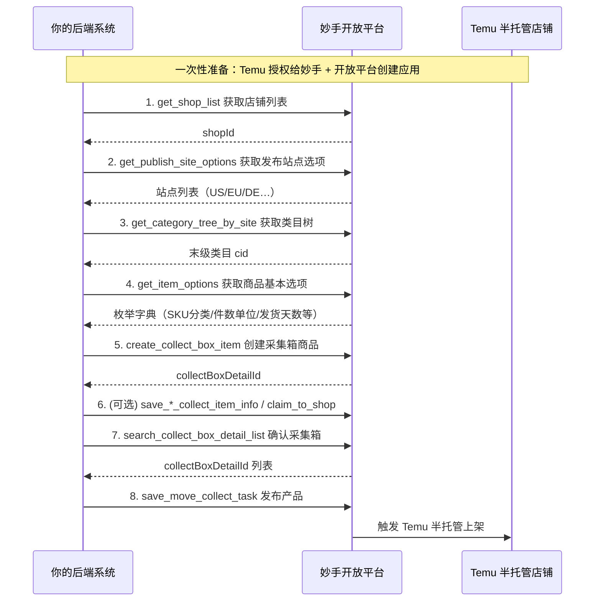

# 妙手开放平台 API 接入指南：Temu 半托管商品上架

> 版本：v1.0 ｜ 适用对象：需要将妙手 ERP 通过开放平台 API 接入自有后端、并向 Temu 半托管店铺批量上架商品的开发团队
> 文档日期：2026-10-27
> 信息来源：妙手开放平台官方文档（https://xu50m955w1.apifox.cn/ ）、妙手帮助中心（https://erp.91miaoshou.com/blog/ ）

## 订正（2026-10-28，对照 Apifox 官方文档核过）

- **签名要签「发出去的那串字节」**：4.4 的 Python 示例签的是紧凑 JSON，却用 `requests.post(json=body)` 发送，请求库会重新序列化成带空格的 JSON，服务端验签会失败。正确做法是先 `body_json = json.dumps(body, ensure_ascii=False, separators=(",", ":"))`，用这串算签名，再用 `data=body_json.encode("utf-8")`（httpx 是 `content=`）原样发出去。
- **本文没列、但上架要用的 Temu 半托接口**（都在 `/open/v1/product/collect_box/pddkj_choice/collect_box/` 下）：
  - `get_category_attribute_rules`（body `{cid}`）：类目属性规则。返回 `productAttributeRules` / `saleAttributeRules`，每条带 pid、templatePid、refPid、required、valueType、values[vid, name]，`attributes` / `saleAttributes` 照它填。
  - `get_site_collect_item_info`（body `{detailId}`）：采集箱站点模式详情。返回的 `siteCollectItemInfo` 和创建接口同构，本项目拿它读每家店的样板商品。
  - `get_shop_collect_item_info`：店铺模式详情。
  - 批量删除采集箱产品接口。
  - 获取原产地国家列表、店铺模特列表、尺码模板 / 尺码表、模特分类配置（服饰类才用）。
- **采集箱列表的返回带 `itemNum`（商品编号）**，还有 remark、platform、editModel 等字段；过滤条件只有 status 和 sourceItemIdKeyword。本项目用主货号 `itemNum` 对账（建箱超时后按货号找回 collectBoxDetailId）。
- **发布接口只回 result / code**，是异步任务，没有任务编号；结果只能翻采集箱列表看 status 是否变成 published。
- **字段类型**：创建接口里 `collectBoxDetailShopList[].shopId` 写的是 integer，`siteWarehouseList` 里的 shopId 写的是 string；本项目店铺 id 是 `v2_…` 形式，一律当不透明字符串处理，以实测为准（见 `progress.md`）。

---

## 目录

1. [文档说明](#一文档说明)
2. [整体架构与调用时序](#二整体架构与调用时序)
3. [前置准备](#三前置准备)
4. [调用规范与签名机制](#四调用规范与签名机制)
5. [上架主流程（分步详解）](#五上架主流程分步详解)
6. [接口清单汇总](#六接口清单汇总)
7. [常见错误排查](#七常见错误排查)
8. [注意事项与风险](#八注意事项与风险)
9. [附录：完整请求示例](#附录完整请求示例)

---

## 一、文档说明

### 1.1 能力范围

本文档覆盖通过妙手开放平台 API 完成 **Temu 半托管店铺商品上架** 的完整链路，包括：

- 店铺授权与开放平台应用注册（一次性准备）
- 接口调用规范（域名、签名、请求头、响应格式）
- 上架主流程：店铺查询 → 站点选项 → 类目查询 → 商品选项 → 创建采集箱商品 → 发布产品
- 常见错误码与排查思路

### 1.2 不包含的内容

- Temu 全托管商品上架流程（接口组不同，本文档仅涉及半托管 `pddkjChoice`）
- 订单、仓储、采购等模块接口（如需可另行扩展文档）
- Temu 平台侧的商品合规、类目资质要求（以 Temu 官方招商/运营要求为准）

### 1.3 术语约定

| 术语 | 说明 |
|------|------|
| 妙手开放平台 | 妙手 ERP 面向第三方的 API 开放体系，接口文档托管于 Apifox |
| AppKey / AppSecret | 开放平台应用密钥对，AppKey 公开、AppSecret 保密 |
| 采集箱 | 妙手内部用于多平台预发布商品的"待上架"容器，上架前商品先进入采集箱 |
| 站点模式 / 店铺模式 | Temu 半托采集箱商品的两种编辑维度：站点模式按站点统一配置；店铺模式按店铺单独配置 |
| pddkjChoice | 妙手内部对 Temu 半托管平台的枚举标识 |
| collectBoxDetailId | 采集箱详情 ID，即发布产品时的 detailIds |

---

## 二、整体架构与调用时序



> 说明：以上时序为"创建即带全量站点模式信息 → 直接发布"的标准路径；如需创建后按店铺再调整，可在 Step 5 与 Step 8 之间调用"保存店铺模式详情/站点模式详情"接口（见 5.6）。

---

## 三、前置准备

### 3.1 卖家侧：把 Temu 半托管店铺授权给妙手

1. 登录 Temu 后台，进入「店铺授权」相关页面，获取：
   - **商品 Token**：在 Temu **全球站**后台获取（上架商品必需）
   - **订单 Token**：在 **美区 / 欧区 / 全球** 各获取一份（如后续要同步订单）
2. 登录妙手 ERP，进入「授权 → 授权店铺 → Temu → 半托管店铺」，按引导填入上述 Token 完成授权。
3. 确认店铺状态为"已授权"，并记录授权过期时间。

**重要：Token 有效期 90 天**。快到期时需要在 Temu 后台重新生成并到妙手重授；半托管订单 Token 若 7 天无通过 ERP 发货的操作，还可能被平台回收，需要重授或申请白名单。

### 3.2 开发者侧：创建开放平台应用

1. 登录妙手 ERP → 「更多 → 系统管理 → 开放平台」→ 「创建应用」。
2. 填写应用名称、描述等信息，**勾选所需接口权限**（Temu 半托采集箱整组接口 + 商品/店铺接口）。
3. 提交审核，审核通过后获取：
   - **AppKey**（应用标识，公开）：形如 `ak_xxxxxxxxxxxxxxxx`
   - **AppSecret**（应用密钥，保密）：形如 `as_xxxxxxxxxxxxxxxx`
4. （可选）配置账户级 IP 白名单：配置后该账户下所有应用仅允许白名单 IP 调用；不配置则允许任意 IP。

> 安全提示：AppSecret 严禁泄露；不要将密钥提交到代码仓库。

---

## 四、调用规范与签名机制

### 4.1 接口域名

| 环境 | 域名 |
|------|------|
| 正式环境 | `https://openapi-erp.91miaoshou.com` |

- 完整请求地址 = 正式域名 + 接口路径，例如：`https://openapi-erp.91miaoshou.com/open/v1/product/shop/shop/get_shop_list`
- **仅支持 POST**，`Content-Type` 固定为 `application/json`
- **签名拼接时只传接口路径**（如 `/open/v1/order/create`），不带域名、不带 query 参数

### 4.2 签名算法

- 算法：`HmacSHA256`
- 输出：hex 字符串（**小写**）
- 有效期：5 分钟（timestamp 与服务器时间偏差超过 300 秒拒绝）

**签名公式：**

```
sign = HmacSHA256(appSecret, appSecret + path + timestamp + appKey + bodyJson + appSecret)
```

**拼接规则（按顺序）：**

1. 以 AppSecret 开头
2. 拼接请求路径（不含域名、不含 Query 参数）
3. 拼接时间戳（**秒级** Unix 时间戳）
4. 拼接 AppKey
5. 拼接请求 Body（JSON 字符串；无 body 时拼空字符串）
6. 以 AppSecret 结尾

### 4.3 请求头

每次请求必须在 HTTP Header 携带：

| 参数名 | 必填 | 说明 |
|--------|------|------|
| `x-app-key` | 是 | 应用 Key |
| `x-timestamp` | 是 | 秒级 Unix 时间戳 |
| `x-sign` | 是 | 签名值（小写 hex） |

### 4.4 代码示例

**Python 签名与请求：**

```python
import hmac
import hashlib
import time
import json
import requests

APP_KEY = "ak_你的AppKey"
APP_SECRET = "as_你的AppSecret"
BASE_URL = "https://openapi-erp.91miaoshou.com"


def call(path: str, body: dict | None = None) -> dict:
    """带签名的 POST 请求"""
    timestamp = str(int(time.time()))  # 秒级时间戳
    body_json = "" if body is None else json.dumps(body, ensure_ascii=False, separators=(",", ":"))
    content = APP_SECRET + path + timestamp + APP_KEY + body_json + APP_SECRET
    sign = hmac.new(APP_SECRET.encode("utf-8"), content.encode("utf-8"), hashlib.sha256).hexdigest()
    resp = requests.post(
        BASE_URL + path,
        json=body if body is not None else {},
        headers={
            "x-app-key": APP_KEY,
            "x-timestamp": timestamp,
            "x-sign": sign,
            "Content-Type": "application/json",
        },
    )
    return resp.json()


if __name__ == "__main__":
    # 示例：获取 Temu 半托管店铺列表
    data = call("/open/v1/product/shop/shop/get_shop_list",
                {"platform": "pddkjChoice", "site": "PDDKJCHOICE", "pageNo": 1, "pageSize": 100})
    print(data)
```

**Java 签名示例：**

```java
import cn.hutool.crypto.SecureUtil;

public class SignUtil {

    public static String generateSign(String appSecret, String path,
                                      long timestamp, String appKey, String bodyJson) {
        StringBuilder sb = new StringBuilder();
        sb.append(appSecret).append(path).append(timestamp).append(appKey);
        if (bodyJson != null && !bodyJson.isEmpty()) {
            sb.append(bodyJson);
        }
        sb.append(appSecret);
        return SecureUtil.hmacSha256(appSecret).digestHex(sb.toString());
    }

    public static void main(String[] args) {
        String appSecret = "as_xxxxxxxxxxxxxxxx";
        String appKey = "ak_1234567890abcdef";
        String path = "/open/v1/product/shop/shop/get_shop_list";
        long timestamp = System.currentTimeMillis() / 1000;
        String bodyJson = "{\"platform\":\"pddkjChoice\",\"site\":\"PDDKJCHOICE\",\"pageNo\":1,\"pageSize\":100}";
        String sign = generateSign(appSecret, path, timestamp, appKey, bodyJson);
        System.out.println("sign: " + sign);
    }
}
```

**curl 请求示例：**

```bash
BASE_URL="https://openapi-erp.91miaoshou.com"
APP_KEY="ak_xxxxxxxx"
APP_SECRET="as_xxxxxxxx"
PATH="/open/v1/product/shop/shop/get_shop_list"
TIMESTAMP=$(date +%s)
BODY='{"platform":"pddkjChoice","site":"PDDKJCHOICE","pageNo":1,"pageSize":100}'

# 按签名公式生成 SIGN（shell 中按 Python/Java 逻辑实现，此处略）
curl -X POST "${BASE_URL}${PATH}" \
  -H "x-app-key: ${APP_KEY}" \
  -H "x-timestamp: ${TIMESTAMP}" \
  -H "x-sign: ${SIGN}" \
  -H "Content-Type: application/json" \
  -d "$BODY"
```

### 4.5 响应格式

**成功响应：**

```json
{
  "result": "success",
  "code": "success",
  "message": "success",
  "data": { }
}
```

**失败响应：**

```json
{
  "result": "fail",
  "code": "signInvalid",
  "message": "签名验证不通过",
  "data": null
}
```

---

## 五、上架主流程（分步详解）

### Step 1：获取店铺列表

获取当前应用有权限访问的 Temu 半托管店铺，得到上架目标 `shopId`。

```
POST /open/v1/product/shop/shop/get_shop_list
Content-Type: application/json
```

**请求参数：**

| 参数 | 类型 | 必填 | 说明 |
|------|------|------|------|
| platform | string | 是 | `pddkjChoice`（Temu 半托管） |
| site | string | 是 | `PDDKJCHOICE` |
| pageNo | integer | 否 | 页码，默认 1 |
| pageSize | integer | 否 | 每页数量 |

**请求示例：**

```json
{
  "platform": "pddkjChoice",
  "site": "PDDKJCHOICE",
  "pageNo": 1,
  "pageSize": 100
}
```

**返回关键字段（data.shopList[]）：**

| 字段 | 说明 |
|------|------|
| shopId | 店铺 ID（后续所有接口使用） |
| shopNick | 店铺昵称 |
| status | 授权状态 |
| gmtExpire | 授权过期时间（用于 Token 到期监控） |

---

### Step 2：获取发布站点选项

确定商品要发布的站点（US / EU / DE 等），以及欧盟子站点。

```
POST /open/v1/product/collect_box/pddkj_choice/collect_box/get_publish_site_options
```

**返回关键字段（data）：**

| 字段 | 说明 |
|------|------|
| publishSiteOptions | 站点选项数组 `[{key: "US", value: "美国站"}, ...]`，选中项的 `key` 填入后续 `publishSiteList` |
| getEuropeanRegionSiteList | 欧盟子站点数组 `[{site: "DE", name: "德国", siteId, isOpen}, ...]`；`isOpen=false` 不可选 |
| siteIdAndSiteMap | siteId → 站点编码映射 |

**规则：** 若 `publishSiteList` 包含 `EU`，则必须从 `getEuropeanRegionSiteList` 中选择 **≥ 2 个**子站点填入 `publishEuSiteList`。

---

### Step 3：获取类目树

获取 Temu 半托管类目树，定位商品所属的末级类目 `cid`。

```
POST /open/v1/product/collect_box/pddkj_choice/collect_box/get_category_tree_by_site
```

**返回关键字段（data.cateTree）：** 分类节点数组，每个节点包含：

| 字段 | 说明 |
|------|------|
| cid | 类目 ID（后续创建商品使用） |
| aid | 属性组 ID |
| fid | 父类目 ID |
| name / nameChinese | 类目英文名 / 中文名 |
| isLastLevel | 是否末级类目 |
| disabled | 是否禁用 |
| children | 子类目数组（递归） |

**用法：** 从根节点递归查找 `isLastLevel=true` 的叶子节点，取 `cid` 作为商品类目。

---

### Step 4：获取商品基本选项

获取创建商品所需的枚举字典（SKU 分类、件数单位、发货天数、模特试穿结果等）。**所有枚举值必须取自本接口，不可自行编造。**

```
POST /open/v1/product/collect_box/pddkj_choice/collect_box/get_item_options
```

**返回关键字段（data）：**

| 字段 | 说明 |
|------|------|
| skuClassificationList | SKU 分类：1=单品，2=同款多件装，3=混合套装 |
| skuPieceUnitCodeList | 件数单位 |
| individuallyPackedList | 是否独立包装（2/3 类 SKU 必填） |
| netContentOptions | 净含量单位 |
| shipmentLimitDayOptions | 各站点承诺发货天数（如 US 可选 1/2/7/9；非定制品可选 1/2） |
| suggestedPriceCurrencyTypeAndNameList | 建议售价币种 |
| goodsModelTryOnResultMap | 模特试穿结果枚举 |
| outerPackageShapeOptions / outerPackageTypeOptions | 外包装形状 / 类型 |
| catIdAndProductNameMaxLengthMap | 类目对应标题长度上限 |

---

### Step 5：创建采集箱商品（核心步骤）

将商品以"站点模式"写入采集箱，提交全量商品信息。成功后返回 `collectBoxDetailId`，供后续发布使用。

```
POST /open/v1/product/collect_box/pddkj_choice/collect_box/create_collect_box_item
```

**请求体结构（siteCollectItemInfo 必填字段）：**

| 字段 | 类型 | 必填 | 说明 |
|------|------|------|------|
| collectBoxDetailShopList | array | 是 | 预发布店铺列表，每项含 `shopId`、`publishSiteList`、`siteWarehouseList`、`siteFreightTemplateList` |
| cid | string | 是 | 末级类目 ID（Step 3） |
| title | string | 是 | 商品标题 |
| productOriginCountry | string | 是 | 原产国 |
| imgUrls | array | 是 | 轮播图 URL 列表 |
| goodsLayerDecorationReqs | array | 是 | 产品描述（image/text 模块） |
| attributes | array | 是 | 商品属性（pid/templatePid/refPid + values[vid/name]） |
| saleAttributes | array | 是 | 销售属性（服饰类必填颜色图与主货号） |
| skuMap | object | 是 | SKU 数据（key 为 `;skuKey1;skuKey2;` 组合串） |
| publishSiteList | array | 是 | 发布站点列表（Step 2 取值） |

**collectBoxDetailShopList 每项结构：**

| 字段 | 说明 |
|------|------|
| shopId | 店铺 ID |
| publishSiteList | 该店铺的发布站点 |
| siteWarehouseList | 站点仓库：US 站直接填 `warehouseId`；EU 站填 `subSiteWarehouseList`（每项含 site + warehouseId） |
| siteFreightTemplateList | 站点运费模板（每项含 site + shopId + freightTemplateId） |

**skuMap 每个 SKU 必填字段：**

| 字段 | 类型 | 说明 |
|------|------|------|
| length / width / height | string | 包装尺寸（cm） |
| price | string | 申报价（人民币） |
| weight | integer | 重量（g） |
| itemNum | string | 平台 SKU（可选） |
| imgUrl | string | 非服饰类 SKU 预览图（非服饰类必填） |
| siteAndWarehouseIdAndStockMap | object | 站点+仓库库存映射（key=站点编码，value=仓库ID→库存数量） |
| skuClassification / pieceUnitCode / numberOfPieces | - | 法国站点必填；skuClassification=1 时 numberOfPieces 只能为 1 |
| multiLanguageImgUrlMap | object | 多语言预览图（pddkjChoice 非服饰类按 materialMultiLanguages 校验必填） |

**可选但常用字段：**

| 字段 | 说明 |
|------|------|
| publishEuSiteList | 欧盟子站点列表（≥2 个） |
| siteAndSkuPriceMap | 站点维度价格（EU 下还需 subSiteAndPriceMap；法国站价格必填） |
| siteShipmentLimitDayMap | 各站点发货天数（key=站点，value=天数） |
| currency | 币种（如 CNY、USD） |
| multiLanguageTitleMap / translateLanguages | 多语言标题 / 自动翻译语言列表 |
| sizeCharts / sizeAttributeValueGroupId | 尺码表（服饰类） |
| shopIdAndGoodsModelReqMap | 店铺维度模特信息（requiredGoodsModel=true 的类目必填） |
| productOriginProvince / productOriginCertFiles | 原产省（中国）/ 原产地认证文件 |
| materialMultiLanguageType / materialMultiLanguages | 多语言素材配置 |
| discreetShipping | 保密发货（0=关，1=开） |

**请求示例（简化结构，仅演示字段层级）：**

```json
{
  "siteCollectItemInfo": {
    "collectBoxDetailShopList": [
      {
        "shopId": 10001,
        "publishSiteList": ["US", "EU"],
        "siteWarehouseList": [
          { "site": "US", "shopId": "10001", "warehouseId": "W001" },
          {
            "site": "EU", "shopId": "10001",
            "subSiteWarehouseList": [
              { "site": "DE", "warehouseId": "W002" },
              { "site": "FR", "warehouseId": "W003" }
            ]
          }
        ],
        "siteFreightTemplateList": [
          { "site": "US", "shopId": "10001", "freightTemplateId": "FT001" },
          { "site": "EU", "shopId": "10001", "freightTemplateId": "FT002" }
        ]
      }
    ],
    "cid": "123456",
    "title": "Wireless Earbuds Pro",
    "productOriginCountry": "CN",
    "productOriginProvince": "330000",
    "imgUrls": ["https://example.com/img1.jpg", "https://example.com/img2.jpg"],
    "goodsLayerDecorationReqs": [
      { "type": "image", "content": { "imgUrl": "https://example.com/desc1.jpg" } }
    ],
    "attributes": [
      { "name": "Brand", "pid": "100", "templatePid": "100", "refPid": "100",
        "values": [{ "vid": 1, "name": "TWS" }] }
    ],
    "saleAttributes": [
      { "name": "Color", "parentSpecId": 0, "pid": 200, "refPid": 200, "templatePid": 200,
        "values": [{ "vid": 10, "skuKey": "black", "name": "Black" }] }
    ],
    "skuMap": {
      ";black;": {
        "itemNum": "SKU001",
        "length": "10", "width": "5", "height": "3",
        "price": "39.90", "weight": 40,
        "siteAndWarehouseIdAndStockMap": { "US": { "W001": 100 } }
      }
    },
    "publishSiteList": ["US", "EU"],
    "publishEuSiteList": ["DE", "FR"],
    "siteShipmentLimitDayMap": { "US": 2, "EU": 8 },
    "currency": "CNY"
  }
}
```

**返回关键字段：**

| 字段 | 说明 |
|------|------|
| data.collectBoxDetailId | 创建成功的采集箱详情 ID（发布时作为 detailIds 传入） |

---

### Step 6：（可选）创建后调整

以下接口用于在创建后对采集箱商品进行补充配置或调整：

| 接口 | 路径 | 用途 |
|------|------|------|
| 保存站点模式详情 | `POST /open/v1/product/collect_box/pddkj_choice/collect_box/save_site_collect_item_info` | 请求体：`detailId` + `siteCollectItemInfo`（与 Step 5 同构），调整站点维度的仓库、运费模板、价格等 |
| 保存店铺模式详情 | `POST /open/v1/product/collect_box/pddkj_choice/collect_box/save_shop_collect_item_info` | 请求体：`detailId` + `shopCollectItemInfo`（含 `shopId`、`editModel`=shop/site、`currency` 等），按店铺单独调整 |
| 认领预发布店铺 | `POST /open/v1/product/collect_box/pddkj_choice/collect_box/claim_to_shop` | 请求体：`shopIds`（≤200）+ `detailIds`（≤200），将采集箱商品认领到指定店铺 |
| 获取店铺运费模板 | `POST /open/v1/product/collect_box/pddkj_choice/collect_box/get_shop_freight_template` | 获取运费模板 ID，供创建/保存时填写 |
| 获取店铺发货仓库 | `POST /open/v1/product/collect_box/pddkj_choice/collect_box/get_shop_warehouse` | 获取仓库 ID（支持同步），供创建/保存时填写 |

---

### Step 7：获取采集箱列表（确认）

按状态查询采集箱商品，确认 `collectBoxDetailId`（批量发布前做数据兜底/校验）。

```
POST /open/v1/product/collect_box/pddkj_choice/collect_box/search_collect_box_detail_list
```

**请求参数：**

| 参数 | 类型 | 必填 | 说明 |
|------|------|------|------|
| pageNo | integer | 否 | 页码 |
| pageSize | integer | 否 | 每页数量，最大 500 |
| filter.status | string | 否 | notPublished-未发布、timingPublish-定时发布、published-已发布 |
| filter.sourceItemIdKeyword | string | 否 | 货源 ID 关键词（≤255 字符） |

**返回关键字段（data）：**

| 字段 | 说明 |
|------|------|
| collectBoxDetailId | 采集箱详情 ID |
| title | 商品标题 |
| status | 发布状态 |
| stock / price / thumbnail | 库存 / 价格 / 缩略图 |
| gmtCreate | 创建时间 |
| collectBoxDetailShopList | 预发布店铺信息列表 |

---

### Step 8：发布产品（触发上架）

将采集箱商品批量发布到指定店铺的指定站点。

```
POST /open/v1/product/collect_box/pddkj_choice/move_collect/save_move_collect_task
```

**请求参数：**

| 参数 | 类型 | 必填 | 说明 |
|------|------|------|------|
| detailIds | array | 是 | 采集箱详情 ID 列表（≤200 个） |
| shopIdAndSitesMap | object | 是 | key=店铺 shopId（整数），value=该店铺本次发布的站点数组 |

**请求示例：**

```json
{
  "detailIds": [10001, 10002],
  "shopIdAndSitesMap": {
    "10001": ["US", "EU"],
    "10002": ["US"]
  }
}
```

**返回：** `result=success`、`code=success`。发布为异步任务，提交后可在妙手采集箱「已发布」或对应查询接口查看上架结果。

---

## 六、接口清单汇总

| 序号 | 接口 | 路径（均在 /open/v1 下） | 说明 |
|------|------|--------------------------|------|
| 1 | 获取店铺数据列表 | `/product/shop/shop/get_shop_list` | 取 shopId |
| 2 | 获取发布站点选项 | `/product/collect_box/pddkj_choice/collect_box/get_publish_site_options` | 取发布站点/EU 子站点 |
| 3 | 获取类目列表 | `/product/collect_box/pddkj_choice/collect_box/get_category_tree_by_site` | 取末级类目 cid |
| 4 | 获取商品基本选项 | `/product/collect_box/pddkj_choice/collect_box/get_item_options` | 取枚举字典 |
| 5 | 创建采集箱商品 | `/product/collect_box/pddkj_choice/collect_box/create_collect_box_item` | 核心：写采集箱，返回 detailId |
| 6 | 保存站点模式详情 | `/product/collect_box/pddkj_choice/collect_box/save_site_collect_item_info` | 可选：改站点维度配置 |
| 7 | 保存店铺模式详情 | `/product/collect_box/pddkj_choice/collect_box/save_shop_collect_item_info` | 可选：改店铺维度配置 |
| 8 | 认领预发布店铺 | `/product/collect_box/pddkj_choice/collect_box/claim_to_shop` | 可选：认领店铺 |
| 9 | 获取店铺运费模板 | `/product/collect_box/pddkj_choice/collect_box/get_shop_freight_template` | 取运费模板 ID |
| 10 | 获取店铺发货仓库 | `/product/collect_box/pddkj_choice/collect_box/get_shop_warehouse` | 取仓库 ID（支持同步） |
| 11 | 获取采集箱列表 | `/product/collect_box/pddkj_choice/collect_box/search_collect_box_detail_list` | 确认 detailIds |
| 12 | 发布产品 | `/product/collect_box/pddkj_choice/move_collect/save_move_collect_task` | 触发 Temu 半托管上架 |

> 注：以上路径省略了公共前缀 `/open/v1` 后与表格内一致即完整路径；请求域名均为 `https://openapi-erp.91miaoshou.com`。

---

## 七、常见错误排查

### 7.1 错误码对照表

| 错误码 | 说明 | 处理建议 |
|--------|------|----------|
| success | 成功 | - |
| appNotFound | 应用不存在或已禁用 | 检查 x-app-key；确认应用已审核通过 |
| signMissing | 缺少签名参数 | 检查请求头是否包含 x-app-key、x-timestamp、x-sign |
| signExpired | 请求已过期 | 检查本机时间；timestamp 必须为秒级 |
| signInvalid | 签名验证不通过 | 检查算法、AppSecret、路径是否带域名/query |
| appNoPermission | 应用无权限访问该接口 | 检查应用是否勾选该接口权限 |
| ipNotInWhitelist | IP 不在白名单 | 检查账户白名单配置 |
| accountQps/Qpm/QpdRateLimit | 账户级限流 | 降低频率或联系平台提额 |
| appQps/Qpm/QpdRateLimit | 应用级限流 | 降低频率或联系平台提额 |
| apiQps/Qpm/QpdRateLimit | 接口级限流 | 降低频率或联系平台提额 |
| routeNotFound | 路由不存在 | 检查路径拼接是否正确 |
| upstreamError / upstream*Timeout | 下游服务异常 | 稍后重试 |
| systemError / redis* | 系统内部错误 | 稍后重试，或联系平台技术支持 |

### 7.2 签名常见问题（Q&A）

**Q1：签名总是验证失败？**
检查：① AppSecret 大小写是否正确；② 时间戳是否为秒级；③ 路径是否带了域名/query（只能传纯接口路径）；④ POST 是否正确拼接 body（无 body 拼空串）；⑤ 输出是否为小写 hex。

**Q2：返回"请求已过期"？**
timestamp 偏差不能超过 300 秒，必须使用秒级 Unix 时间戳。

**Q3：域名解析失败？**
确认域名拼写 `openapi-erp.91miaoshou.com`；切换公共 DNS（阿里 223.5.5.5 / 114.114.114.114）；检查防火墙与代理。

**Q4：支持哪些 HTTP 方法？**
仅 POST，Content-Type 固定 application/json。

---

## 八、注意事项与风险

1. **Token 维护**：Temu 半托管商品 Token 有效期 90 天；订单 Token 可能因 7 天无 ERP 发货操作被平台回收。建议对店铺授权过期时间（`gmtExpire`）做定时监控，提前重授。
2. **站点与仓库配对**：EU 站点必须配置 `subSiteWarehouseList`（按子站点分别给 warehouseId），不能只填 US 式单 warehouseId；运费模板同样按站点配置。
3. **法国站点强制项**：`skuClassification`、`numberOfPieces`、`pieceUnitCode` 必填；`skuClassification=1` 时 `numberOfPieces` 只能为 1；`skuClassification=3`（混合套装）时需额外填写 `individuallyPacked` 与 `productSkuAccessories`。
4. **服饰类商品**：颜色图（saleAttributes.values[].imgUrls）、尺码表（sizeCharts + sizeAttributeValueGroupId）、模特（requiredGoodsModel=true 的类目每个店铺都必须配置，试穿尺码需与销售规格值匹配）。
5. **限流控制**：存在 QPS/QPM/QPD 多级限流，批量上架建议排队 + 失败重试，避免并发打满触发限流错误码。
6. **权限最小化**：创建应用时按需勾选接口权限；生产环境配置 IP 白名单；AppSecret 加密存储。
7. **异步任务**：发布（save_move_collect_task）为异步任务，提交成功不代表 Temu 端已上架，需通过采集箱状态或后续查询确认最终结果。
8. **枚举依赖**：所有枚举值（SKU 分类、件数单位、发货天数、模特试穿结果等）必须实时取自 get_item_options，类目结构以 get_category_tree_by_site 为准，勿硬编码。

---

## 附录：完整请求示例

以下为"创建采集箱商品"的完整请求示例（字段层级与官方 schema 一致，数值为演示用途）：

```json
{
  "siteCollectItemInfo": {
    "collectBoxDetailShopList": [
      {
        "shopId": 10001,
        "publishSiteList": ["US", "EU"],
        "publishEuSiteList": ["DE", "FR"],
        "siteWarehouseList": [
          { "site": "US", "shopId": "10001", "warehouseId": "W001" },
          {
            "site": "EU", "shopId": "10001",
            "subSiteWarehouseList": [
              { "site": "DE", "warehouseId": "W002" },
              { "site": "FR", "warehouseId": "W003" }
            ]
          }
        ],
        "siteFreightTemplateList": [
          { "site": "US", "shopId": "10001", "freightTemplateId": "FT001" },
          { "site": "EU", "shopId": "10001", "freightTemplateId": "FT002" }
        ]
      }
    ],
    "cid": "123456",
    "title": "Wireless Earbuds Pro",
    "multiLanguageTitleMap": { "en": "Wireless Earbuds Pro", "de": "Kabellose Ohrhörer Pro" },
    "translateLanguages": ["en", "de", "es"],
    "itemNum": "M-001",
    "productOriginCountry": "CN",
    "productOriginProvince": "330000",
    "imgUrls": ["https://example.com/img1.jpg", "https://example.com/img2.jpg", "https://example.com/img3.jpg"],
    "goodsLayerDecorationReqs": [
      { "type": "image", "content": { "imgUrl": "https://example.com/desc1.jpg" } },
      { "type": "text", "content": { "text": "High quality wireless earbuds with noise cancellation." } }
    ],
    "attributes": [
      {
        "name": "Brand", "pid": "100", "templatePid": "100", "refPid": "100",
        "values": [{ "vid": 1, "name": "TWS" }]
      },
      {
        "name": "Material", "pid": "101", "templatePid": "101", "refPid": "101",
        "values": [{ "vid": 2, "name": "ABS" }]
      }
    ],
    "saleAttributes": [
      {
        "name": "Color", "parentSpecId": 0, "pid": 200, "refPid": 200, "templatePid": 200,
        "values": [{ "vid": 10, "skuKey": "black", "name": "Black" }]
      }
    ],
    "skuMap": {
      ";black;": {
        "itemNum": "SKU001",
        "length": "10", "width": "5", "height": "3",
        "imgUrl": "https://example.com/sku-black.jpg",
        "price": "39.90", "weight": 40,
        "skuClassification": 1,
        "pieceUnitCode": 1,
        "numberOfPieces": 1,
        "siteAndWarehouseIdAndStockMap": {
          "US": { "W001": 100 },
          "EU": { "W002": 50 }
        }
      }
    },
    "publishSiteList": ["US", "EU"],
    "publishEuSiteList": ["DE", "FR"],
    "siteAndSkuPriceMap": {
      "US": { ";black;": { "price": "39.90" } }
    },
    "siteShipmentLimitDayMap": { "US": 2, "EU": 8 },
    "currency": "CNY",
    "shipmentLimitDay": 2
  }
}
```

---

> **免责声明**：本文档基于妙手开放平台公开文档（Apifox）整理，接口路径、参数、枚举以官方文档为准；实际调用时请以开放平台「应用权限」实际勾选结果和最新版官方文档为准。涉及 Temu 平台侧规则（Token 回收、站点开放、类目资质）以 Temu 官方要求为准。
