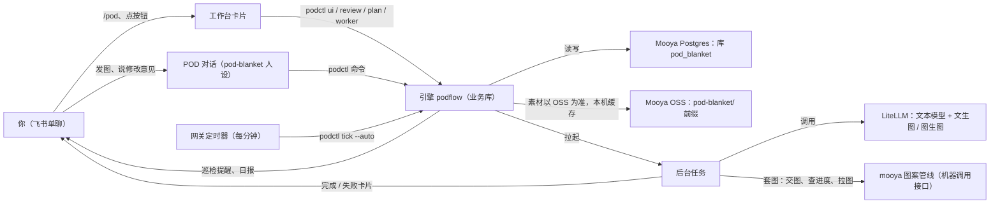
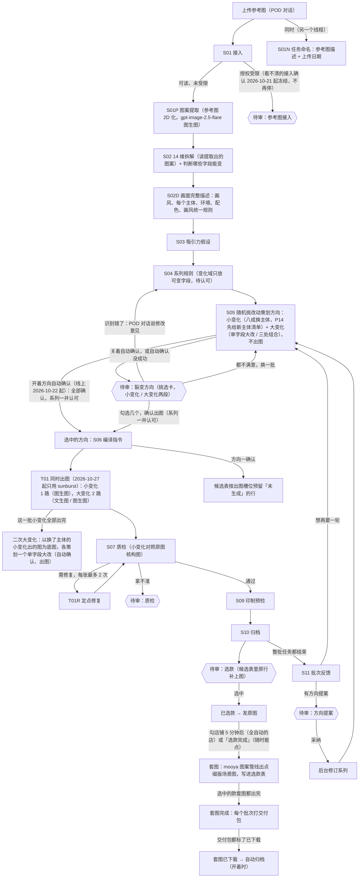

# POD 毛毯流水线：流程与使用详解

[Last Updated: 2026-10-25]

一页速览见 `usage.md`。本文按「谁在做 → 一张图怎么走完 → 每一步的细节 → 怎么触发 → 去哪看 → 出问题怎么办」展开。规则以程序（`scripts/podflow/`）为准，文中数值是当前默认配置，可在数据目录的 `podflow.yaml` 里改。

## 目录

1. 整体结构
2. 首次准备
3. 全流程总览
4. 分阶段详解
5. 人工审核项一览
6. 任务是怎么被触发的
7. 连续运行与定时巡检
8. 飞书工作台详解
9. 在 POD 对话里能做什么
10. 状态、历史与追溯
11. 配置项
12. 异常与排查
13. 命令速查（运维）
14. 编号与术语

---

## 1. 整体结构

| 角色 | 是什么 | 负责什么 |
| --- | --- | --- |
| 你 | 操作人 | 授权、挑选裂变方向（系列规则一并认可）、审核与选款、开关连续运行 |
| 工作台卡片 | 飞书单聊发 `/pod` 打开的卡片 | 看进度和下一步；不需要附言的操作直接点按钮，不经过大模型 |
| POD 对话 | 和 pod-blanket 人设的专属会话 | 上传参考图、写修改意见、问原因、导出选款表这类开放式操作 |
| 引擎 podflow | `podctl` 命令 + 业务库（Mooya 的 Postgres）+ 素材库（Mooya 的 OSS，本机缓存） | 全部状态、规则、模型调用、审核项；卡片和人设都只是调用它 |
| 后台任务 | 引擎拉起的独立进程 | 拆解、系列修订、裂变策划、出图这些长任务，结束时发卡片 |
| 网关定时器 | 飞书渠道里的计时器 | 每分钟问一次引擎「到点没」：到巡检间隔就巡检，到日报时刻发日报 |
| mooya 图案管线 | mooya 的 Pattern Showcase 毛毯流水线，经机器调用接口 `/api/service/v1` 调用 | 选中的款出套图（点缀版场景图）；提示词、流程和交付包命名以 mooya 为准，这边只交图、查进度、拉图 |
| 模型（经 mooya LiteLLM） | gpt-6.1-sol-high；gpt-image-2.5 flare / sunburst（2026-10-25 起；2026-10-15 到 10-25 还有 nano-banana 2.1，图生图另用 `-edit` 模型再出一张） | 前者做拆解、规划、指令、质检、反馈（P01–P07、P11）；后两个出图，每个都做文生图和图生图（同一个模型名，图生图多带一张参考图） |

基本原则是**模型提出、程序执行**：每次模型输出都要过 JSON Schema 和程序校验，不合格就带着错误说明重问；状态、重试、计划去重、计费由程序强制执行；需要拍板的地方一律停下来等你。成图不判重复：彼此相近的候选一并进选款，由你挑。

## 2. 首次准备（一次性）

- [x] **飞书绑定**：Web 设置里连接飞书，把 `/connect` 连接码发到和机器人的单聊。
- [ ] **机器人菜单**：飞书开放平台 → 应用能力 → 机器人 → 自定义菜单，选「事件推送」，加两项：`POD`（打开工作台）、`POD_CHAT`（直接进 POD 对话），然后发布新版本。菜单要求你先在单聊里给机器人发过一条消息。
- [x] **通知接收方**：`podflow.yaml` 的 `notify.feishu.receive_id` 是你和机器人的单聊。
- [x] **自检**：`podctl doctor` 检查 LiteLLM 连通、模型可见、配置合法。
- 预算当前关闭（`budget.enforce: false`：不设上限、不计费，只记调用次数）。打算长时间连续运行前，建议先重新评估。

## 3. 全流程总览

## 4. 分阶段详解

### 4.1 上传参考图

- **你**：进入 POD 对话，发图片就行；来源（店铺、链接、截图出处）和授权可以顺便说，也可以之后补。
- **人设**：不等你多说，直接登记参考图（同一文件按 sha256 去重，重复上传会返回已有编号；没说来源记「飞书单聊上传」），得到 `S0x`，原图存进 `assets/seeds/S0x/`。
- **授权默认「未知」**，不开待审（2026-10-13 起）。你已决定：未知也照常拆解、出图，图生图会把这张参考图原图发给生图模型；只有登记「授权受限」才不拆解、不做图生图。
- 随后人设把母版各步转到后台（`seed analyze --detach --notify`）：接入、图案提取、拆解、假设、系列规则做完，接着策划裂变方向（见 4.5）。

### 4.2 母版各步 S01–S04（后台，约 15–25 分钟）

| 步骤 | 做什么 | 程序把关 | 产出 |
| --- | --- | --- | --- |
| S01 接入（P01） | 找出有效印花区，排除主图标题、尺寸线、播放按钮、场景；判断可读性 | 授权以人工登记为准，模型的判断不作数；授权受限就停在 S01，开「参考图接入」待审。看不清或模型拿不准原本也停下等人确认，2026-10-21 起接入确认冻结（`intake.review: false`）：不停，模型的疑点记在接入记录的 `intake_review` 里，接着往下做 | 接入记录 |
| S01N 任务命名（P12，2026-10-20 起，和 S01 同时跑） | 另一个线程里让模型看原图，写一个 4–8 个字的描述（主体 + 风格 / 题材，如「森林三伙伴水彩」），接上这张图登记那天的月日（按 `timezone`），作为任务名字「森林三伙伴水彩 1020」 | 描述去掉空格和标点后要 2–10 个字，不合格退回重答；起名失败只记一条事件，拆解照常往下走，下次拆解再试；已有名字不再改（重新拆解、重新提取图案都不改名） | 名字（表 `seed_names`）；任务列表、任务明细、相关卡片标题、候选表表名都写成「S0x 名字」 |
| S01P 图案提取（2026-10-20 起） | 参考图 2D 化：把原图里的毯子印花用图生图提取成一张干净的平面图案（去掉房间、家具、商品形状、褶皱、透视、阴影和光影，保留图案的主体、数量、配色、构图和印花文字），之后的拆解、图生图和质检都用这张图案。提示词照抄 Pattern DNA 的 `flatten_textile`（`references/flatten_textile.md`），模型依次 `gpt-image-2.5-flare` → `gpt-image-2.5-sunburst`（`pattern_extract.models`；Pattern DNA 用的 gpt-image-2 按用户要求不用），4:5、`1856x2304`、`quality: high`，输入图先压到最长边 1536 | 授权受限、看不清的在 S01 就停了，不会提取；两个模型都失败就停在这一步，再让人设继续拆解会从这里接着做 | 图案 `assets/seeds/S0x/pattern-<n>.png`；完成卡片上并排放原图和提取的图案 |
| S02 14 维拆解（P02） | 41 个在用字段（编号 D01–D58，停用的 17 个不再输出），分 14 个维度；小变化 / 大变化字段另判断这张图上能不能变（`variable` + 原因；2026-10-27 起只看能不能改出看得见的变化，改动会牵动位置、大小或布局不算不能变），并写参考图特征（单幅 / 花型 / 混合、有没有文字） | 在用字段每个必须出现一次（看不清写 unknown），缺字段或缺可变判断带错误重问；关系只能引用已定义的对象；程序按特征关掉不适用的维度（单幅场景不做排列重复、没有文字不做文字定制） | 拆解版本 `S0x-A01`，带可变字段清单 `variation` |
| S02D 画面完整描述（P13，2026-10-21 起） | 看提取出的图案和拆解，把参考图完整反推一遍：画风（定位、线条、上色、光影、细节密度、造型语言、饱和度与对比）、配色（底色 / 主体色 / 强调色各用在哪）、每个主体（按拆解的对象编号：物种、外形比例、颜色斑纹、五官表情、动作姿态、位置大小）、环境元素和它们的画法、构图、情绪，以及 3–6 条**画风统一规则**（换场景、换背景、加元素时新内容必须照着画的地方）；另写英文版：每个主体 / 环境的英文写法、一句画风句（`style_anchor`）和一段能单独复原整幅画的英文描述（`full_scene`） | 拆解里的主体每个一条、每个对象都要写到、编号只能用拆解里的，不合格退回重答；没写成（模型出错、格式不对）只记一条事件，拆解照常往下走，之后用拆解拼的简版档案兜底，完成卡片上写明 | 画面描述（表 `seed_descriptions`，按拆解存）；系列规则、策划、出图指令和质检都拿它当依据（`reference_profile`） |
| S03 吸引力假设（P03） | 为什么可能好卖的假设 | 没有销售数据时一律「待验证」 | 假设集 |
| S04 系列规则（P04） | 定位、保留项、变化域（每个可变字段一条，可写几个具体改法）、锁定字段（2026-10-27 起只锁用户、修订意见或印制要求明确要保持不动的，写来源 `source` 和原因；设计建议不锁）、联动、排除项 | 变化域只留这张图的可变字段：多写的丢掉、漏掉的补上（不为这个重答）；没写来源的锁定按设计建议处理，放回变化域 | 系列 `F0x v1`（待认可），接着自动策划方向；策划好后「系列规则」待审并进「裂变方向」 |

- **14 个维度与裂变分层**：
  - **小变化**（每个方向随机改两处：一处是一个可变单元上的一个小变化字段，单元里的全部成员一起改，一眼看得出；配色、绘制技法这类整幅字段挂在「整幅」上；整体构图不动）：03 元素角色 · 04 主体外形 · 05 表情动作 · 06 服饰道具 · 07 关系结构 · 09 排列重复（只在花型 / 混合图上）· 10 配色结构 · 11 绘制技法（同一画法大类内整幅改 2–3 个方面）· 13 文字定制（只在有文字的图上）；
  - **大变化**（两种：改一个主题叙事 / 整体构图 / 绘制技法字段就是大改；或随机三处一起改，叫三处组合）：02 主题叙事 · 08 整体构图 · 11 绘制技法（换画法大类）；绘制技法两类都能进；
  - **只记录**（作为系列规则、出图与质检的约束，不出方向）：01 需求语境 · 12 风格情绪 · 14 版型印制，以及 09 里的「单幅或花型」（它决定排列重复能不能变）。
- **字段梳理（2026-10-16）**：编号不变，停用 17 个：重复的合并（D02 / D03 → D01，D12 → D28，D31 → D27，D38 → D37），是规则不是画面属性的移进系列规则（D22 → 兼容条件，D26 → 联动，D47 → 排除项，D48 → 保留项），校验与生产类移出拆解（D35 / D52 → 质检，D40 / D56–D58 → 生产模板，D04 → 配置，D08 → 拆解的 groups）；含糊的改了名（如 D10「陪衬角色」、D21「道具与承托物」、D25「承托依附关系」）。完整清单见 `references/field_dictionary.json`（`status: retired` 写着去向）。
- **小变化加大幅度（2026-10-19）**：小变化不再做只动一个局部的微调。字段字典给每个小变化字段写了 `small_change`（怎么改才看得出，如表情是所有主体一起换成同一种新情绪、服饰配件是所有主体一起配一套成系列的配饰、整体配色是底色 / 主体色 / 辅助色 / 强调色整套换成另一组和谐配色），策划（P05）、编译（P06）、质检（P07）都按它来；D37 改名「整体配色」，底色（D36）、明暗冷暖（D39）并进整体配色，前后遮挡（D24，构图不动时改不出来）改为只记录。
- **小变化两字段、大变化三字段、绘制技法合并（2026-10-21）**：小变化只改一个字段，变化太小，改成程序随机挑两个小变化字段；大变化是单字段大改或随机三个小变化字段（三字段组合），原来的「两轴组合」取消。绘制技法原来的四个字段（D41 线条轮廓、D42 上色方式、D43 光影体积、D44 纹理细节）在复杂图案上单独改看不出来，合并成一个 D41「绘制技法」，配一份技法变化清单（`change_forms`：画法大类、线条与轮廓、上色方式、光影与体积、纹理与细节、造型处理），模型按原图画风从里面挑着改；D42–D44 停用并入 D41，旧拆解、旧系列和做过的方向读取时自动归到 D41，不用重新拆解。
- **按可变单元改（2026-10-23，字段字典 0.4）**：画面只有一个主体时，「所有主体一起换表情」只动一个主体，两个字段都落在它身上也看不太出来；多主体图上字段再多又会改得太多。现在画面描述（S02D）另列**可变单元**：会一起改的一组对象算一个单元——单个角色是一个单元，满屏星星、一圈花边、几处相似的点缀这类成组的同类元素只算一个单元，多个角色时既有组单元（全部角色）也有显眼的成员单元；每个单元写类型（角色 / 装饰群 / 承托物与道具 / 文字）、显著度（大 / 中 / 小）和在它身上不成立的字段。小变化改两处、三处组合改三处，**一处 = 一个单元上的一个字段**（配色、绘制技法、排列密度、加陪衬、加定制位这类整幅字段挂在程序加的「整幅」上）。每处都要看得见：只出中档以上的组合，五官、表情这类只动脸的字段降一档；同一个单元（或组和它的成员）上的两处要求它是大档、部位不同（脸 / 身体 / 穿戴）、不是同一字段、不互斥（换物种与轮廓、头身互斥）；整幅最多一处（抽象图没有单元时不限）。上限是两处大档，和以前多主体图「两个字段 × 所有主体」差不多。字段字典每个可变字段多了能挂哪类单元、部位、互斥、整幅档位几项。还没有单元清单的图（10-23 之前写的描述、描述没写成）那一张自动按字段策划，卡片会写原因；`plan.unit: fields` 是整体回退开关。
- **字段字典 0.5（2026-10-26）**：按已出的款复盘（已审 1329 张、选中 56 张）调了这几处：
  - **物件单独算一类**：游戏手柄、宇航头盔、月亮、花环这类没有脸的主角，之前只能硬算成「角色」，表情、五官、姿态都改不了。现在可改的主体多了「物件」：能换成同主题的另一种物件（手柄换耳机）、改轮廓、加上笑脸、戴配件；轮廓和「拟人（加笑脸）」也能用在装饰群、承托物上（之前选中过的「微笑天体」「圆弧扇贝波带」就是这类）。要重写一遍画面描述才会认出物件（上线后已对全部参考图重写）。
  - **小变化不改绘制技法**：绘制技法在小变化里只选中过 1/168，在单字段大改和三处组合里有 5–6%。现在只进单字段大改（换画法大类）和三处组合（同一画法大类内整幅改几个方面）。
  - **三处组合能动布局**：动作姿态、距离互动、承托依附、拟人、陪衬角色、头身比例在 8–12 张图上被判成「构图不动时改不了」，连本来允许调整布局的三处组合也用不上。现在三处组合另外会挑这些字段（改动带 `layout_change`，可以连带调整位置、大小和布局）；被门控关掉的维度（单幅场景的排列、没有文字的文字定制）和系列锁定的字段不用。开关 `plan.combo_layout_fields`（缺省开）。2026-10-27 起其中的动态字段（动作姿态、朝向视线、距离互动、承托依附、陪衬角色）也进单字段大改与二次大变化。
  - **新字段「单元配色」D59、「表面纹样」D60**：配色之前只能整套换（10-19 的决定）；现在另有只给一个主体或一组装饰换色的「单元配色」，和整体配色不会出现在同一个方向里。「表面纹样」给物件、装饰、承托物（也可以是动物身上的花纹）换填充纹样：格纹、波点、条纹、碎花、拼布。之前拆的图上没判断过这两个字段，策划时按「能变」处理，具体某个主体上不合适的由画面描述排除。两个字段都只改点名的主体，画风照原图。
  - **文字定制有了文案库**（`references/text_bank.json`）：有文字的图上之前常因为「没有可用文案」跳过文字内容 / 定制位，现在策划时会带上按主题分组的英文短句、示例名字和日期写法（不写真实人名、品牌和台词）。文案可以直接改这个文件。
  - **候选表加「没选原因」**：见 8.12，选款完成时程序读回来，给批次反馈和 `podctl table reasons` 汇总用。
- **进度**：工作台「进度」显示「S0x 母版拆解中：S02 14 维拆解（3/7）（已用 n 分钟）」，第 2 步是 S01P 图案提取，第 4 步是 S02D 画面描述，第 7 步是 S05 裂变策划（关掉图案提取或画面描述时各少一步）。
- **画面描述（S02D）为什么要有**：拆解是按字段记的，策划一个方向时只看得到那个字段的现状，写出图指令时更是只看得到方向本身——2026-10-21 的 S03「奇幻恐龙卡通」就因此出了两种问题：换秋天湖岸时背景写成了写实的暮色薄雾，和高饱和撞色的卡通恐龙打架；换构图的文生图不知道 E01–E09 是什么动物，出的图和原图脱钩。现在每一步都带着这份画面档案：没改的主体和画风照档案写全，新画进来的内容照它的画法画。
- **画面描述写错了 / 想看**：在 POD 对话里说「S01 的画面描述给我看看」（`seed describe S01 --show`）；认错了就说「S01 画面描述里左边那只是小鹿」，人设执行 `seed describe S01 --hint="…" --detach --notify` 只重写描述（不重做拆解和系列），之后新写的出图指令照新描述。可改的主体（可变单元）也在描述里：分得不对就说「S01 的星星和月亮算一组」「S01 的小熊单独算一个」，同一条命令重写，下一轮策划按新的分法。没写成时同一条命令（不带 `--hint`）补写。2026-10-21 之前拆的参考图已统一补写（`seed describe --all`）。
- **图案提取得不好**：在 POD 对话里说「S01 重新提取图案（要求……）」，人设执行 `seed extract S01 --hint="…" --detach --notify`：重新提取一张（旧的留着不用），之后的图生图和质检用新图案，发「图案已提取」卡片（并排原图和新图案）。拆解不会自动重做；想按新图案重新拆解，再说「S01 按新图案重新拆解」（`seed analyze S01 --reanalyze`）。工作台缩略图、选款的第一张图、选款拼图第一格、选款表的「原图」列都换成图案，标「图案 S0x」。
- **任务名字不准**：在 POD 对话里说「S01 改名叫……」，人设执行 `seed name S01 --set="…"`（只换描述，日期仍是上传那天）；说「S01 重新起个名字」则 `seed name S01`，模型再看一次图（花一次 P12 调用）。候选表表名在下一次表格同步时跟着改（改名会自动拉起一次同步）。
- **结束**：开着方向自动确认时（线上 2026-10-22 起，见 4.5「自动确认」）收到「母版拆解完成，已开始出图｜S0x 名字」卡片：逐行列出方向，已经全部确认、在后台出图，按钮是「任务明细」；关着自动确认（或自动确认没成功）时是「母版拆解完成，方向已策划好｜S0x 名字」卡片，点「去挑选」。策划没成功时卡片是橙色的，写着原因，带「重新策划」按钮（系列规则照常可看、可批准）。如果停在 S01（接入确认冻结后只有授权受限会停），会收到橙色「母版拆解未完成」卡片：去待审处理「参考图接入」，接入后在 POD 对话里让人设继续拆解（已完成的阶段会自动跳过）。冻结之前停在接入待确认的图，让人设再跑一次拆解就会自动放行（接入待审随之关掉）。
- **耗时**：M1 实测四步合计约 13.5 分钟，单次模型调用 23–341 秒（S02 最长）；S02D 画面描述再加 1–9 分钟（2026-10-21 补写 11 张实测 71–515 秒，主体和环境元素越多越久）；策划按维度分组几组同时跑，再加 5–10 分钟。
- **旧系列要重新拆解**：2026-10-16 字段梳理之前拆的系列没有可变判断，不能按字段策划（策划、任务列表、任务明细都会提示）。在 POD 对话里说「S01 按新字段重新拆解」，人设执行 `seed analyze S01 --reanalyze`：只重跑 S02、S03，S04 作为原系列的修订（新版本，做过的方向接着算），然后自动策划。中途失败（比如上游临时不可用）再说一次会接着做：已按新字段拆好的 S02、S03 不再重跑。拆解里「能不能变」的判定存在拆解结果里，提示词或字段字典改了不会自动重判；某张图想按现在的规则重判（如 2026-10-27 之前拆的 S04、S12 主体被判不能换，同日 P02 / P04 已放宽），也用这句话重新拆解。

### 4.3 素材授权（随时可做）

2026-10-13 起上传参考图不再弹「素材授权」待审：未知和已获授权效果一样，只有不能用时才需要登记。要登记就在 POD 对话里说（例如「S01 授权受限」「S01 已获授权，可商用」），人设会执行 `seed rights`。

| 状态 | 含义 | 影响 |
| --- | --- | --- |
| 已获授权 | 你确认了来源与可用范围 | 记为已授权；文生图、图生图照常做 |
| 授权受限 | 不能用 | 如果在接入（S01）之前登记，参考图会被隔离、不做拆解；之后还没开始出图的任务只做文生图（S06 撤掉图生图槽位）；已经产出的系列请自己驳回 |
| 保持未知 | 先不确定 | 和已获授权一样：拆解照常，文生图、图生图都做（2026-10-13 你的决定） |

### 4.4 系列规则：随方向一起认可、修订

- **只审一次**（2026-10-14 起）：系列规则不再单独等你批准。拆解后自动策划方向，挑选卡顶部写着系列要点（识别出的主体、保持不变的部分）；你确认方向时，系列规则一并认可（记为你批准）。开着方向自动确认时（线上 2026-10-22 起），策划完程序自动确认全部方向，系列规则随之自动认可（记为 `system:auto`），这道门不再等你。完整规则在 POD 对话里让人设讲。
- **修订**：主体认错了、保留项不对，就在 POD 对话里说修改意见，人设转后台重做 S04（约 3 分钟），生成新版本（旧的待认可版本自动作废），**接着重新策划方向**，旧版本上没人挑的候选作废。完成后收到「系列已修订，方向已策划好｜F0x」卡片。
- **单独批准 / 驳回**：策划没成功时「系列规则」待审还在，可以照旧批准或驳回；POD 对话里也能说。同一系列旧的已批准版本由新版本取代。
- **注意**：视觉识别会出错（M1 把小象认成了考拉），确认方向前一定看一眼挑选卡上的「识别出的主体」。开着自动确认时没有这一步：看「母版拆解完成」卡片和任务明细，认错了就修订系列（会重新策划、自动出图），已经确认的方向里还没开始出图的可以停掉。
- 不想要「只审一次」时，把 `batch.auto_plan_after_analyze` 设为 false：回到先批准系列、再点「策划」的老流程。

### 4.5 裂变策划 S05（P05）与挑选方向

- **触发**：拆解或修订系列之后自动策划；想再要一批，就在工作台「任务列表」里已完成的任务下点「继续裂变」，或在任务明细里点「再策划 n 个方向」，或在「下一步」里点「策划 n 个方向」（n 是这张图的方向数）；也可以在 POD 对话里说。
- **线上现在的数量**（2026-10-27 起只用 sunburst 一个模型，每个方向出的图少了一半，所以多出方向）：小变化 30 个（换主体 24 + 不换 6，每个 1 张）、大变化 24 个（单字段大改 12：动态 4 + 换画法 4 + 主题 / 构图 4；三处组合 12：含动态 6 + 含技法调整 3 + 其余 3；每个 2 张），小变化出完后另有二次大变化 16 个（换画法 6 + 动态 4 + 其余 6，每个 2 张）；一张新图一轮约 70 个方向、110 张图。下面几条讲的是规则本身，括号里的数是样例缺省值。
- **每轮出多少**（2026-10-21 起，2026-10-23 起按可变单元）：程序从系列变化域里可变、没锁定的字段和画面描述里的可变单元随机挑。默认小变化 `plan.small_count` = 12 个（每个两处，槽位 S1–S12）；大变化 `plan.big_count` = 8 个，其中 `plan.big_single_count` = 4 个单字段大改（从主题叙事 D05–D07、整体构图 D27–D30、绘制技法 D41，以及 2026-10-27 起的动态字段 D10 / D18 / D19 / D23 / D25 里挑一个，同一轮不重复，槽位 B1–B4），其余是三处组合（槽位 T1–T4）。随机数用系列号 + 批次号做种子，同一批可以复现；每个单元总的机会相同（字段多的主体不会占满槽位；同一组下的成员单元合起来只占一份、同一批里也一起降权，十只恐龙这种图不会只改单只恐龙）；这个系列少被改过的「单元 × 字段」优先（10-23 之前按字段做过的方向折半计入）；同一个方向里的几处尽量来自不同维度；同一批里不重复，和做过的组合尽量不重。池不够时：大字段不够就多出三处组合，凑不成就少出几个，不凑数（如抽象花型图只有整幅的配色和技法，一轮小变化只有 1 个）。按字段策划的图仍是每处一个小变化字段。只想看这一轮会挑出哪些改动：`podctl plan --family F01 --preview`（不调模型、不建批次）。
- **小变化以换主体为主**（2026-10-27，`plan.small_swap_ratio`，线上 0.8）：主体变化比配色、装饰更显眼，所以小变化分两组挑——换主体组（`round(比例 × 个数)` 个）每个至少一处是「换主体」（D09：单元里的角色 / 物件主体整个换成同主题的另一种，如三只小狐狸换成北极熊、企鹅、海豹），另一处照常随机，P05 让它围绕新主体配合；其余组不换主体。换主体的组合不够时由其余组补（反过来也一样），总数不凑数；这张图没有能换的主体（没有角色 / 物件单元、主体太小、系列锁定了 D09、单元否决了 D09）时全部照旧随机，卡片写原因。比例为 0 就是原来的不分组。
- **换主体清单（P14）**：单主体图上二十几个小变化换的都是同一个主体，P05 分块并发写时几块看不到彼此，容易都换成同一种动物。所以策划时先调一次 P14：给每个要换的单元列一份互不相同的新主体（同题材、类别明显不同、特征完整，不用 IP 角色；组单元给一整组），避开这个单元以前换过和没被选的；程序再和历史去重，按槽位顺序分给每个换主体的那处（`swap_to`），P05 照它换。清单不够的那几处写 `swap_avoid`（本批已分出去的和做过的），由 P05 自己换。同一批里同一个单元还是换成了同一个主体的，后出来的那个丢掉（`duplicate_swap`）。P14 失败只记在批次里，P05 照常写。
- **单字段大改可以重复**（2026-10-27，`plan.big_single_repeat`，线上 2）：各系列能大改的字段只有 5–8 个，原来同一个大字段一轮只出一次，`big_single_count` 调大了也只会多出三处组合。现在同一个大字段一轮最多出 repeat 次（第二次挑中的权重减半），P05 要把它们改成明显不同的样子（不同的主题、构图类型、画法大类）；单字段大改的上限 = 可变大字段数 × repeat（换画法另算，见下面「大变化的配额」）。
- **动态字段进单字段大改**（2026-10-27）：动作姿态 D18、朝向视线 D19、距离互动 D23、承托依附 D25、陪衬角色 D10 这五个「动态字段」三类方向都进：小变化里照字段字典的 `small_change` 留在原位置改；单字段大改与二次大变化里按它的 `big_change` 大改，可以连带调整位置、大小和布局（主体的身份、数量、配色不变，新加的角色同一套画法）；三处组合照旧。大字段池里的动态字段要在可变单元里找得到能挂的单元：只有一个角色的图不出距离互动，没有承托物的不出承托依附。2026-10-27 之前拆的图上这些字段大多被判成「构图不动时改不了」，开着 `plan.combo_layout_fields` 时程序照样把它们放进单字段大改与二次大变化（带 `layout_change`），小变化不收；按新规则重拆后就按新判定。
- **大变化的配额**（2026-10-27，`plan.big_single_quota` / `plan.combo_quota` / `plan.derived.quota`，各写 `dynamic`、`technique` 两项比例）：单字段大改、三处组合、二次大变化里，先按比例定好动态字段和绘制技法各几个，其余随机。三处组合按「含动态字段的 / 含技法调整（不含动态）的 / 两类都不含的」分组挑，组合不会落进两组。这一类的字段不够（比如抽象花型没有角色、系列锁定了绘制技法）时由其余补，都不够时少出、不凑数。单字段大改里换画法最多出「比例 × `plan.big_single_count`」个（线上 4 个，至少 `big_single_repeat` 个），大字段少的图（如抽象花型只剩绘制技法能大改）也是这个数，剩下的名额给三处组合。比例都是 0 就是原来的随机挑。线上：单字段大改 0.34 / 0.34、三处组合 0.5 / 0.25、二次大变化 0.25 / 0.4。
- **换画法清单**（2026-10-27）：换画法的槽位（单字段大改与二次大变化里只改绘制技法的）由程序从字段字典的 23 种「画法大类」里各分一种不重复的（`technique_to`），原图同类的不分（按画面档案 style 里写到的画法认），这个系列做过的排在最后；另给几种没分出去的当备选（`technique_spare`）。P05 照 `technique_to` 换，它和原图同类或明显不配题材时从备选里挑。同一批里还是写成同一种画法的，后出来的那个丢掉（`duplicate_technique`）；分到的画法记在批次（`plan_json.technique`）和方向（`technique`）上，下一轮避开。
- **怎么调用**：一次调用出 20 个方向太慢，一处出错就整轮重来，所以 P05 按类型分块：每块 `plan.slots_per_call`（默认 4）个槽位（如「小变化 S5–S8」），`plan.concurrency`（默认 4）块同时跑。某块失败只丢这一块，挑选卡和完成卡片上写明哪些槽位这次没出来；全部失败才算策划失败。
- **前提**：系列的最新版本已批准或待认可。同一系列正在策划、或还有一批方向待挑选时，不能再提交（先挑完或「换一批」）。之前选的方向还在出图时，任务明细里也能先策划，选中的新方向排在后面接着出；任务列表只在选中的方向全部出完（「已完成」）时给「继续裂变」，「下一步」只在该系列没有没做完的任务时才给「策划」按钮。
- **只策划部分类型（可选）**：`plan --kinds small,combo` 只策划小变化与三处组合（这一轮不出单字段大改），也可以写 `big`；`family revise` 也能带 `--kinds`，修订后的自动策划只出这几类；「换一批」沿用这一轮的类型。这一轮没出方向只说明这几类做不出来，不算系列耗尽。
- **这一轮的要求（可选）**：任务列表「继续裂变」或任务明细「再策划」旁边的输入框写一句想要的方向（≤ 100 字，如「换成海洋动物」「冬季主题」），POD 对话里说也一样（`plan --hint`）。有要求时这一批都围绕它展开，可以超出变化域里列出的选项，但不能违反系列的保留项和排除项，也照样不能和做过的方向重复；做不到的部分写进覆盖缺口，不凑数。要求原文记在批次上，显示在挑选卡顶部、任务明细和「最近动态」里；「换一批」会沿用。
- **做过的方向不重复**：策划时把这个系列做过和提过的**全部**方向（各版本、各批次：出过图的、在出的、待出的、你没选的）按字段汇总交给模型：每个字段做过哪些「改成的样子」和状态（已出完 · n 张 · 选中 k / 出图中 / 待出图 / 没选），改了多处的方向（小变化、三处组合、以前的两轴组合）另外看做过的组合（标题 + 简述）；落在单元上的改动写明是哪个单元；停用字段归到并入的字段（如旧方向改的上色方式 D42 算在绘制技法 D41 名下）。改版前的老批次没有简述，按改动字段补出来。提示词要求新方向在改成的样子上和它们都明显不同。
- **只出候选、不出图**：策划只调模型（不花出图的钱），结果是一批**候选方向**（批次 `B00x` 状态「方向待挑选」，每个方向是一个变体 `V000x`），开「裂变方向」待审。任务和出图槽位等你确认时才建（开着自动确认时策划完当场确认，见下一条）。
- **自动确认**（2026-10-22 起线上开着 `batch.auto_confirm_directions: true`；样例缺省 false）：人发起的每轮策划（拆解 / 修订后的自动策划、「继续裂变」「再策划」「策划 n 个方向」、POD 对话「再出一轮」、换一批）一出候选，程序就把这一批全部确认，等于替你点了「全选」再「按勾选的方向出图」：建任务和出图槽位、系列规则待认可的一并认可、后台马上开始出图并一直出到全部出完；确认人记 `system:auto`，动态和挑选卡写「（自动）」。worker 的补充规划（`batch.auto_plan`）不自动确认，免得「策划 → 出图 → 再策划」停不下来。完成卡片标题写「已开始出图」，列出方向，写一共几张图、出图开始了还是排在正在跑的出图后面（暂停时恢复后接着出；待审积压到上限时先排着，选款降下来后自动接上），按钮是「任务明细」。不想要的方向里还没开始出图的可以停掉（见下面「停掉没开始的方向」）。自动确认没成功（比如出图模型配置有误）时这一批照旧待挑选，卡片写原因、带「去挑选」。开关打开前已在待挑选的批次不追认，照旧手动挑（或说「B00x 全选」）。任务列表、任务明细和「下一步」的策划按钮写「…并出图」，提醒点了就花出图的钱。关掉开关就回到手动挑选。
- **每个方向怎么写**：模型按槽位写，程序核对：
  - **槽位里的字段都要改**：少改了一个，整个方向丢掉（`slot_mismatch`）；写成停用字段的按并入的字段算；
  - **小变化**：槽位给两处（每处是一个单元上的一个字段，或整幅的一项；按字段策划的槽位是两个字段），两处都要改得一眼看得出：按字段字典里每个字段的 `small_change` 把这处单元的全部成员一起改（一组角色一起换表情、一组装饰整组换掉、整套配色换成另一组和谐配色），没点名的单元不动，两处改动围绕同一个构思；不做只动一个局部的微调（一个五官、一个配件、一个颜色、一段线条）。构图锁里的（整体构图、元素位置与大小、留白、排列与密度、配色、线条与上色、质感）都照原图，改的就是其中一项时除外。这份构图锁参照 Mooya Pattern DNA 相似度「中 / 高」两档的保留清单。绘制技法在小变化里不换画法大类，从技法变化清单里挑 2–3 个方面整幅一起改（如线条整体加粗并改成彩色描边、上色改成两阶赛璐璐、加纸纹颗粒）。多写的字段程序直接丢掉；
  - **单字段大改**：改槽位那一个字段（主题叙事、整体构图、绘制技法，或动态字段），可以大改，被带动的主体、配角、装饰写进联动改动；没被带动的部分可以沿用参考图，也可以为配合改动调整；多写的字段程序改记为联动；动态字段按 `big_change` 改，可以连带调整位置、大小和布局；绘制技法换成另一种和题材相配的画法大类（如卡通数字插画换成水彩绘本、丝网版画、剪纸拼贴；分了 `technique_to` 的照它换），线条、上色、光影、纹理按新画法一起换，不主动换整套配色；
  - **画风统一**（2026-10-21 起）：策划时带着这张图的画面档案（S02D）。除改配色、改绘制技法的方向外，新画进来或改掉的场景、背景、道具和配角都写成参考图同一套画法（同样的轮廓线、上色方式、饱和度与对比、细节密度、光影做法），不写参考图没有的写实光照、黄昏逆光、大气透视、体积光、薄雾，也不给主体重新打光；换季节、换场景也用这套画法表达（高饱和卡通的图换成秋天，就写成同样高饱和、平涂的金黄红叶）。改配色、改技法的方向主体和背景整幅一起换。每个方向另写一句 `style_fit` 说明新内容怎么沿用画风；系列规则（P04）也要有一条「画风统一」的保留项；
  - **参考图的组合与布局不是禁区**（2026-10-19 起）：系列规则不再写「不复现参考图组合 / 布局」「纯技法不算独立款」之类的排除项；排除项只管可识别的既有角色、品牌标识、商标、非印花内容、文字等；
  - **三处组合**（算大变化，出 4 张图）：槽位给三处，每处都按小变化做法改到这处单元的全部成员，三处改动相互配合、主题统一，可以为配合改动调整布局；多写的字段程序改记为联动；
  - **标题**：12 个字以内点明新设计，如「薄荷珊瑚夏日配色」「三伙伴开怀大笑」「极地冷色三伙伴」；
  - **改哪几处**：每个改动字段一条「原来 → 改成」，用字段短名，如「整体配色：奶白粉蓝 → 薄荷珊瑚」「主体：狐狸、兔子、刺猬 → 北极熊、北极狐、企鹅」；模型写漏的用字段的目标值补上，没有字段支撑的条目丢掉；
  - **不变**：20 个字以内写保持不变的部分（小变化在挑选卡段标题里统一写「其余照原图」）；
  - **类型**：「小变化 · 表情动作 + 配色结构」「大变化 · 主题叙事」「大变化 · 元素角色 + 服饰道具 + 配色结构」（三处组合；2026-10-23 之前按字段策划的叫三字段组合）；2026-10-21 之前的批次里还有只改一个字段的小变化和两轴组合（「大变化 · 配色结构 + 服饰道具」）；改版前的老方向仍显示「组合 · 改 n 处」「对照 · 只改某一处」。
  - 详细的字段改动（`changed_fields`）照旧保留，出图时编提示词用它。
- **程序会丢弃**：与历史计划重复的（改动字段和目标值完全相同，换个标点也算）；和做过的方向一样的（同一个单元的同一个字段改成同样的样子，只是换了说法；按字段做过的方向，新方向去掉单元后一样也算）；不是这一轮槽位的、同一槽位出了两个的、没把槽位里的几处都改到的（单元写错也算没改到）。某个槽位没出方向就记进覆盖缺口，不凑数。
- **挑选**（关着自动确认、自动确认没成功或开关打开前策划的批次）：挑选卡是一张勾选清单，分「小变化」「大变化」两段（段标题写着每个方向出几张图），每行一个勾选框，后面是这个方向的标题、改动和不变的部分；顶部写着小变化 / 大变化各几个、这张图哪些维度不适用、拆解判定不能变的字段和系列锁定的字段。勾选只在飞书本地生效（不发请求），勾完点一次「按勾选的方向出图」才把勾选结果一起交给引擎（在 POD 对话里说过「选 1、3」的，卡片上默认勾着）。勾选框要飞书 7.9 及以上，看不到就在 POD 对话里说「B003 选 1、3」。确认后：
  - 只给选中的方向建任务：小变化 2 个出图槽位（2 个模型各一个图生图，`image_generation.small_change_modes` 默认只做图生图）；大变化 4 个（2 个模型各一个文生图、一个图生图）。图生图槽位编号带 `@i2i`，如 `gpt-image-2.5-flare#1@i2i`；2026-10-25 之前确认的任务还有 nano-banana 和 `-edit` 模型的槽位（小变化 6 个、大变化 9 个）；
  - **停掉没开始的方向**：确认后还没开始出图的方向可以停掉（POD 对话里说，或 `directions cancel B00x [--pick 序号] [--kind small|big|combo] --by <人>`）：任务和出图槽位删掉，方向在任务明细和挑选卡里显示「已停掉」，照样算做过的方向；已经开始出图的跳过。一个任务都不剩的批次记「方向全部停掉了」。
  - 系列规则还待认可的，一并认可；
  - 没选的方向记为「人工没选」，以后不再提；
  - 后台马上开始出图，**一直出到这几个方向全部出完**（见 4.6）。
- **换一批**：挑选卡上点「都不满意，换一批」：这一批都记为没选，后台重新策划一批，完成发卡片。
- **耗尽**：已批准的系列上，每个槽位都没出不重复、又成立的方向，系列就标为「已耗尽」并开「系列耗尽」待审。要继续，就给新参考图，或在 POD 对话里修订系列、扩大变化域。待认可的系列策划不出方向时不标耗尽，卡片上写原因；带了要求的这一轮没出方向也不标耗尽（只说明这个要求做不出新方向，可以换个说法再试）。
- **二次大变化**（2026-10-27，`plan.derived`，线上开着）：一批小变化全部出完（成功或失败都算结束、至少出完一个）后，程序自动挑 `plan.derived.count`（线上 16）个换了主体的小变化，各取一张出好的图当底图（没被判「不要」的，按 fanout 顺序，线上就是 sunburst 那张），再给每个底图配一个大字段（主题叙事 / 整体构图 / 绘制技法 / 动态字段里可变、没锁定的；按 `plan.derived.quota` 先定好动态和换画法各几个，换画法的按清单分画法；其余少改过的优先、同一批里分散开）策划一轮单字段大改，写进一个新批次（任务明细里写「二次大变化（底图来自 B…）」）。P05 拿到的槽位带底图（标题、它改了什么），新主体照底图保持；出图时图生图的输入图就是这张小变化图（不再是参考图），P06 的文生图把新主体照底图写全。开着方向自动确认时程序当场全部确认、开始出图（确认人「自动」），每个方向 2 张（文生图 + 图生图）。规则：
  - 只自动接按换主体规则策划的批次（批次里有 `small_swap` 标记），一个原批次只派生一次（表 `derived_rounds`），二次批次本身不再往下派生；
  - 由巡检（每 10 分钟）和出图 worker 的反馈循环（每 60 秒）拉起一个后台 `plan --derive-due`，同时只跑一个；
  - 选款卡第一张图放底图（「底图 IMG…」），选款表「选中的款」的「原图」列也放底图；挑选卡分段写「二次大变化」，简述第一行是「底图·…·主体：原来 → 改成」；
  - 计划指纹和方向签名带底图：同一个大改落在不同底图上不算重复；
  - 手动：POD 对话说「B0xx 的换主体小变化再出一轮大变化」（`plan --derive-from B0xx [--parents V…] [--count n]`；`--preview` 只看挑哪些底图、配哪个字段，不花钱）。旧批次（没有 `small_swap` 标记）只能手动。
- **任务明细（原方向记录）**：任务列表里的「看明细」、挑选卡上的「任务明细」、「出图一轮结束」卡片上的「再策划新方向」都能打开。一张参考图（系列）一张卡：顶部是参考图、这个任务的状态和五步进度条（见 8.10）、「现在」在做什么、统计（做过 n 个方向：已出完 / 出图中 / 待出图 / 没选 / 待挑选；选中的款几张），下面按批次从新到旧，每批写批次号、时间、状态、选了几个、出完几个和这一轮的要求，每个方向一行「序号. 标题（改动的方位）— 细到哪一步」（如「已出完 9 张 · 待选 8 · 选中 1」「出图中 4/9」「质检中」「排队（停在质检）」「待出图」「没选」「待挑选」）；每页 3 批，带「更早的批次 / 更新的批次」。底部是要求输入框和「再策划 n 个方向」；有一批待挑选时换成「去挑选 B00x」，正在策划或系列不能策划时写明原因（旧系列写「先按新字段重新拆解」）。有多个系列时先列出系列，各带「看明细」。
- **结束**：收到「裂变方向已策划好｜B00x」卡片，写着小变化 / 大变化各几个，两段各列前几个方向的标题和改动的维度，点「去挑选」。开着自动确认时是「裂变方向已自动确认，开始出图｜B00x」卡片，写着一共几张图和出图进度，按钮「任务明细」。

### 4.6 出图：每个任务依次推进

| 步骤 | 做什么 | 关键规则 |
| --- | --- | --- |
| S06 编译指令（P06） | 一次调用写英文提示词：文生图（`prompts`）、图生图（`i2i_prompts`），每套按 fanout 里的模型家族各一份（2026-10-25 起只有 gpt；之前还有 gemini），附中文摘要；开着 Edit 时 `-edit` 那张和同一模型的图生图共用一份；小变化只写图生图 | 先按这个方向的出图方式（小变化 `small_change_modes`、大变化 `modes`）与授权核对槽位：缺的补上，不在配置里、还没发过请求的撤掉（换下的模型、关掉的 Edit、授权受限时的图生图）；文生图提示词不准出现「参考图 / 原图」这类说法，违规就重问；**小变化**两家模型都写最小改动：完整保留输入图（构图、元素位置与大小、留白、排列密度、配色、线条上色、质感），只改这一项；**大变化**改动字段和它带动的部分改到位、保留项照留，其余可以沿用参考图也可以为配合改动调整，gemini 写逐元素改动清单（需要一起调整的部分也点名）；参考图印花里有文字时不再把文字列入避免项；画幅由程序映射：Gemini 2K、4:5，GPT 1856×2304。**2026-10-21 起**：P06 带着画面档案（含英文写法）并附上参考图（授权受限时不附图）——文生图以档案里的整幅英文描述为底稿，没改的主体逐个写清物种、颜色斑纹、表情动作和位置，改的部分按方向写；每份提示词写进画风句，新内容和主体同一套画法（方向的 `style_scope` 写明沿用画风还是整幅换配色 / 技法），优先级「安全 > 小变化构图锁 > 系列保留与印制 > 画风统一 > 本任务改动」；提示词里出现说明 / 诊断文字（如 `COMPILATION BLOCKED`）或拆解的对象编号（E01）就退回重写；P06 返回 blocked / failed 时任务停在 S06、记「生成指令没写出来」，不出图不花钱 |
| T01 出图（小变化 1 路 / 大变化 2 路） | 2026-10-27 起只用 gpt-image-2.5-sunburst：小变化出 1 张图生图，大变化（含二次大变化）出 1 张文生图 + 1 张图生图，同时跑（10-25 到 10-27 还有 gpt-image-2.5-flare：小变化 2 路、大变化 4 路；10-15 到 10-25 还有 nano-banana-2.1 与各自的 `-edit`：小变化 6 路、大变化 9 路） | 图生图多带一张输入图：提取出的平面图案（没有图案时是参考图原图，压到最长边 2048 的 JPEG），二次大变化是底图（父方向那张小变化图），都不是文生图的结果。原模型名带输入图时，mooya 代理会按 `<模型>-edit` 的配置转到编辑接口，所以以前的 Edit 那张和图生图走同一条路由，只是多一次采样；各路互不依赖，各自重试、各自对账。已经退役的模型（`replaced_models`：nano-banana 2.1 与更早的 pro）发请求前换成 gpt-image-2.5-flare。请求先落账再提交；瞬时错误最多重试 3 次；已提交却没拿到结果 = 结果未知，**不会自动重付费**，开「结果未知对账」待审；字节完全相同的图只存一份 |
| S07 质检（P07 + 文件检查；2026-10-19 起线上暂停，见 `qc.enabled`） | 逐项核对任务改动是否落实、保留条件、角色数量与结构、关系、画幅（偏差 ≤ 3%）等；小变化另附参考图原图，核对构图没漂移、只改了目标字段 | 有任何一项 fail 就不能判通过（小变化构图漂移或改了别处判 fail，给出改回参考图样子的修复说明）；只剩「文字 / 商标与角色检索 / 状态」这类工具验证不了的项时，按通过处理并留痕；判修复就去 T01R；拿不准（或有 fail 却没给修法）不再停下，标「质检存疑」写明疑点照常往下走；质检调用本身失败的标「未经质检」，也照常往下走，都由你在选款时一起看。恢复质检后另按画面档案查两项：画风统一（新背景与主体画风打架、出现写实光照或雾气判 fail）、主体一致（没改主体的方向里物种、配色、数量变了判 fail） |
| T01R 定点修复 | 用同一个模型、以这张图为输入图，按修复说明改（nano-banana 2.1 / pro 出的旧图改用 gpt-image-2.5-flare，`-edit` 出的旧图仍用原来的 `-edit` 名，代理里与原模型同一路由） | 每张最多修 2 次，用尽就淘汰；修复版接替原图（原图记「已被新版本取代」），再回到 S07 |
| S09 印制预检 | 质检通过就做：检查画幅，记录上模板前要做的适配 | 没有供应商 SKU 模板，最多到「预览就绪」（预览可用 ≠ 可以生产） |
| S10 归档 | 在图旁边写 `.manifest.json`：谱系、生成参数（含出图方式）、质检结论、费用 | 开「选款」待审 |

- **不判重复**（2026-10-13 起）：原来 S08 的近重复判定（pHash + P08 复核、「疑似重复」待审）已经去掉。彼此相近的候选一并进选款，由你挑；只剩字节完全相同的图不存第二份。裂变时「与历史计划重复」的计划照旧丢弃（同一套改动不重复花钱）。
- **耗时**：2–4 路同时出图，本身约 1 分钟（sunburst 慢一些，p90 约 100 秒）；一个方向约 2–3 分钟，大头是 P06 写生成指令（中位约 40 秒）和等最慢的那张图。2026-10-26 起出图 worker 多条工位同时出（线上 10-26 是 8 条，10-27 起 12 条、LLM 名额 6），一轮 40 个方向从约 3 小时降到半小时上下（看上游能扛多少）。
- **出图 worker**（2026-10-26 起）：一个后台进程里开 `batch.workers` 条工位，每条一次推进一个方向（写指令 → 出图 → 归档），所有工位共用生图名额 `batch.image_concurrency`（同时在途的生图请求）和 LLM 名额 `batch.llm_concurrency`；一张图卡住只占它那一条工位和一个名额，别的方向照常出。
  - **领什么、按什么顺序**：选款里要求的修改最先领；其余按任务轮流（当前在出最少的任务先领，一样多时先来先到，`batch.queue_order: fair`，改成 `fifo` 就是先来先到），几张图同时传上来时每张都先出一些。
  - **你选中的方向**：worker 有活一直跑，直到全部出完，不看连续运行窗口；它在跑时新确认的方向、你刚点的「修改」直接排进它的队列，有空的工位就接着做，不用等。没活时等 `batch.worker_idle_seconds`（60 秒）再退出。被打断（网关重启等）时下一次巡检会接上，「恢复」运行时也会接上。中间不发卡片，全部出完（或中途停下）才发一张。
  - **交接**：跑满 `batch.worker_lifetime_minutes`（120 分钟），或 `podflow.yaml` / `secrets.env` / 引擎代码改了（文件稳定 30 秒后），worker 先拉起接班的、交出租约，自己把手上这几步做完就退出，不留空档；改配置不用重启任何东西。
  - **其他排队的任务**（改版前的旧批次）：开着连续运行时定时器会自动接上；没开时，工作台「下一步」会出现「开始出图」，要再点一次。
- **会暂停出新图的情况**：待审积压（选款 + 结果未知对账）达到 `batch.review_backlog_limit`（线上 1500，2026-10-21 起；之前是 200）时只停新出图，已有的图继续质检、归档；你在选款里点的「修改」不受这个限制。积压降回上限以下后（选款处理掉一些，或把旧批次的候选清出选款），已选方向里被积压挡住的任务由巡检自动接着出。你点了「暂停」时，正在跑的一步做完就停。每轮的方向多了（2026-10-25 起每轮小变化 24 个、每个 2 张，大变化 16 个、每个 4 张），一轮约 112 张进选款，选款要跟上。
- **按新规则重出一个方向**（2026-10-21 起）：某个方向出的图和原图脱钩、画风不协调，在 POD 对话里说「金叶湖岸群像按新规则重出」（人设先 `job redo V0107 --by <你> --dry-run` 告诉你要作废几张，你同意后执行）：这个方向已出的图（含修复版）记「已被新版本取代」、撤出选款（不算你没选）、候选表里的行删掉，文件和出图记录留着；任务回到 S06，按现在的提示词和画面描述重新写指令、重新出图（新图新编号，会再花一轮出图的费用）。有图已经选中、任务还没出完、有结果未知的请求时拒绝。已出完的批次会重新打开，出完后重新生成批次反馈。2026-10-21 已对 S03 的 J0076「金叶湖岸群像」、J0077「水潭环岸群像」执行。
- **结束**：选中的方向全部出完（或中途停下），以及手动点的那一轮出图结束后，收到「出图一轮结束」卡片：处理了几个任务、为什么停（队列已空 / 已暂停）、每批选中的方向出完几个、待你处理多少。交接给接班 worker 时不发；只做了修改的那次也不发（修改卡片已逐张发过）。

### 4.7 选款与取图

- 待审「选款」逐张点「选中」或「不要」。
- **想改这张图**：在这一项下面的输入框写清楚改什么（例如「兔子耳朵改短、背景换成雾蓝」），点「修改」。
  - 后台用同一个模型、以这张图为底按你的意见改，修改排在所有方向前面。改好的新图**跳过自动质检**直接回到选款，第一行写「修改自 IMGxxx：你的意见」，改好一张就收到一张「修改完成｜IMGxxx」卡片（不等整个 worker 结束）。
  - 没改成（模型报错或重试用完）时原图放回选款，写明「上次修改没成功：原因」，不会淘汰；可以换个说法再点一次。
  - 已经有出图在跑时，修改排进它的队列，有空的工位就先改它；流水线暂停时也排队，点「恢复」后接着改。修改中途被打断（比如网关重启），下一次巡检会自动接着改，不需要开连续运行。
  - 在 POD 对话里说「RV00xx 需要修改：……」效果一样。每次修改都花一次出图费用。
- 标「质检存疑」的图，疑点会写在卡片上，输入框里也预填了「按质检疑点修正：……」，直接点「修改」就按疑点改；觉得没问题就直接「选中」。标「未经质检」的是质检没做成的图，要你自己看一眼。
- 每张选款都先放这个任务的原图（参考图）、再放候选，下面写着它属于哪个裂变方向（标题、改哪几处、不变）和出图模型、文生图 / 图生图。看一眼就知道改够了没有、是不是太像原图（图生图是在原图上改的）——这一步现在只能靠你把关，程序不再判相似。
- 「已选款」里是所有点过「选中」的图。「发原图」会把原文件作为飞书**文件消息**发到单聊（不压缩，单个 ≤ 30MB），没选中的图不会发；文件名是「编号_方向短语」（如 `IMG00123_三伙伴开怀大笑.png`，2026-10-20 起）。
- 点了「选中」的图还会自动同步进飞书多维表格「选款表」（见 8.11）：每行有缩略图、裂变方向、原图和原图下载链接，方便团队一起看、拿原图。
- 不想逐张点：每个任务有一张「候选表」（见 8.12），方向一确认就按出图张数占好了行（「未生成」），出了图原行补上。在表里勾店铺：开着全自动的店勾完 5 分钟（犹豫期）内取消算撤销，过了就定为选中、出套图、一直到上架；看完这一批点「选款完成」（随时能点，图没出完也行），勾上的算选中、出了图没勾的算没选中，选中的款都接着自动出套图（见 4.9）。2026-10-30 起不再有「选中的先出套图」那一行。2026-10-20 起不再把选中原图打成压缩包。
- 图多的时候，可以在 POD 对话里要选款拼图，或要一份 xlsx 选款表：填好上传后，人设会批量导入。拼图第一格是原图，后面每格写着编号、方向标题、模型和文生图 / 图生图（中文字体由 `review.sheet_font` 配置，没配时只写 ASCII）。

### 4.8 批次反馈 S11 与方向提案

- **触发**：一批任务全部结束（完成或失败）后，在那一轮出图的末尾自动生成。
- **内容**：首检通过率、质检通过率、每个候选的成本、人工选中率（没有数据记为未知，不记 0），再加上技术发现和下一轮实验建议；每张图都带出图方式、每个方向带小变化 / 大变化类型，反馈可以对比文生图和图生图、小变化和大变化的表现。
- **方向提案**：如果反馈认为该调整系列规则，就开「方向提案」待审。点「采纳」，系统在后台按提案修订系列并重新策划方向，新版本在你确认方向时一并认可；点「不采纳」只记录。

### 4.9 套图（场景图，mooya 图案管线）

- **是什么**：选中的款交给 mooya 的图案管线（Pattern Showcase 毛毯：文字审核 → 高清放大 → 白底图 → 白底图门控 → 场景分析 → 场景策划 → 场景出图）出一套点缀版场景图：7 张点缀场景 + 机洗 + 适用场景共 9 张（每张 1024×1024；2026-10-25 起，之前是点缀 / 浓烈两种风格共 16 张），白底图在 mooya 那边只做出图参考。提示词、场景数量和流程都以 mooya 为准，mooya 那边改了，下一套就按新的出，这边不用改。
- **怎么触发**：选款完成后（任务列表点「选款完成」，或候选表最上面「▶ 选款完成」那一行打勾，见 8.12），这个任务选中、还没出过套图的款自动入队；开着全自动的店，勾店铺的犹豫期（5 分钟）一过这一款就入队，不用等选款完成（2026-10-30 起）。之后在卡片上逐张选中的款不会自动出，任务列表会出现「出套图（n 款）」按钮（或在 POD 对话里说「S01 出套图」）。同时最多 2 款在 mooya 出图（`scenes.max_in_flight`；停着等人工 / 已暂停的不算，后面的款照常出），一款大约 15–25 分钟。
- **后台怎么走**：后台进程把设计原图交给 mooya（每套带幂等键，重复提交不会多建任务），每 30 秒查一次进度（`scenes.poll_seconds`）；出完把原图逐张拉回来存进素材库，再按 mooya 给的交付清单打一个压缩包传到 OSS：设计图（「编号_方向短语_设计图」）+ mooya 交付包里的文件，顺序和文件名与 mooya 交付工作台下载这个交付包一样（001–007 点缀场景、008 适用场景、009 机洗、010 尺码图，方便直接上架）。命名规则只在 mooya 那边；在 mooya 交付工作台里调了包内顺序或换了调色版，`podctl scenes refresh SS0001` 后这边跟着变。2026-10-25 之前出的套图是旧名字（设计图 + 白底图 + 场景 01–16），`podctl scenes refresh --all --detach` 能换成交付包的文件名（不重新出图）。一轮最多 40 分钟（`scenes.sync_max_minutes`），没出完的下一次巡检接着查，网关重启也一样接上。mooya 连不上或在重启时只是等下一次查，不算失败；拉图、存图连续出错 6 次（`scenes.max_attempts`）才记没出成；令牌被拒或没配就整体停 30 分钟再试，`podctl doctor` 写明原因。
- **出完以后**：每个任务（参考图）发一张「套图出完｜S01」卡片，逐款写几张场景图（款多时分几次发，还有在出的标题写「套图出完 n 款」并写明还剩几款）；选款表「选中的款」那一行写入套图状态、场景图张数和「下载套图」（2026-10-29 起不再放场景图缩略图；压缩包链接，`table.link_days` 天有效，自动续签）；这个任务的候选表最上面（按钮行和交付包行下面）也有一行「套图 · 编号_方向短语」，写着同样的套图状态、张数、下载链接和第一张场景图的缩略图（2026-10-23 起）。任务列表进度条多一步「套图 出完 / 选中」，工作台「已选款」每款写着套图状态。选中的款套图都出完，任务的状态从「已完成」变成「**套图完成**」（标题后面带时间），卡片上带「B… 已下载」按钮，正文写「下载后点『B… 已下载』，任务才会归档」。
- **状态**：排队中 → 出图中 → 已出完。mooya 停在要人看的一步时是「等人工」（多半是白底图没过门控：有人在 mooya 网页的图案管线里处理后，这边自动接着拉）或「已暂停」，刚停下时发一张「套图等人工｜S01」卡片，写着 mooya 任务编号和去哪处理；有几张没出成是「缺图」（已出的照样打包下载）；整套失败是「没出成」；停掉的是「已取消」。
- **重出**：没出成 / 已取消的款点「出套图」就重出；已出完或缺图的款要重出，在 POD 对话里明确说（`scenes start --force`），会再花一套出图的费用。在 mooya 网页里单独重生过某几张场景图，`podctl scenes refresh SS0001` 拉回新图、重新打包。
- **要原图**：用选款表的「下载原图」、「已选款」的「发原图」，或套图压缩包里的设计图。
- **交付包**（2026-10-23 起，`scenes.batch_packages`）：每个裂变批次打一个交付包（「S01 名字 · B008」），包里每款一个文件夹（文件夹名是「编号_方向短语」），里面的文件和每款的套图压缩包一样（设计图 + 按 mooya 交付包编号的场景图）；下载下来叫「S01_名字_B008_套图交付包.zip」。
  - **什么时候打**：这个批次里没有排队 / 在出的套图就打，停在 mooya 等人工的款不挡（处理完出完再补进包里）。之后这个批次又有款出完（补选的款出套图、重出、在 mooya 里重生过图）就重打，链接跟着换，旧包删掉；重出没出成时包里还是上一套。同一个任务以后继续裂变出的新批次各有各的包。打包由套图进程收尾时做，只有包要打时巡检拉起 `scenes pack`；同一份内容打包失败 5 次不再自动试（`podctl doctor` 会提示），修好后 `podctl scenes repack --seed S01 --batch B008` 手动重打。
  - **在哪下载**：任务列表每个任务的第一行写各批次交付包的情况（新批次在前，最多 3 批，更早的在任务明细），按钮最前面是「交付包 B008」；候选表最上面的交付包行和「套图交付包」列（见 8.12）；任务明细每个批次标题后面的「交付包 n 款」链接；「套图出完」卡片上的「下载 B008 交付包」。链接 `table.link_days` 天有效，快到期时巡检自动续签。POD 对话问「交付包在哪」也会给链接（`podctl scenes packages --seed S01`）。任务归档以后，交付包在历史任务卡（8.13）、候选表、「选中的款」和「套图出完」卡片上照样能下载。
  - **标已下载**（2026-10-26 起）：下载完点「B008 已下载」（任务列表、历史任务、任务明细、「套图出完」卡片上都有），或在候选表最上面「▶ 交付包 B008（7 款）」那一行的「选中」打勾，或在 POD 对话里说「B008 交付包下载好了」。标的是这一版包：内容变了（补选、重出、在 mooya 里重生过图）重打以后标记作废，候选表里这一行回到最上面、备注写「重打过，下载新包后再勾」，任务列表写「重打过，下载新包后再标」；只是续签链接、内容没变的重打不作废。包还没打好、或有新出完的款马上要重打时不让标。每个有选中款的批次都标完、套图都出完，任务到「**套图已下载**」（进度条「下载 a/b」打 ✓），开着自动归档时当场归档（见 4.10）。标错了在 POD 对话里说撤销（`scenes downloaded --undo`）。

### 4.10 任务归档与历史任务（2026-10-25 起）

- **为什么**：候选表和任务列表会越积越多。做完的任务收起来，任务列表只留在做的；候选表挪进同一本「POD 毛毯选款表」里的「已归档」文件夹（根目录下，第一次归档时程序自动建）。**归档不删任何东西**：表的编号、所有行、缩略图、下载链接、方向记录、交付包都不变，调出后继续裂变照样避开做过的和没选的方向。
- **自动归档**（`shelf.auto`；样例和代码缺省关着，线上验证过手动归档后再打开）：**选中的款都定了店铺时**（2026-10-30 起）——点过「选款完成」、没有待选、选中的款每家店都已上架就收起，最后一款上架时当场收，不看交付包下载（还差几款写「选中的款还有 n 款没上架完」）。**有选中的款没定店铺时**同时满足才收起——这张图选中的方向都出完了图、没有在策划 / 挑选 / 拆解；选款完成过（点过「选款完成」，或在卡片上逐张定过）而且**没有待选**；至少选中 1 款；选中的款最近一套套图都出完（已出完或缺图）；开着批次交付包（`scenes.batch_packages`）时，**每个有选中款的批次最新的交付包都标了已下载**（任务到「套图已下载」，2026-10-26 起）；而且这次完成（选款完成、套图出完、标已下载里最晚的那个）在上一次归档 / 调出之后。标完最后一个已下载时只对这个任务扫一遍，满足就当场归档（发「任务已归档」卡片）；套图进程收尾时扫一遍（关着交付包时这时就能收，「套图出完」卡片标题写「套图出完，任务已归档｜S01 …」，带「调出」「历史任务」），巡检（每 10 分钟）再扫一遍（这一轮收起的合并发一张「任务已归档」卡片）。已经归档的任务不追溯；`podctl shelf sweep --dry-run` 写着每个任务还差什么（如「交付包还没标已下载：B008」）。
- **只能手动归档的**：一款没选中、有套图没出成、套图没打开、授权受限、拆解失败、已耗尽、待策划的任务（手动归档不要求交付包标已下载）。任务列表上这些任务有「归档」按钮（有在做的事、或还有待选时不给）；或在 POD 对话里说「S03 归档」。**还有待选时**要在 POD 对话里明确说「剩下的不看了，强制归档」：剩下的待选清出选款（记「已清出」，不算「不要」，以后策划不把它们当成被否掉的方向），卡片上不放强制归档。有在做的事（拆解中、策划中、待挑选、还有方向没出完、套图在出、后台正在验收）时拒绝并写明原因。
- **调出**：历史任务卡或归档卡片上点「调出」，或 POD 对话里说「调出 S03」：回到任务列表，候选表挪回根目录。下面这些操作**自动调出**：继续裂变（`plan`）、重新拆解、修订系列、出套图（真有款排上队时）、按新规则重出；巡检也会把有新动静的历史任务调出（有在出的图、新的待选、在出的套图、和它有关的后台任务）。调出后要等**新一轮**选款完成、套图出完或标已下载才会再自动归档；同一个任务可以归档、调出很多次（历史任务里写「第 n 次」）。
- **候选表挪表**：表格同步时做，只在归档或调出那一刻挪一次；你在飞书里手动拖过的表，程序不再拖回去。挪不动（多半是应用没开 `base:block:read / create / update`）时记次数，满 8 次不再自动试，历史任务里写「候选表还没挪进文件夹：原因」，修好后 `podctl table sync --retry`。
- **不影响的**：选中的款还在「选中的款」里；上架状态照常回读。工作台「下一步」「可策划」和 worker 的补充策划跳过已归档的系列；`podctl status` 的 `archived_tasks` 是已归档几个任务。

### 4.11 上架状态（2026-10-25 起，`listing.enabled`）

- **是什么**：「选中的款」多三列：**上架状态**（单选：待上架 / 已上架 / 不上了）、**上架日期**、**上架备注**（店铺货号、商品链接都行）。由你填，程序只读，用来回答「这个款上过没有」。新进表的款写「待上架」；已有的表第一次同步时补这三列，空着的旧行一次性补「待上架」（已经填了的不动），之后程序不再写这一列。
- **定了店铺的款**（Temu 自动上架）：上架状态由程序按这一款所有店铺汇总写，多两个值「上架中」「上架失败」。2026-10-30 晚起的口径：还没进妙手的（领货号、等出套图、出套图中、套图等人工、准备上架图、待确认、排队上架）是**待上架**；从建箱起（建箱中、写品牌、等发布、发布中）才是**上架中**，有一家店已上架、别的还没上完也算上架中；每家店都上了是已上架；有一家没上成是上架失败（在「待上架」视图里）。走到哪一步看「当前环节」，逐店看「上架备注」。
- **在哪改**：直接在「选中的款」里改；或在 POD 对话里说「IMG00325 已上架，货号 A123」（人设 `podctl listing set`，写进那一格）。程序每 10 分钟（`listing.read_minutes`）回读一次。
- **在哪看**：「选中的款」的视图从左到右是表格「全部」、画册「看图」、表格「待上架」（上架状态是待上架、上架失败或空着的，「看图」也只看这些）、「上架中」「已上架」（2026-10-30 起；「不上了」的只在「全部」里），程序给的链接直接打开「待上架」；任务进度条最后一步「上架 已上架/选中（不上 n）」，都标了（已上架或不上了）打 ✓；POD 对话问「S01 上了几款」（`podctl listing status --seed S01`）。
- **不影响归档**：任务归档只看选款、套图和交付包下载；归档了的任务，选中的款照样在「选中的款」里标上架。

### 4.12 下载确认：在「选中的款」里一款一款下（2026-10-27 起，`table.download_confirm`）

- **是什么**：「选中的款」多两列：**下载确认**（勾选框，在「下载套图」后面）和**排序**（数字，程序写，表格视图里藏着）。下完一款的套图就在那一行勾「下载确认」，几秒内这一行沉到表底，新出完的套图一直在最上面，下图只看这一张表就够了。已有的表第一次同步时补这两列、摆好列、给各个视图设上按「排序」排。
- **表从上到下**：**待下载**（最近一套套图出完或缺图、还没确认这一版，出完时间新的在前）→ **还不能下**（排队、在出、等人工、没出成、还没出套图）→ **已下载**（确认早的在前，刚确认的在最底下）。表里不能拖行；你自己的筛选、分组照常用。
- **勾了不算的**：套图没出完的款勾了，程序把勾取消（这一款不变）。你自己的「下载情况」之类的列程序不读、不改（迁移时读一次，见下）。
- **和交付包打通**：一个批次交付包里的款都确认了（确认的是包里那一版），这个批次的交付包自动标已下载，跟点「B… 已下载」一样：候选表的交付包行沉底，满足条件的任务当场归档。反过来，在卡片、候选表交付包行、对话里标了交付包已下载，包里的款自动打勾沉底；撤销交付包只撤掉由它带出来的勾，你自己勾的留着；撤销单款不动交付包。
- **作废**：重出套图、在 mooya 里重生过图、在交付工作台调过交付清单，都算新的一版：旧的确认作废，勾取消，这一行回到最上面，下载新的以后再勾。
- **取消勾**：在表里取消勾，巡检（约 10 分钟）回读后撤销（取消不会推过来）；急的话在 POD 对话里说「IMG00325 刚才标错了」（`podctl table downloaded --asset IMG00325 --by <你> --undo`）。
- **迁移旧标记**：之前自己在「选中的款」里加列记过下载的，运维跑一次 `podctl maintenance import-downloads --column 下载情况 --option 已下载 --by <人> --dry-run` 先看会确认哪些款、哪些批次会因此自动标已下载、哪些任务可能跟着归档，确认后去掉 `--dry-run`；已经标过已下载的交付包，包里的款也一起补上勾。可以重复执行。
- **勾了没沉下去**：多半是事件没送到（巡检约 10 分钟接上）；`podctl table status` 的 `downloads` 写着各组几行、还有几行要写（`writes_pending`）、写表失败的原因（`error`，满 8 次不再自动试，修好后 `podctl table sync --retry`）。

## 5. 人工审核项一览

| 类型 | 什么时候出现 | 卡片按钮 → 效果 | 需要附言时（POD 对话） |
| --- | --- | --- | --- |
| 参考图接入 | 授权受限；看不清、需要确认的那一种 2026-10-21 起冻结（`intake.review: false`），不再开 | 接入 → 可以继续拆解（要让人设再跑一次）；不接入 → 停在这里 | — |
| 裂变方向 | 每次策划出候选方向（拆解 / 修订后自动，或点「策划」）；开着方向自动确认（线上 2026-10-22 起）时程序当场全部确认、不留这一项，自动确认没成功才开 | 「去挑选」打开挑选卡：勾选想要的方向，点「按勾选的方向出图」→ 建任务、一并认可系列、后台出到全部出完；都不满意，换一批 → 后台重新策划 | 「B00x 选 1、3」「B00x 都不要，换一批」；主体认错了说修改意见 → 重做系列并重新策划 |
| 系列规则 | 只在自动策划没成功、或关了 `batch.auto_plan_after_analyze` 时出现（平时并进「裂变方向」） | 批准系列 → 可以策划；驳回 → 作废 | 修改意见 → 重做系列 |
| 选款 | 归档后（先放原图再放候选，写着裂变方向、模型和出图方式；质检拿不准 / 没做成的标「质检存疑 / 未经质检」） | 选中 → 进入已选款；不要；输入框写意见点「修改」→ 后台只改这一张，新图直接回到选款 | 在 POD 对话说「RVxx 需要修改：……」效果相同 |
| 结果未知对账 | 生图或修复请求已提交，却没拿到结果 | 未扣费，重新提交 → 该槽位重试；已扣费 → 该槽位结束 | 先到供应商后台按请求查记录 |
| 系列耗尽 | 已批准的系列策划不出新方向 | 知道了 | 要继续：给新参考图或修订系列 |
| 方向提案 | 批次反馈提出调整系列 | 采纳 → 自动后台修订；不采纳 | — |

用卡片按钮做的决定，决定人记为 `feishu:<你的 open_id>`。

「素材授权」「质检待审」两类 2026-10-13 起不再产生：质检拿不准的图带标记直接进选款，授权受限在 POD 对话里说。

## 6. 任务是怎么被触发的

| 触发方式 | 会做什么 |
| --- | --- |
| 你点工作台按钮 | 审核裁决、策划方向（后台，可以带一句要求）、挑选方向并确认出图（后台出到出完）、换一批（后台重新策划）、开始出图（后台）、选款完成（回读候选表，选中的款接着出套图；随时能点）、出套图（后台）、B… 已下载（标交付包已下载，满足条件当场归档）、开启 / 停止连续运行、巡检一次、暂停 / 恢复 |
| 你在候选表最上面的按钮行 / 交付包行打勾 | 「▶ 选款完成」和点对应按钮一样：几秒内后台处理整张表，结果写回那一行、发卡片；「▶ 交付包 B…」当场标已下载（2026-10-23 起；按钮行在表顶、交付包行 2026-10-26 起） |
| 你在 POD 对话里说 | 登记参考图并后台拆解（接着自动策划方向）、系列修订（后台，接着重新策划）、挑选方向、需要附言的裁决、拼图 / 选款表 / 原图、报告 |
| 后台任务结束 | 发完成或失败卡片，卡片上带下一步按钮；选中方向的出图一轮结束时，还有剩下的就接着下一轮 |
| 网关定时器 | 到巡检间隔跑一次巡检（见下表）；到日报时刻发日报 |
| 出图过程内部 | 一批全部结束时，自动生成批次反馈（S11） |
| 采纳方向提案 | 自动后台修订系列，接着重新策划方向 |

**巡检的判断顺序**（定时器和「巡检一次」都走这套）：

| 结论 | 条件 | 动作 |
| --- | --- | --- |
| 派发（不看窗口） | 选款里要求的修改，或你选中的方向，有在等着出、又没有出图在跑 | 拉起只推进这些任务的后台出图（暂停时不派） |
| 停止 | 已暂停 / 连续运行没开 / 启用预算时额度不足 | 只记录 |
| 等待 | 已有出图在跑 / 队列为空 | 只记录 |
| 派发 | 有可推进的任务 | 拉起一个后台出图（积压超限时只做质检、预检、归档这些后处理） |
| 需要人工 | 积压超限且没有后处理可做 / 有系列耗尽 | 发提醒卡 |
| 补充规划 | 队列空且开了 `batch.auto_plan`（当前关闭） | 拉起出图并先补策划一批候选方向（仍要你挑选才出图） |

每次巡检之后还会顺手补三件事（不看窗口）：没传上 OSS 的素材接着传、选款表补漏和续签链接、有在排队 / 在 mooya 出的套图又没有套图进程在跑时拉起 `scenes sync`（没有套图在出、只有交付包要打或续签时拉起 `scenes pack`）。

派活前会先回收上次中断留下的状态：卡在「进行中」的任务放回队列；已提交却没结果的生图请求转为「结果未知」等你对账。

## 7. 连续运行与定时巡检

- **连续运行**：状态汇总里叫「试运行窗口」。点「开启连续运行」开 24 小时（`trial.duration_hours`），点「停止连续运行」立即关闭，开关人都会记录。
- **你选中的方向不需要连续运行**：确认后自己出到全部出完（见 4.6）。连续运行只影响其他排队的任务（如改版前的旧批次）。
- **开着时**：定时器每 10 分钟巡检一次，有任务就拉起出图（每轮最多 9 分钟），实际效果接近不间断出图。这时每轮出图**不发**完成卡片，免得刷屏；有异常会发巡检提醒。它**不会自动策划**新方向（`batch.auto_plan: false`），一批做完要你再点「策划」。
- **关着时**：巡检只接上选中方向和选款修改的出图，其他只记录结论、不派活；要出图就手动点。
- **巡检提醒**：只在有告警或需要人工时发，同样内容 6 小时内不重复。告警包括：有结果未知的调用要对账、预算为 0、待审积压超限、系列耗尽、最近有任务失败。「窗口没开」这种正常停止不发。精简通知（`notify.style: brief`，线上 2026-10-27 起）时不发，现在的异常写进状态总结。
- **日报**：每天 21:00（`schedule.daily_report_at`）发一次，内容是今日各模型调用次数（含失败 / 未知）、今日新素材、待审、预算或调用次数。网关当时没在运行的话，当天之后会补发；发送失败不重试，可以随时在工作台点「日报」看。精简通知时换成状态总结（见下）。
- **状态总结**（精简通知）：每天 `schedule.digest_at` 的每个时刻（默认 10:00 / 15:00 / 21:00）发一张「POD 状态总结」，四节：待你处理（待挑选 / 待下载 / 套图等人工，同待办提醒）、待生成 / 进行中（每个任务出图到第几个方向、还要出约几张，拆解 / 策划中的，等你挑选的批次，在 mooya 出的套图）、今日已完成（按 `timezone` 的本地 0 点起：新任务、出图张数与出完的方向 / 批次、没出成的方向、选款选中 / 没选张数与点了选款完成的任务数、套图出完 / 没出成、交付包打好 / 标已下载、归档）、异常（暂停、积压满或快满（上限的 90%）、mooya 套图接口出错、结果未知的调用、拆解失败的任务；有才写）。什么都没有时不发。错过的时刻（网关当时没在运行）补发最近的一次；第一次打开精简通知时从下一个时刻开始发。工作台「日报」按钮和 POD 对话「今天怎么样」（`report digest`）给的也是它。
- **待办提醒**（精简通知）：有待办时每 `notify.todo.interval_minutes`（默认 60）分钟一张「POD 待办」，只在 `notify.todo.active_hours`（默认 09:00–21:00，开始含、结束不含，可跨午夜）里发；状态总结刚发过的那一个间隔里不再单独发。待办三类（`notify.todo.kinds`）：待挑选（还开着的选款，按任务列张数、还在不在出、候选表「待选」视图链接）、待下载（打好、是最新内容、还没标已下载的批次交付包，带下载链接和最多两个「B… 已下载」按钮；已归档任务的旧包不算）、套图等人工（停在 mooya 等人 / 已暂停的款）。每类最多列 6 条。`notify.todo.skip_unchanged: true` 时和上次一样就不发。
- **定时器本身**：网关启动后每 60 秒问一次引擎，没到点什么都不做、也不写记录；出错时退避，最长 30 分钟一次。改了 `schedule` 配置，下一跳就生效，不用重启。

## 8. 飞书工作台详解

### 8.1 打开与使用

- 单聊发 `/pod`，或点菜单「POD」。只在单聊、已绑定账号时可用，群里点按钮只会提示。
- 点按钮后卡片先提示「正在……」，几秒内原地刷新。出错会变成红色卡片，点「重新打开工作台」。
- 旧卡片上的按钮也能点，执行的是当前状态下的操作；重复提交会被拒绝并说明原因。

### 8.2 首页从上到下

1. **提示行**：刚才那个操作的结果，比如「已在后台开始，完成后会通知你（BG0003）」。
2. **进度**：后台任务（「S01 森林三伙伴水彩 1020 · F01 裂变策划中：策划裂变方向：5/12 组（已用 4 分钟）」「S02 … 母版拆解中：S03 吸引力假设（3/5）」）、待挑选的批次（「S02 … · B003（F02）：33 个方向待挑选，已选 2 个」）、进行中的批次（「S01 … · B002（F01，3 个任务）：已完成 1，进行中 1，待出图 1」）。编号前面是任务名字（见 8.7 末尾的「卡片里的称呼」）。
3. **下一步**：按优先级列出现在该做的事，每条带按钮（见 8.3）。
4. **状态汇总**：运行 / 暂停、连续运行窗口、后台出图是否在跑、各系列状态、最近批次、任务与素材分布、待审分类计数、今日调用。
5. **异常**：告警列表。
6. **固定按钮**：待审（N）· 任务列表 · 刷新 · 巡检一次 · 暂停 / 恢复 · 最近动态 · 已选款 · 选款表（表格建好后才有，点了直接打开飞书多维表格，见 8.11）· 日报 · 开启 / 停止连续运行 · 进入 POD 对话 · 返回原会话。

### 8.3「下一步」的规则（从上往下判断）

| 条件 | 显示 | 按钮 |
| --- | --- | --- |
| 已暂停 | 流水线已暂停 | 恢复 |
| 有授权或接入待确认 | 有 n 张参考图的授权或接入待确认 | 去确认 |
| 有方向待挑选（最多列 3 批） | S0x 的 n 个裂变方向待你挑选（已选 k 个）：选中的才出图 | 去挑选 |
| 有系列待批准（自动策划没成功时） | 有系列规则待你批准 | 去批准 |
| 有后台任务在跑 | 后台正在处理：…… | 无（看进度） |
| 有可以策划的系列（最多列 3 个；按新字段拆过、没有没做完的任务、也没有待挑选的方向，且不在策划中） | 系列 F0x 还没有裂变方向（待认可的）/ 可以再策划一轮裂变方向（小变化 a · 大变化 b（单字段大改 c + 三处组合 d）） | 策划 n 个方向 · 任务明细（这个系列已经策划过时） |
| 有按旧字段字典拆的系列（最多列 3 个） | 系列 F0x 是按旧字段拆的：进入 POD 对话说「S0x 按新字段重新拆解」 | 进入 POD 对话 |
| 有待出图的任务，且没有出图在跑 | n 个任务等着出图 | 开始出图 |
| 有素材待审 | 待你处理：选款 n、结果未知对账 n…… | 处理选款 / 处理结果未知对账 / …… |
| 有方向提案 | 批次反馈提出了新的方向提案 | 看提案 |
| 有系列耗尽 | 系列 F0x 已耗尽 | 进入 POD 对话 |
| 还没有参考图 | 进入 POD 对话，发一张爆款参考图开始 | 进入 POD 对话 |
| 没开连续运行、没暂停，且有任务在排队 | 开启连续运行后，后台每 10 分钟自动推进一次 | 开启 24 小时连续运行 |
| 以上都没有 | 暂时没有需要你处理的事 | — |

### 8.4 待审页

- 每页 3 项，顶部按类型筛选（全部 / 选款 / ……），底部翻页、返回工作台。
- 每项都有缩略图：选款是「原图」（这个任务的参考图）和「候选」两张并排，原图在左，标题下面先看图；授权、接入、系列、裂变方向显示参考图。
- 选款项的说明依次是：
  - 「方向：V0012 薄荷珊瑚夏日配色（小变化 · 配色结构）· B003」或「方向：V0013 极地冷色三伙伴（大变化 · 主题叙事）· B003」；改版前的旧变体写「组合 · 改 n 处 / 对照 · 只改某处」，标题是变化轴，改动按字段补出来；
  - 每处改动一行，如「· 整体配色：奶白粉蓝 → 薄荷珊瑚」；
  - 「不变：……」；
  - 「出图：gpt-2.5-flare · 图生图」（2026-10-25 之前出的旧图还会写 nano-banana-2.1、带 `-edit` 的 Edit 那张，或更早的 nano-banana-pro），修复过的再写「修复 n 次」；
  - 最后是质检存疑 / 修改自 / 未自动核验等原有说明。
- 选款项下面有输入框和「修改」按钮：写意见、点「修改」就开始改（见 4.7）。输入框要飞书 V6.8 及以上版本，更老的版本会提示改去 POD 对话里说。其他需要附言的决定仍在 POD 对话里说。
- 裂变方向项写着小变化 / 大变化各几个，列出前 3 个方向的标题和改动的维度，点「去挑选」打开挑选卡（见 8.8）。

### 8.5 最近动态

最近 20 条关键事件，一句话一条，按本地时间：新增参考图、拆解完成、系列生成 / 批准 / 驳回、策划了几个方向、选了几个方向出图 / 都没选中、批次反馈、出图一轮结束、审核裁决、放回重跑、暂停 / 恢复、连续运行开关、后台任务完成或失败、拉起了出图的巡检。顶部列出仍在进行的后台任务。领取任务、存图、心跳这类内部流水不显示。

### 8.6 已选款

- 只列选款时点了「选中」的图，每页 3 款：标题是图片名字（「IMG00123_三伙伴开怀大笑」），下面写任务、批次和方向编号（「S01 森林三伙伴水彩 1020 · B008 · V0012」）、模型、出图方式、尺寸，以及套图状态（还没出 / 出图中（mooya 的哪一步）/ 已出完 n 张（选款表里能下载）/ 没出成……）。
- 「发原图」把原文件作为文件消息发到当前单聊；超过 30MB 的会跳过并说明。
- 选款表建好后，底部多一个「打开选款表」，直接打开飞书多维表格（见 8.11）。

### 8.7 你会收到的卡片

**精简通知（`notify.style: brief`，线上 2026-10-27 起）**：只有下面这几种，表格里的其余卡片不再发（只写进状态总结或待办）。

| 卡片 | 什么时候 | 按钮 |
| --- | --- | --- |
| POD 待办 | 有待办时每小时一次（09:00–21:00，见第 7 节）：待挑选 / 待下载 / 套图等人工 | 任务列表 / B… 已下载（最多两个）；正文里是候选表和交付包的链接 |
| POD 状态总结 | 每天 10:00 / 15:00 / 21:00：待你处理 / 待生成·进行中 / 今日已完成 / 异常 | 任务列表 / B… 已下载 / 打开工作台 |
| 拆解完成 / 系列已修订 / 策划完成｜… | 你发起的拆解、修订、继续裂变 / 换一批的后台任务做完：一行「n 个方向、约 m 张图，开始出图」（排队、积压满时写「先排着」）；要你挑选（自动确认没成功）、没策划出方向、策划失败、系列待批准时两行（橙色） | 任务列表；要你处理时是 去挑选 / 任务明细 / 重新策划 / 查看待批准的系列 |
| 选款完成 / 先出套图｜… | 选款完成、选中的先出套图做完：一行「选中 a · 没选 r，k 款开始出套图」 | 候选表（链接）/ 任务列表 |
| 修改完成 / 修改没成功｜IMG… | 选款里点了「修改」的那张改完 | 任务列表 |
| 图案已重新提取 / 画面描述已写好｜… | 你让它重新提取图案（带原图和新图案两张缩略图）、重写画面描述 | 任务列表 |
| ××失败（红色，两行） | 后台任务报错：第一行原因，第二行怎么办；出图 / 套图这类程序自己重试的，同样的原因 `notify.renotify_hours`（6 小时）内只发一次 | 任务列表 |
| 套图没出成（红色，两行） | 这一轮有款在 mooya 没出成（人取消的不算） | 任务列表 |
| 选款表已建好 / 已放进知识库 | 一次性，同下表 | 同下表 |

**原来的样式（`notify.style: full`）**：

| 卡片 | 什么时候 | 按钮 |
| --- | --- | --- |
| 母版拆解完成，方向已策划好 | 拆解（含自动策划）后台任务结束；卡片写小变化 / 大变化各几个，两段各列前 6 个方向 | 去挑选 / 打开工作台 |
| 母版拆解完成，已开始出图 / 系列已修订，已开始出图 / 裂变方向已自动确认，开始出图 | 开着方向自动确认时，拆解、修订或策划的后台任务结束：方向已全部确认，写一共几张图、出图开始了还是在排队（暂停、待审积压到上限时写明何时接着出），怎么停掉不要的方向 | 任务明细 / 打开工作台 |
| 系列已修订，方向已策划好 | 修订（含重新策划）后台任务结束 | 去挑选 / 打开工作台 |
| 母版拆解完成 / 系列已修订（橙色） | 自动策划没成功 | 重新策划 / 查看系列规则 / 打开工作台 |
| 母版拆解未完成 | 停在 S01 | 查看待审 / 打开工作台 |
| 裂变方向已策划好 / 没有策划出新方向 | 点「策划」「继续裂变」「再策划」或「换一批」的后台任务结束；带了要求的写着「这一轮的要求」 | 去挑选 / 打开工作台；没策划出方向时是任务明细 / 打开工作台 |
| 出图一轮结束 | 选中的方向全部出完（或中途停下），或手动点的那一轮出图结束 | 查看待审 / 再策划新方向（有批次出完时，打开任务明细）/ 打开工作台 |
| 修改完成 / 修改没成功 | 选款里点了「修改」的那张改完（或没改成、原图已放回选款） | 查看选款 / 打开工作台 |
| ××失败（红色） | 后台任务报错 | 打开工作台（卡片里有原因和日志位置） |
| POD 巡检提醒 | 巡检有告警或需要人工 | 打开工作台 / 查看待审 |
| POD 日报 | 每天 21:00 | 打开工作台 / 查看待审 |
| 选款表已建好 | 第一次同步选款表时（程序建好表格、把你加为协作者） | 打开选款表 / 打开工作台 |
| 选款验收完成 | 在任务列表点「选款完成」、在候选表最上面「▶ 选款完成」那一行打勾（或对话里说「S01 选款完成」）后，后台回读候选表做完；卡片写着交给 mooya 出套图的有几款、待审积压的变化、排队的出图有没有接着出 | 打开候选表 / 任务列表 / 打开工作台 |
| 已提前出套图 | 在对话里说「S01 勾上的先出套图」（或点老卡片上的「选中的先出套图」）后，后台回读候选表做完；写着勾上的新图定为选中几张、交给 mooya 几款，「没勾的不动，不算选款完成」（2026-10-26 起） | 打开候选表 / 任务列表 / 打开工作台 |
| 套图出完 / 套图有没出成的（橙色） | 一个后台进程跑完时，这个任务有套图结束了；逐款写几张场景图、缺图或没出成的原因，带前 3 款的第一张场景图；所在批次的交付包打好了就写「B008 交付包：n 款 · 大小」，还没标已下载的写「下载后点『B008 已下载』，任务才会归档」。出得多的任务分几次发：还有在出的，标题写「套图出完 n 款」，正文写「还有 m 款在出（其中 k 款等人工）」 | B008 已下载（批次打好包、还没标时，最多两个）/ 任务列表 / 打开工作台；链接：打开选款表 / 下载 B008 交付包 / 下载套图（只有一款时） |
| 套图等人工（橙色） | 有款刚停在 mooya 等人工（多半是白底图没过门控）或被暂停；逐款写 mooya 任务编号、卡在哪一步、去哪处理 | 任务列表 / 打开工作台 |
| 套图出完，任务已归档 | 开着自动归档，这一轮套图出完后任务满足归档条件（见 4.10）；正文多一行「已归档，在『历史任务』里」 | 同「套图出完」，另加 调出 / 历史任务 |
| 任务已归档 | 巡检这一轮自动归档了任务（多个任务合并一张），或标完最后一个交付包已下载时当场归档；写着交付包、候选表、选中的款都还在 | 历史任务 / 调出（只有一个任务时）/ 任务列表 |

卡片上的按钮会把这张卡片原地换成工作台、待审页、挑选卡、任务列表、任务明细或历史任务；「打开选款表」是直接打开链接。

**卡片里的称呼**（2026-10-21 起）：卡片和 POD 对话里提到编号都带上名字，和选款表、候选表是同一套写法：

- 任务（参考图）：「S01 森林三伙伴水彩 1020」（名字见 4.2 的 S01N）；系列、批次带上所属任务：「S01 森林三伙伴水彩 1020 · F01」「…· B008」。
- 图片：「IMG00123_三伙伴开怀大笑」（编号_方向短语，和候选表「素材」列、下载下来的原图同名）；方向：「V0012 三伙伴开怀大笑」。
- 用在：卡片标题（「裂变方向已策划好｜S01 森林三伙伴水彩 1020 · B009」「修改完成｜IMG00123_三伙伴开怀大笑」「后台任务失败」也一样）、待审项的标题和图下的字（「原图 S01 森林三伙伴水彩 1020」「候选 IMG00123_三伙伴开怀大笑」）、工作台的进度 / 下一步 / 系列 / 最近批次、最近动态、已选款、「出图一轮结束」里每批的进度、套图卡片逐款的说明、选款和发原图之后的提示，以及人设在对话里的汇报。
- 还没起名、找不到所属方向时只写编号；按钮和命令里仍只用编号。已经发出去的旧卡片不会回改，点按钮刷新之后就是新写法。

### 8.8 裂变方向挑选卡

开着方向自动确认时（线上 2026-10-22 起）新策划的批次当场全部确认，挑选卡只用来回看（状态行写「已确认：选了 n 个方向出图（自动）」）；要手动挑的只有自动确认没成功、或开关打开前策划的批次。

- **打开**：完成卡片上的「去挑选」、工作台「下一步」的「去挑选」、待审里「裂变方向」一项的「去挑选」、任务列表 / 任务明细里的「去挑选 B00x」。
- **顶部**：参考图缩略图；系列和版本；「已选 n / 总数 个方向」；「按可变单元策划：小变化 a 个（改两处：每处是一个单元上的一个字段，单元里的成员一起改，构图不动）· 大变化 b 个」（按字段策划的批次写「按可变字段策划：…改两个字段、同类元素一起改…」，2026-10-21 之前的写「改一个字段」）；这张图不适用的维度和原因（如「不适用：排列重复（单幅场景没有重复花型…）；文字定制（图上没有文字）」）、拆解判定不能变的字段、系列锁定的字段；这一轮带了要求时写「这一轮的要求：……」。系列还待认可时另外写着「确认方向时一并认可」，并列出要你核对的内容：第一版是「识别出的主体」，修订版是修订意见，再加保持不变的部分。
- **勾选清单**（一个表单），分两段，每段先一行段标题：「小变化（a）：改两处（单元·字段），其余照原图，每个出 2 张图（2 个模型 × 图生图）」（按字段策划的批次写「改两个字段（同类元素一起改）」）「大变化（b）：每个出 4 张图（2 个模型 × 文生图 / 图生图）」；张数按当前配置写（2026-10-25 之前是 6 张、9 张）。每个方向一行勾选框，后面是这个方向的说明：
  - 第一行是序号、标题和改动的维度，如「1. 薄荷珊瑚笑脸三伙伴　表情动作 + 配色结构」「13. 极地冷色三伙伴　主题叙事」、三处组合「17. 冬日围巾雪原伙伴　元素角色 + 服饰道具 + 配色结构」；
  - 下面逐条写改哪几处，如「· 整体配色：奶白粉蓝 → 薄荷珊瑚」；
  - 大变化最后一行「不变：……」（小变化不逐条写，段标题里说了「其余照原图」）。

  序号在两段间连续，「B003 选 1、3」照样能用。点整行就能勾上 / 取消，只在飞书本地生效、不发请求；勾完点表单底部的「按勾选的方向出图」一次提交。清单上面有「全选」「全不选」两个按钮：点了会把这一批全部勾上 / 全部清空并刷新卡片（会发一次请求，没提交的勾选以按钮结果为准），方向多时先全选、再取消不要的几个最省事。一个都没勾就点，只提示「先勾选要出图的方向」。勾选框要飞书 7.9 及以上，看不到就在 POD 对话里说「B003 选 1、3」。
- **表单外面**：「都不满意，换一批」「任务明细」「返回工作台」。
- **确认之后**：卡片原地变成只读（绿色），每个方向标「已选（任务状态）」或「没选」，顶部写谁确认的，下面仍有「任务明细」。被新一轮策划取代或都没选中的批次是灰色。
- 之前发出的旧挑选卡（带「选这个」按钮的）照旧能点。

### 8.9 任务明细卡（原方向记录卡）

- **打开**：任务列表里的「看明细」、「下一步」里能策划的系列旁的「任务明细」、挑选卡上的「任务明细」、「出图一轮结束」卡片上的「再策划新方向」、「没有策划出新方向」卡片上的「任务明细」。之前发出的卡片上的「方向记录」按钮照旧能点，打开的就是任务明细。
- **内容**：见 4.5「任务明细」：任务状态和五步进度条、现在在做什么、统计、按批次从新到旧（每页最多 3 批，「更早的批次 / 更新的批次」翻页）、每个方向一行写细到哪一步。二次大变化的批次标题写「二次大变化（底图来自 B…）」。
- **方向多时**（2026-10-27 起，一批 50 多个方向）：飞书卡片整体约 30KB 上限，方向列表按文字预算排——放不下就少放几批；一批自己就放不下时改成紧凑行（序号 · 标题 · 进度），还放不下只列前面几行，末尾写「其余 n 个方向（已出完 a、出图中 b…）在 POD 对话里问『B0xx 的方向』」。挑选卡同样：方向太多时只留标题和勾选框，改了什么去任务明细或 POD 对话里看。
- **按钮**：有一批待挑选时是「去挑选 B00x」；有任务等着出图、又没有出图在跑时是「开始出图」；有待选的图时是「去选款（n）」；系列耗尽时是「进入 POD 对话」；底部还有「任务列表」「返回工作台」。
- **再策划**：底部输入框写这次想要的方向（可不填，≤ 100 字），点「再策划 n 个方向」，卡片换成任务列表并提示已在后台开始；完成后收到「裂变方向已策划好」卡片。有一批待挑选时这里换成「去挑选 B00x」，正在策划时写「正在策划，完成后会通知你」。输入框要飞书 V6.8 及以上。

### 8.10 任务列表卡

- **打开**：工作台固定按钮「任务列表」；任务明细卡底部的「任务列表」；在任务列表里点「继续裂变」后也会回到这里。
- **一张参考图一个任务**，每页 4 个，排序是「待你处理 → 进行中 → 已完成 → 其他」，同一组里新的参考图在前。顶部写「共 n 张参考图：待你处理 a · 进行中 b · 已完成 c」和选款待审总数，有打好、还没标已下载的交付包时写「交付包待标已下载 n」，有归档的任务时再写「已归档 m（在「历史任务」里）」，底部多一个「历史任务（m）」按钮（见 8.13）；进行中的任务都归档了时只写一句并给「历史任务」按钮。流水线暂停时多一行「流水线已暂停」和「恢复」按钮。**已归档的任务不在这里**（见 4.10）。
- **每个任务一段**：左边参考图缩略图，右边：
  - 第一行「S01 森林三伙伴水彩 1020 · F01 v3　出图中」：编号、任务名字（还没起名时没有）、系列版本和任务状态（已完成的写几点出完；套图完成 / 套图已下载写那一刻的时间，如「套图已下载（10-26 15:30）」）；
  - 有交付包时紧接着一行「交付包：B019 套图 3/7 出完，出完后打包 · B008 7 款 · 227MB（01-21 前有效） · 已下载 ✓」：每个批次一段，新批次在前，最多 3 批（更早的写「更早的 n 批在任务明细」）；标过已下载的写「已下载 ✓」，标的是重打前旧包的写「重打过，下载新包后再标」；打好的批次按钮行最前面有「交付包 B008」，点开直接下载，还没标的批次有「B008 已下载」（见 4.9）；
  - 进度条，如「拆解 ✓ › 策划 ✓ › 挑选 ✓ › **出图 6/8** › 选款 待选 12 · 选中 1 › 套图 0/1 › 下载 0/1」：做完的打 ✓，正在做或等你处理的加粗。出图是「选中的方向出完了几个 / 一共选了几个」；选款只显示待选 / 选中张数；套图是「选中的款出完套图几款 / 选中几款」（开着套图时才有这一步，见 4.9）；下载是「标了已下载的批次 / 有交付包的批次」（开着交付包、有选中的款时才有）；开着上架状态、有选中的款时最后还有「上架 已上架/选中」（见 4.11）；
  - 「现在：……」：正在跑的方向细到哪一步（如「B003「冰雪三伙伴」出图中 4/9」），暂停的写原因，排队的按批次说有几个（改版前的旧批次写「要点「开始出图」」），还有几款在 mooya 出套图（其中几款等人工）、几款没出成，套图出完后哪些交付包还没标已下载；
  - 「3 批 · 14 个方向 · 出图 41 张」。
- **任务状态**：

  | 分组 | 状态 | 什么时候 |
  | --- | --- | --- |
  | 待你处理 | 待你挑选 / 等你开始出图 / 暂停中 / 拆解失败 / 待拆解 / 参考图待确认 | 有一批方向等你挑；改版前的旧批次在排队、又没开连续运行；任务被积压或预算挡住；拆解报错、还没拆或停在一半；参考图看不清待你确认接入（接入确认冻结后不会再出现） |
  | 进行中 | 拆解中 / 策划中 / 出图中 / 等出图 / 已暂停 | 后台在拆解、策划或出图；选中的方向在排队（巡检会自己接上，也可以点「开始出图」马上开始）；流水线暂停 |
  | 已完成 | 已完成 / 套图完成 / 套图已下载 | **选中的方向全部出完图**是已完成，选款可以之后再审；选中的款套图都出完是套图完成；每个批次的交付包也都标了已下载是套图已下载（开着自动归档时这时就收进历史任务） |
  | 其他 | 待策划 / 已耗尽 / 系列已驳回 / 授权受限 | 拆完还没策划（自动策划没成功）或上一轮都没选中；系列耗尽；系列被驳回；参考图授权受限 |

- **按钮**（按状态给）：去挑选 B00x · 去确认（参考图接入）· 开始出图（有任务等着、又没有出图在跑时）· 有待选时给「选款完成（待选 n）」（2026-10-30 起图没出完也给）· B008 已下载（打好、还没标的交付包）· 去选款（n）· 出套图（n 款）（选中了还没出套图或没出成的款）· 看明细 · 进入 POD 对话（拆解失败、待拆解、耗尽、驳回、授权受限时）· 归档（没有在做的事、也没有待选时；点了从任务列表收起，见 4.10）。「候选表」按钮直接打开画册「待选」。底部是翻页、历史任务（有归档的任务时）、刷新、返回工作台。
- **继续裂变**：已完成的任务下面有输入框，写一句这次想要的方向（可不填，≤ 100 字），点「继续裂变（再策划 n 个方向）」：后台重新随机挑字段再策划一轮（默认小变化 24 个、大变化 16 个；做过的、没选的方向自动避开），卡片回到任务列表，这个任务变成「策划中」；策划好收到「裂变方向已策划好」卡片，接着去挑选、出图。「待策划」的任务同样有输入框，按钮是「策划 n 个方向」。系列耗尽、按旧字段字典拆的系列等不能再策划时写明原因。

### 8.11 选款表（飞书多维表格）

- **是什么**：选款里点了「选中」的图（不管在卡片上点的、在对话里说的，还是 xlsx 导入的）都会同步进一张飞书多维表格「POD 毛毯选款表」，一行一张图，方便团队一起看、筛选、拿原图。
- **建表**：第一次同步时程序自动建表，把最近一次在卡片上选款的人加为可管理的协作者（也可以在 `table.share_with` 写 open_id），然后发一张「选款表已建好」卡片。要先在飞书开放平台给应用开 `bitable:app` 权限（查看、评论、编辑和管理多维表格）并发布版本（见 `DEPLOYMENT.md`）。
- **每行有什么**：素材（2026-10-20 起写成「编号_方向短语」，如 `IMG00123_三伙伴开怀大笑`，短语就是「方向」列去掉 V 编号的那句；缩略图附件也叫这个名字）、缩略图、原图（参考图缩略图）和原图编号、方向（编号 + 标题）、改了什么（每处一行）、不变、方位（多选，改动的维度）、类型（小变化 / 大变化；2026-10-16 之前的行是组合 / 对照）、模型、出图方式、批次、系列、尺寸、选中时间、选中人（卡片上选的显示名字）、修改自（修改版才有）、下载原图、链接到期、备注（给你写，程序不覆盖）；2026-10-20 起多套图几列：套图状态、场景图张数、下载套图（已有的表第一次写套图时自动补列，见 4.9；原来还有一列「场景图」放十来张套图缩略图，2026-10-29 起不再生成，这一列从各张「选中的款」和模板里删掉了）；2026-10-25 起再多三列上架状态、上架日期、上架备注（你来填，见 4.11）；2026-10-27 起再多两列下载确认（你下完这一款就勾）和排序（程序写，表格视图里藏着），见 4.12。视图（2026-10-25 起，`table.views`；2026-10-30 起按上架状态分）：从左到右是表格「全部」、画册「看图」、表格「待上架」（待上架 / 上架失败 / 空着的，「看图」也只看这些）、「上架中」「已上架」；程序给的选款表链接直接打开「待上架」。之前建的表在表格同步时就地改一次：删掉原来后面的「已上架」「全部」，第一个表格「待上架」改名「全部」、去掉筛选，「看图」留着（封面效果不变），再新建三个状态视图（收藏过的旧「待上架」链接会打开「全部」）。四个表格视图开头是素材、缩略图、下载原图、下载套图、下载确认（2026-10-27 起，其余列照原来的先后；你自己加的列跟着它左边那一列走，比如「下载情况」跟着「下载套图」）；开着下载确认时五个视图都按「排序」排：待下载在最上面，已下载沉到最底下。
- **省空间**：表里只放缩略图（每张约 40KB，原图平均约 5MB）；原图用「下载原图」链接拿，点开直接下载成「编号_方向短语.png」（中文文件名按 RFC 5987 写在链接里，个别不认的下载工具会退回 `IMG00123.png`；存储里的文件名不变）。链接是 mooya OSS 的签名链接，不占飞书空间，`table.link_days`（默认 90 天）有效，剩不到 `table.link_refresh_days`（默认 15 天）时巡检自动续签；拿到链接的人都能下载，不要外传。原图刚生成、还没传到 OSS 时先不放链接，传好后补上。
- **什么时候更新**：点「选中」后马上在后台同步；巡检时再补一次（补漏、补链接、续签）。改判成不要的图，对应的行会被删掉。某一行连续失败 8 次就不再自动重试，`podctl table status` 能看到原因，修好后 `podctl table sync --retry`。
- **从哪打开**：工作台固定按钮「选款表」、「已选款」卡片底部的「打开选款表」、建表时发的「选款表已建好」卡片；POD 对话里问「选款表在哪」也会给链接。配了 `table.wiki_space_id` 时，这些链接打开的是知识库里的这本表。
- **放进知识库**：在 `table.wiki_space_id` 填知识库的 space id 后，已有的这本表会整本挪进知识库（各任务候选表和「选中的款」还在里面，不用重建）。应用要另开 `wiki:wiki` 并发布版本，还要被加为这个知识库的可编辑成员。挪成功会发「选款表已放进知识库」卡片。没配就留在云空间。挪失败时选款照常同步，`podctl table status` 的 `wiki_error` 写着原因，一小时内巡检不再重试。
- **想移到团队空间**：你是可管理的协作者，可以分享给团队；要换一张新表就在 POD 对话里说，人设会 `podctl table init --reset`（旧表不删，选中的款重新同步进新表，各任务的候选表也在新表格里重建；配了知识库时新表也建在知识库里）。

### 8.12 候选表（每个任务一张，打钩选款）

- **是什么**：同一个多维表格里，每个任务（参考图）一张数据表「S01 森林三伙伴水彩 1020 候选」（表名带任务名字；起名之前建的表叫「S01 候选」，有了名字或改了名，下一次表格同步时跟着改名）：这个任务进了选款的图都在里面，一行一张，有素材（「编号_方向短语」，和选款表一样，缩略图附件、下载下来的原图也叫这个名字）、缩略图（约 40KB）、**选中**勾选框、选款结果（未生成 / 待选 / 已选中 / 没选中 / 已修改 / 已清出 / 没出成）、下载原图（OSS 签名链接，`table.link_days` 天有效）、方向、改了什么、类型、模型、出图方式、批次、备注（给你写，程序不覆盖），还有一列隐藏的「排序」（程序写，表按它排，不用改）。
- **表从上到下**（2026-10-26 起，所有视图按「排序」升序排；开了排序以后表里不能再手动拖行）：
  1. 「▶ 选款完成」按钮行（2026-10-30 起「▶ 选中的先出套图」那一行删了）；
  2. 还没标已下载的交付包行「▶ 交付包 B010（7 款）：下载后在这一行的『选中』打勾」（新批次在前，带下载链接；套图还在出、包还没打时写「交付包 B010：套图还在出，出完自动打包」）；
  3. 这些批次的套图行「套图 · 编号_方向短语」；
  4. 候选图：新批次在前，同一批次按方向、出图槽位排，修改出的新版本跟在原图下面；
  5. 最底下：标了已下载的交付包行（「交付包 B008（7 款）已下载」），连同这个批次的套图行。
- **预留行**（2026-10-26 起，`table.reserve_rows`）：方向一确认（含自动确认），候选表就按每个方向的出图槽位占好行（还没有图也先建表）：素材写「V0123 方向标题 · flare 图生图 · 未生成」，方向、改了什么、类型、模型、出图方式、批次照填，选款结果「未生成」。出了图、进了选款，就在**原行**补上缩略图、素材名和下载原图，变成「待选」（这时这一行之前误打的勾会被清掉）；方向出完了这一路也没出图是「没出成」（备注写原因），重出（`job redo`）后回到「未生成」；停掉的方向、出图前去掉的槽位，预留行删掉。2026-10-26 前开始出图的批次，在上线后第一次同步时给还没出图的槽位补上预留行。「未生成」「没出成」的行没有图，**打勾不算**，「选款完成」不会把它们当成没选中。
- **「没选原因」**（2026-10-26 起）：多选、选填，选项是变化太小 / 变化太大不像原图 / 画错变形 / 画风不统一 / 配色不好看 / 不好卖 / 和别的款重复 / 其他（在飞书里加的选项也照存）。新表排在「选款结果」后面，之前建的表在下一次表格同步时补在最后一列。在没打钩的行上点几下就行，不填也不影响选款；点「选款完成」时程序读回来（判了不要的图才记，之后补填的下次选款完成时读到），批次反馈按方向类型、字段、主体归纳哪些原因集中出现。想看汇总在 POD 对话里问「没选的都是什么原因」（`table reasons`）。
- **视图与表名前缀**（2026-10-25 起，`table.views`；2026-10-30 起四个视图，你定的，从左到右）：
  - 表格「全部」（第一个）：所有行都在，不筛选：表顶的「▶ 选款完成」、交付包行、套图行，候选图，「未生成」「没出成」的预留行。开头是素材、缩略图、选中（有店铺列时是店铺列和货号）、下载原图、下载套图、套图交付包，其余列照原来的先后。
  - 画册「全部画册」：所有有图的原图（选款结果是待选、已选中、没选中、已修改、已清出），不放套图行、表顶几行和「未生成」「没出成」的空行；卡片上是店铺勾（没有店铺列时是选中）、货号、选款结果、改了什么、类型、出图方式。
  - 画册「已选中」：所有选款结果是已选中的原图，卡片封面是缩略图，卡片上是店铺勾（没有店铺列时是选中）、货号、改了什么、类型、出图方式。勾了店铺选中的款，选中后就从「待选」挪到这里，勾都在。
  - 画册「待选」：还没选过的图（选款结果是待选），卡片上是店铺勾、改了什么、类型、出图方式，在卡片上勾店铺。程序给的候选表链接（任务列表、待办）直接打开它；找不到某张图就切到「全部」。
  - 四个视图都按「排序」排、「排序」列藏起来（2026-10-26 起，用 Base v3 的视图排序接口，应用要开 `base:view:read`、`base:view:write_only`）。列和卡片新建的表建表时就这样摆，之前建的表在下一次表格同步时摆一次（只动视图里列的先后和卡片字段，不动数据；你藏起来的列还藏着，你自己加的列跟着它左边那一列走）。之后你在表里再拖列、改卡片，程序不会改回去。
  - 飞书开放接口不能调视图的先后（新建的总排在最后），所以之前建的表在表格同步时就地改：最早那一套（第一个表格「待选」+ 画册「看图」+ 最后的表格「全部」）删掉最后的「全部」、第一个表格改名「全部」去掉筛选；已有的画册按先后依次改名、改筛选（18:07 那一版的「已选中」变成「全部画册」、「待选」变成「已选中」），最后新建画册「待选」。封面效果跟着视图走：最后新建的「待选」是默认的「填充」，要「适应」得自己点一次（见下面的模板）。收藏过的旧链接可能打开的是改了名的那个视图。表名前面写选款进度（2026-10-30 起）：选了 N 款、还没点「选款完成」是「【已选N款】S01 名字 候选」；点过「选款完成」、没有待选是「【选款完成】S01 名字 候选」；点过之后又有新图进来是「【有新图】S01 名字 候选」；一款没选、也没点过的没有前缀（还没起名的任务不加前缀，起名后一起改）。选中的款都上架完，表挪进「已归档」（见 4.10）。
- **归档后在哪**：任务归档后这张表挪进同一本表格里的「已归档」文件夹，调出后挪回根目录（见 4.10）。
- **套图交付包列**（2026-10-23 起）：「套图交付包」写这一行所在批次的交付包下载链接（「下载 B008 交付包（7 款 · 2027-01-21 前有效）」，见 4.9），同一批次的每一行都是同一个链接，表顶的交付包行和套图行也写（按钮行不写）；包重打、续签或删掉时整批一起改，还没打好时是空的。2026-10-27 起「全部」视图里它和下载原图、下载套图一起排在「选中」后面（新表、旧表都是；飞书接口改不了表里的列序，摆的是视图里的先后）。
- **「选中」和「选款结果」**（2026-10-22 起）：**选款只看「选中」勾选框**，那是你的输入；「选款结果」是程序写的结论，手改不算（比如把它下拉改成「已选中」、却没打钩，验收时照样算不要，还会被改回「没选中」）。勾上以后「选款结果」仍是「待选」，勾店铺 5 分钟后（犹豫期过了）、点了「选款完成」或在卡片上定了才会变；已经定了的行再改勾也不算。简单记：待选的行看勾选，定下来的行看选款结果。两列表头都有说明（鼠标停在列名旁的图标上）。之前建的表里这一列叫「状态」，下一次表格同步时自动改名、补说明，格子里的值不变。
- **什么时候进表**：图进选款后马上在后台同步（第一次有图时自动建这张表）；巡检时再补一次。原图还没传到 OSS 时先不放链接，传好后补上。
- **怎么选**（2026-10-30 起）：
  - **勾店铺**：开着全自动的店，在想要的图那一行勾店铺列，**5 分钟犹豫期**内取消勾算撤销；过了程序定为选中、领货号、出套图、一直做到上架，不用点按钮。
  - **「▶ 选款完成」是标记，随时能点**（图没出完也行）：看完这一批在表**最上面的按钮行**打勾（不用回聊天框），或在工作台「任务列表」点「选款完成（待选 n）」，或在 POD 对话里说。后台回读表格：**勾上的算选中**（犹豫期里的店铺勾当场定）、**出了图没勾的算没选中**（和在卡片上点「选中 / 不要」一样，选中的同步进选款表；进选款不到 10 分钟、或这次才进表的没勾就留到下次），表里的选款结果随之更新，表名改成【选款完成】；发「选款验收完成」卡片，这个任务选中、还没出过套图的款都交给 mooya 出套图（见 4.9）。之后又出了新图，表名变【有新图】，看完再点一次。
  - 2026-10-30 前表顶还有「▶ 选中的先出套图」，上线后第一次同步时删掉；POD 对话里说「S01 勾上的先出套图」照样能用。
- **按钮行**（2026-10-23 起，2026-10-26 起在表最上面）：勾上后飞书把这次改动推给机器人，约 2 秒后后台开始处理：这一行的「备注」先写「验收中（10-23 14:05 提交）」、勾自动取消；做完写「上次验收 10-23 14:06：选中 3 · 没选 9 …」，同时照常发卡片（卡片写着是在候选表里提交的）。这个任务正在验收时再勾，备注写「正在验收（…），完成后会通知」，不会重复跑。事件没送到（网关刚重启、订阅还没开）时，下一次巡检（约 10 分钟）会读到这个勾接着处理。按钮行、交付包行、套图行不是图，不进选款、也不算待选。2026-10-26 前建在表最底下的「▶ 选款完成」行，上线后第一次同步时原地改成表顶的按钮行（记录不变、备注照旧）。
- **交付包行**（2026-10-26 起）：每个有选中款的批次一行。下载了交付包就在这一行的「选中」打勾：当场标已下载、勾自动取消，备注写「10-26 15:30 标了已下载」，这一行改成「交付包 B008（7 款）已下载」，连同这个批次的套图行沉到表底；包还没打好、或有新出完的款马上重打时没标上，备注写原因。包的内容后来变了（重打）就回到表顶，备注写「重打过，下载新包后再勾」。每个批次都标完、套图都出完的任务到「套图已下载」，开着自动归档时当场归档（选中的款都定了店铺的任务看上架，见 4.10）。
- **套图行**：这个任务每个选中的款一行「套图 · 编号_方向短语」：套图状态（排队中 / 出图中 / 等人工 / 已出完 / 缺图 / 没出成 …）、场景图张数、「下载套图」（压缩包链接，自动续签），缩略图是第一张场景图，「备注」写着等人工 / 没出成的原因。还没出完时张数和链接是空的；不再是选中的款，套图行删掉。这几行由程序维护，不用改（手改不算，套图有变化时会被覆盖）。
- **扣积压、接着出图**：验收把这个任务的选款从「待审积压」里扣掉（上限 `batch.review_backlog_limit`；刚进表留到下次的不扣），因积压暂停的出图当场接着出，不用等下一次巡检；卡片上写「待审积压 a → b（上限 c）」。
- **刚进表的新图不算不要**（2026-10-22 起）：进选款不到 10 分钟的图、以及点「选款完成」时才补进表（或刚在预留行补上图）的图，你多半还没看到：没勾就留到下次验收（还是待选），勾了照样算选中。卡片上写「刚进表、没勾的 n 张留到下次验收」。
- **和卡片两边都能选**：卡片「待审 → 选款」里照样能逐张选中 / 不要 / 修改，表里的勾和选款结果会跟着变（修改后的新图另起一行）；已经在卡片上定了的图，验收时以卡片为准。还没进表的新图留到下次验收；表里被删掉的行不替你决定，仍在选款里。
- **从哪打开**：任务列表里每个任务的「候选表」按钮。POD 对话里问「S01 的候选表在哪」也会给链接（`podctl table status`）。配了知识库时，这个按钮打开知识库里的这一页。

- **模板（2026-10-28 起，`table.template`）**：画册卡片的封面效果（适应 / 填充）和卡片样式只能在飞书里设，开放接口改不了。所以新候选表不再从零建，而是从「模板」文件夹里的「候选表模板（勿删）」复制结构（列、四个视图和它们的设置，连封面效果一起，不带记录），复制完挪到根目录。你在模板的三个画册「全部画册」「已选中」「待选」里设好封面效果「适应」，以后的新表都是这样（2026-10-30 升级时最后的「待选」是新建的，要在模板里再设一次）；想换默认的卡片样式也改模板。模板由程序建好、跟着程序的版本补列，没有记录，不用往里加东西；被删了程序会照原样新建这一张，下一次同步重建模板，重建的要再设一次（`podctl doctor` 写着）。已有的表、「选中的款」要一张张改：POD 对话说「给我所有画册的链接」（`podctl table galleries`），照着链接点开改。

### 8.12a 每周选款表（2026-10-29 起，`table.weekly`）

- **长什么样**：知识库根目录里——
  - 「POD 选款表模板（勿改）」：三张模板表「选中的款模板」「候选表模板」「已上架的款模板」，没有记录。开着高级权限，「编辑者」对三张表都只读；可管理的人（你和程序）照样能改。
  - 「POD 选款表 W44（10.26–11.01）」：一周一本（周一到周日），这一周第一次要建表时从模板整本复制出来。里面有「模板」文件夹（从模板带过来的三张模板表，这一周的新表从它们复制），每天一个文件夹「10-26 周一」：那天上传的任务的候选表、「10-26 选中的款」、「10-26 已归档」子文件夹；那天第一个任务要建表时才建。「已上架的款」每本周表格一张，按上架日期归到那一周。
  - 「POD 毛毯选款表」（旧）：10-25 及以前上传的任务照旧在这里，名字、链接、同步、它自己的「已归档」都不变。
- **任务归到哪一天**：看上传日期（Asia/Shanghai）。这个任务的候选表、它选中的款都在那一天的文件夹里；以后继续裂变、补选、重出也还在那一天。
- **画册的封面效果**：在模板表格的画册里设好（适应）：「选中的款模板」「已上架的款模板」的「看图」，「候选表模板」的「全部画册」「已选中」「待选」。整本复制时跟着走，每天的「选中的款」、每张候选表复制出来都一样。想换以后的默认，由可管理的人改模板（之后新复制的周表格照新的）；已经复制出来的周表格要改就在那本里改，这一周的新候选表从这本周表格自己的「候选表模板」复制（`podctl table galleries` 列着模板表格、各本周表格的「候选表模板」、每天的「选中的款」和每张候选表的画册链接）。
- **归档**：任务归档后候选表挪进那一天的「10-26 已归档」，调出后挪回那一天的文件夹。
- **从哪打开**：工作台「选款表」打开这一周的周表格（今天的文件夹建好了就直接打开今天的「选中的款」）；任务列表的「候选表」打开它所在的那一本。勾按钮行、交付包行、下载确认和以前一样（周表格建好时程序就订阅了它的记录变更事件）。
- **旧任务搬过来**（`podctl maintenance migrate-week --week 2026-W44`，先 `--dry-run`）：把一周里还在旧表格的任务搬进那一周的周表格。表里的行照业务库重写（选款结论、链接、表顶行、套图、下载确认、排序），人填的格子（待选行的「选中」、没选原因、备注、上架状态三列）按素材搬过去，逐格核对一致后才删旧表格里的候选表和「选中的款」行；旧表的记录整份导出到数据目录的 `backups/`。人自己加的列缺省不搬（值在备份里）。中途失败了重跑同一条命令接着做。2026-10-29 搬了 W44 的 S16–S27。
- **权限**：应用要有 `wiki:node:create`（复制知识库节点）、`base:app:read / update`（读表格、开关高级权限）、`base:role:read / update`（把编辑者改成只读）。`podctl table books` 看模板表格锁没锁、各本周表格和各天；`podctl table books --lock` 手动再锁一次。

### 8.13 历史任务卡（2026-10-25 起）

- **打开**：任务列表底部的「历史任务（n）」；「套图出完，任务已归档」「任务已归档」卡片上的「历史任务」。
- **顶部**：「已归档 n 个任务（新归档的在前）」和一个搜索框：写名字、编号或日期（如「恐龙」「S03」「1020」，≤ 20 个字），点「搜索」；空着搜就是全部。参考图的画面描述也能搜到。
- **每个任务一段**（和任务列表一样的缩略图和进度条）：第一行「**已归档**（10-25 自动归档）；候选表在『已归档』文件夹」（第二次起写「第 n 次」，挪表没成功时写原因），接着是进度、交付包、统计；按钮有「交付包 B…」「候选表」（直接打开）、「调出」（回到任务列表，卡片留在历史任务）、「B… 已下载」（还没标的交付包，点完卡片留在历史任务）、「看明细」；下面有「这次想要的方向」输入框和「继续裂变」（点了自动调出、后台再策划一轮，卡片回到任务列表）。
- **底部**：翻页、全部历史任务（搜过时）、任务列表、刷新、返回工作台。
- 任务明细卡里已归档的任务也写着「已归档」，带「调出」。

## 9. 在 POD 对话里能做什么

- **进入**：工作台「进入 POD 对话」或菜单「POD_CHAT」，会切到最近的 POD 会话，没有就新建；「返回原会话」切回之前的会话和人设。也可以发 `/agent pod-blanket`。
- **人设的边界**：只通过 podctl 操作，不自己看图下结论；授权、批准、开连续运行、审核裁决都要你明确同意；不改预算和单价，不装软件，不下单；Temu 上架只在你勾「确认上架」或明确说「确认上架」后由程序发起（`temu.enabled` 开着时），人设不替你确认。

| 你说（示例） | 人设做什么 |
| --- | --- |
| （只发一张图，或附上「来源：……」） | 登记 S0x，后台拆解并按可变字段策划方向；开着方向自动确认时策划完全部确认、直接出图，你收到「母版拆解完成，已开始出图」卡片（精简通知时是一行「拆解完成｜S0x 名字：n 个方向、约 m 张图，开始出图」；关着自动确认时收到挑选卡片的入口） |
| 「现在有什么要我处理的」「哪些图等我挑」「哪些套图能下载了」 | 列待挑选（每个任务几张、候选表链接）、待下载（交付包和下载链接）、套图等人工（`podctl report todo`）；你要它发到飞书就加 `--notify` |
| 「今天怎么样」「总结一下」 | 状态总结：待你处理 / 待生成·进行中 / 今日已完成 / 异常（`podctl report digest`） |
| 「讲讲 B003 的方向」 | 先说小变化几个、大变化几个，再按序号说每个方向的标题、改哪几处、不变的部分（方向多时卡片只列标题或前几行，完整的在这里问） |
| 「B003 选 1、3、5」 | 确认这几个方向（系列一并认可），后台一直出到全部出完 |
| 「B003 全选出图」 | 这一批全部确认出图（`--pick all`） |
| 「B003 都不要，换一批」 | 这一批记为没选，后台重新策划一批 |
| 「F01 做过哪些方向」 | 按批次说做过和提过的方向、每个方向的状态、一共选中了几张 |
| 「F01 再出一轮，往海洋动物方向」 | 带上这句要求后台重新随机挑字段再策划一轮（线上小变化 30 个（八成换主体）、大变化 24 个；做过的、没选的方向自动避开），开着方向自动确认时策划完直接出图（关着时你会收到挑选卡片的入口）；小变化出完后自动接二次大变化 |
| 「B0xx 的换主体小变化再出一轮大变化」/「拿 V0123、V0125 当底图出大变化」 | 先 `plan --derive-from B0xx [--parents …] --preview` 说会挑哪些底图、各配哪个大字段，你同意后执行：以这些小变化出的图为底图各策划一个单字段大改，开着自动确认时直接出图 |
| 「F12 下一轮换主体会怎么换」 | `plan --family F12 --preview`：换主体组 / 其余组各几个、要换的主体各要换几次（不花钱；具体换成什么由 P14 正式策划时给） |
| 「S01 按新字段重新拆解」 | 说明会花一轮拆解加策划的调用，你同意后后台重跑 S02–S04（修订原系列、方向记录接着算），完成后自动策划 |
| 「S01 改名叫小熊野餐」/「S01 重新起个名字」 | 只换描述、日期不变（`podctl seed name S01 --set="小熊野餐" --by <你>`）/ 让模型再看一次图起名（`podctl seed name S01`）；候选表表名随后跟着改 |
| 「S01 的拆解讲一下」 | 有效印花区、主题主体、构图、配色、技法、未知项、能拿来裂变的字段（哪些维度不适用）、待验证的假设 |
| 「S01 的画面描述给我看看」/「S01 画面描述里左边那只是小鹿」 | 讲画风和每个主体（`podctl seed describe S01 --show`）/ 按你的更正只重写画面描述（`--hint`，不重做拆解和系列），之后新写的出图指令照新描述 |
| 「金叶湖岸群像按新规则重出」 | 找到这个方向，先说会作废几张图、再花一轮出图的费用（`job redo V0107 --dry-run`），你同意后执行：旧图撤出选款，按现在的画面描述和画风规则重新写指令、重新出图 |
| 「F01 的规则讲一下」 | 保留、变化域、锁定字段、联动、排除 |
| 「F01 改一下：中间是小象不是考拉，三只动物的布局不变」 | 后台修订系列，接着重新策划方向，旧的候选作废 |
| 「这张图的来源我确认了，可以商用」 | 登记授权，写明是你确认的、可用范围是什么 |
| 「RV0007 需要修改：兔子耳朵改短」 | 选款：按意见在后台修改这张图，新图直接回到选款（和卡片上点「修改」一样） |
| 「给 B001 出一张选款拼图」/「导出 B001 选款表」 | 发拼图（第一格是原图，每格写编号、方向标题、模型和出图方式）或 xlsx 给你；你填好上传后批量导入 |
| 「IMG00012 的原图发我」 | 导出原图发给你 |
| 「选款表在哪」/「选款表没更新」 | 给你选款表链接和同步状态（`podctl table status`）；需要时立刻补同步（`podctl table sync --detach`） |
| 「S01 选款完成」 | 回读 S01 候选表的勾选（`podctl table accept --seed S01 --by <你> --detach --notify`），做完发「选款验收完成」卡片，选中的款接着自动出套图；图没出完也能做，之后的新图表名标【有新图】 |
| 「S01 勾上的先出套图」 | 回读勾选，勾上的先定为选中、出套图，没勾的不动、不算选款完成（`podctl table dispatch --seed S01 --by <你> --detach --notify`），做完发「已提前出套图」卡片 |
| 「B008 交付包下载好了」/「刚才标错了，B008 没下载」 | 标这个批次的交付包已下载（`podctl scenes downloaded --seed S01 --batch B008 --by <你>`），满足条件时当场归档 / 撤销（同一条加 `--undo`） |
| 「这周的选款表在哪」/「10-27 选中的款在哪」 | 这一周的周表格链接、每天的文件夹和「选中的款」（`podctl table books`） |
| 「给我所有画册的链接」/「新表的画册怎么默认适应」 | 给你每个画册的直达链接（`podctl table galleries`，候选表的「全部画册」「已选中」「待选」，「选中的款」等的「看图」）：模板那几个改了就是以后新表的默认，已有的表要一个个点开改；封面效果、卡片样式程序改不了 |
| 「IMG00325 的套图下载好了」/「IMG00325 刚才标错了」 | 确认这一款下载好了（`podctl table downloaded --asset IMG00325 --by <你>`，和在「选中的款」里勾「下载确认」一样，当场沉底；一个批次的款都确认了，交付包自动标已下载）/ 撤销（加 `--undo`，交付包不跟着撤） |
| 「S01 出套图」/「IMG00012 重新出套图」 | 选中了还没出或没出成的款交给 mooya 出套图（`podctl scenes start`）；已出完的要重出，确认你明确要重出后加 `--force`（再花一套费用） |
| 「S01 的套图出到哪了」 | 出完几款、在出几款（等人工的提醒你去 mooya 处理）、没出成几款和原因（`podctl scenes status --seed S01`） |
| 「S03 归档」/「S03 剩下的不看了，强制归档」 | 归档这个任务（`podctl shelf archive S03 --by <你>`）；还有待选时先问你，你明确说强制才加 `--force`（剩下的待选清出选款，不算不要） |
| 「之前那个恐龙的任务呢」/「调出 S03」 | 在历史任务里搜（`podctl shelf list --search 恐龙`）/ 调出到任务列表（`podctl shelf restore S03`） |
| 「S03 继续裂变，往冬季主题」 | 直接策划（`podctl plan --family F03 --hint … --detach --notify`），归档着的任务自动调出 |
| 「IMG00325 已上架，货号 A123」/「S01 上了几款」 | 写进「选中的款」的上架状态（`podctl listing set`）/ 说已上架、不上了、待上架各几款（`podctl listing status --seed S01`） |
| 「B001 的批次报告」 | 指标、模型分布、费用（未计费时只有次数） |
| 「最近做了什么」/「现在进度怎么样」 | 最近动态 / 状态快照 |
| 「各个任务到哪一步了」/「S01 那张图出到哪了」 | 任务进度（`podctl tasks`）：每张参考图走到哪一步；某张图再看每一批、每个方向细到哪一步（`podctl tasks --family F01`） |
| 「先暂停」/「继续」 | 暂停 / 恢复 |

## 10. 状态、历史与追溯

### 10.1 去哪看

| 想看什么 | 去哪看 |
| --- | --- |
| 现在在做什么、下一步该点什么 | 工作台「进度」「下一步」 |
| 每张参考图走到哪一步、哪些已完成 | 工作台「任务列表」（见 8.10）；某张图的每个方向细到哪一步：「看明细」 |
| 每款的套图（场景图）、下载套图 | 选款表「选中的款」的套图四列（下完勾「下载确认」，见 4.12）；任务列表「套图 d/n」；POD 对话：「S01 的套图出到哪了」 |
| 一个批次的套图交付包（每款一个文件夹）、标没标过已下载 | 任务列表每个任务的第一行和「交付包 B…」「B… 已下载」按钮；候选表最上面的交付包行和「套图交付包」列；任务明细每个批次标题；POD 对话：「S01 的交付包在哪」 |
| 收起来的任务（历史任务） | 任务列表底部「历史任务（n）」（能搜）；候选表在选款表的「已归档」文件夹；POD 对话：「之前那个恐龙的任务」 |
| 这个款上过没有 | 「选中的款」的上架状态三列（「待上架」「上架中」「已上架」视图）；任务进度「上架 已上架/选中」；POD 对话：「S01 上了几款」 |
| 最近发生过什么 | 工作台「最近动态」；完整事件在业务库 `events` 表 |
| 某个后台任务的细节 | 完成或失败卡片里的日志位置；POD 对话里让人设看日志 |
| 某一批的指标 | POD 对话：「B00x 批次报告」 |
| 某张图的来历（参考图 → 拆解 → 系列版本 → 批次 → 变体 → 修复链） | 图旁边的 `.manifest.json`；POD 对话：「IMG000xx 的详情」 |
| 今天的调用与产出 | 工作台「日报」 |

### 10.2 状态说明

- **任务**：待推进 → 进行中 → 完成。分支：阻塞（预算或积压，条件恢复后自动继续）、失败（尝试次数用尽，或所有槽位都没出图）。
- **素材**：待质检 → 质检通过 → 预览就绪 → 已入库（2026-10-25 前叫「已归档」，改名免得和任务归档混在一起）。分支：待修复（质检自动修复，或你在选款里点了「修改」）、修复结果未知、已被新版本取代（被修复版接替，或方向按新规则重出）、淘汰、失败。2026-10-13 之前的旧数据里还可能见到「非重复」「重复」「质检待审」几个已停用的状态。
- **系列**：待批准（待认可）→ 已批准（确认方向时一并认可，或单独批准），之后可能变成已被新版本取代、已耗尽或已驳回。
- **批次**：策划中 → 方向待挑选 → 已选方向 → 已完成（反馈已出）；也可能是失败（策划调用失败）、没有新方向（没有通过的计划）、方向都没选中（点了「换一批」）或已被新一轮策划取代（系列有了新版本）。
- **方向（变体）**：待挑选 → 已选（建任务出图）/ 没选（以后不再提）。
- **后台任务**：启动中 → 运行中 → 完成 / 失败；进程意外退出的会自动记为失败。
- **套图**：排队中 → 出图中 → 已出完。分支：等人工 / 已暂停（mooya 那边停着，处理后接着拉）、缺图（有几张没出成，已出的照样能下载）、没出成、已取消。
- **任务（参考图）**：……→ 已完成（选中的方向都出完图）→ 套图完成（选中的款套图都出完）→ 套图已下载（每个批次的交付包都标了已下载；包重打后回到套图完成）（见 4.9、8.10）。
- **候选表的行**（选款结果）：未生成（方向确认了、图还没出来）→ 待选 → 已选中 / 没选中 / 已修改 / 已清出；方向出完也没图是没出成（见 8.12）。
- **任务归档**：没归档 →（自动 / 手动 / 手动并清出待选）已归档 →（手动或有新动静）调出 → 再归档……；只改显示和候选表在哪个文件夹，不删数据（见 4.10）。
- **上架状态**：待上架（新进表的款）→ 已上架 / 不上了，由人在「选中的款」里改（见 4.11）；定了店铺的款由程序写：待上架（还没进妙手）→ 上架中（建箱起）→ 已上架 / 上架失败。
- **下载确认**（「选中的款」）：还不能下 → 待下载（最近一套套图出完）→ 已下载（勾上，或交付包标了已下载）；重出、重生过图回到待下载（见 4.12）。

### 10.3 数据放在哪

2026-10-13 起，业务库和素材都复用 Mooya 的设施：

| 位置 | 内容 |
| --- | --- |
| **Mooya Postgres 上的库 `pod_blanket`**（宿主机 5431） | 业务库：参考图、拆解、系列、批次、任务、素材、调用账本、审核项、事件、后台任务、素材上传记录 |
| **Mooya OSS 主桶 `bighead-customer-output` 的 `pod-blanket/` 前缀** | 全部素材，以这里为准：`pod-blanket/assets/seeds/S0x/` 是参考图原图；`pod-blanket/assets/families/F0x/V000x/` 是每张图的原图、缩略图（`.thumb.jpg`）、归档清单（`.manifest.json`），版本不覆盖；`pod-blanket/assets/scenes/IMGxxx/SSxxxx/` 是从 mooya 拉回的白底图和场景图原图；`pod-blanket/exports/scenes/IMGxxx/` 是套图压缩包；`pod-blanket/exports/packages/S0x/Bxxx/` 是每个批次的交付包（重打后旧包删掉） |

本机数据目录 `backend/.deer-flow/pod-blanket/` 里还有：

| 位置 | 内容 |
| --- | --- |
| `podflow.yaml` | 运行配置（只由你编辑） |
| `secrets.env` | 凭证，含数据库连接串与 OSS 凭证（权限 600，不要打开、不要外发） |
| `assets/` | 素材的**本机缓存**：新图先落这里，后台再上传 OSS；缺了的读到时自动从 OSS 拉回 |
| `reports/` | 拼图、选款表等导出物 |
| `logs/` | 每个后台任务一个日志：`<类型>-<对象>-<时间>.log`（包括上传 OSS 的 `sync-…`） |
| `cache/thumbs/` | 工作台用的缩略图缓存 |
| `podflow.db.bak-20261013` | 迁移前的 SQLite 业务库备份（保留 30 天作回退） |

数据库备份用 `scripts/fork/backup_pod_blanket.sh`，存到 `/work/backups/postgres/`。

## 11. 配置项（`podflow.yaml`）

只能你自己改，人设和工作台都改不了。改完对下一次命令生效，不用重启；正在跑的那一轮按旧配置跑完。

| 配置 | 默认 | 作用 |
| --- | --- | --- |
| `timezone` | Asia/Shanghai | 日报时刻、预算日界线 |
| `llm.default_model` | gpt-6.1-sol-high | P01–P11 用的模型；`stage_models` 可按阶段单独指定 |
| `image_generation.fanout` | nano-banana-2.1、flare、sunburst 各 1 张（线上 2026-10-25 起只有 flare、sunburst，2026-10-27 起只有 sunburst） | 每个任务出哪些模型、每种出图方式各几张；不要直接写 `-edit` 模型。线上同时把 flare 写进 `replaced_models`（旧 flare 图的修改、没出完的旧槽位改用 sunburst），`pattern_extract.models` 也只留 sunburst |
| `pattern_extract.enabled` / `models` / `input_max_side` | `true` / `[gpt-image-2.5-flare, gpt-image-2.5-sunburst]` / `1536` | 参考图 2D 化（S01P）：接入后先提取平面图案，后面都用它；模型依次尝试；关掉就回到用原图 |
| `describe.enabled` / `describe.concurrency` | true / 3 | 画面完整描述（S02D，P13）：拆解后写画面档案，系列规则、策划、出图指令和质检都照它写；关掉就都按拆解拼的简版写（`doctor` 提醒）。`concurrency` 是 `seed describe --all` 同时写几张 |
| `task_name.enabled` | true | 任务命名（S01N）：拆解时同时让模型看原图写短描述（P12，模型走 `llm.default_model`，可在 `stage_models` 给 P12 换快的），接上上传日期作为任务名字；关掉后只显示编号，`podctl seed name` 照样能手动起名 |
| `image_generation.modes` | `[t2i, i2i]` | 大变化的出图方式：`t2i` 文生图（只给提示词）、`i2i` 图生图（同一个模型 + 参考图原图）；两种一起跑。只留 `[t2i]` 就回到纯文生图 |
| `image_generation.small_change_modes` | `[i2i]` | 小变化的出图方式：默认只做图生图（文生图从零画，保不住原构图）；写了 `t2i` 时 `doctor` 提醒 |
| `image_generation.i2i_edit` | true（线上 2026-10-25 起 false） | 图生图再用 `<模型>-edit` 各出一张（同一提示词、同一张参考图）；false = 每个模型的图生图只出一张：3 个模型时大变化 6 张、小变化 3 张，线上 2 个模型时 4 张、2 张 |
| `image_generation.replaced_models` | nano-banana pro → nano-banana 2.1（线上 2026-10-25 起 nano-banana 2.1 与 pro → gpt-image-2.5-flare） | 退役模型 → 接替模型：旧图的修复（含选款里「修改」）和没出完的旧槽位都改用接替模型 |
| `format_profiles.blanket_preview` | 4:5 | 预览画幅（130×150cm 毛毯的近似，不是供应商规格） |
| `budget.enforce` | false（当前） | 关闭 = 不设上限、不计费；打开要同时填 `budget` 与 `prices` |
| `plan.unit` | pairs | `pairs` = 按「可变单元 × 字段」策划（一处 = 一个单元上的一个字段）；`fields` = 应急回退成按字段策划（两个字段、同类元素一起改）；没有单元清单的图自动按字段 |
| `plan.small_count` | 12（线上 2026-10-25 起 24，2026-10-27 起 30） | 每轮小变化几个（每个改两处）；0 = 不出 |
| `plan.big_count` | 8（线上 2026-10-25 起 16，2026-10-27 起 24） | 每轮大变化几个（单字段大改 + 三处组合，不含二次大变化） |
| `plan.big_single_count` | 4（线上 2026-10-25 起 8，2026-10-27 起 12） | 大变化里单字段大改几个，其余是三处组合；大字段不够时多出三处组合（单字段大改最多是这个系列可变的大字段数 × `plan.big_single_repeat`） |
| `plan.big_single_repeat` | 1（线上 2026-10-27 起 2） | 单字段大改里同一个大字段一轮最多几次（第二次挑中权重减半，P05 要改成明显不同的样子） |
| `plan.big_single_quota` | `{dynamic: 0, technique: 0}`（线上 2026-10-27 起 0.34 / 0.34） | 单字段大改里动态字段 / 换画法各占几成（0–1，合计不超过 1）；这一类不够时由其余补；换画法的槽位按清单各分一种不重复的画法大类 |
| `plan.combo_quota` | `{dynamic: 0, technique: 0}`（线上 2026-10-27 起 0.5 / 0.25） | 三处组合里含动态字段的 / 含技法调整（不含动态）的各占几成；其余组两类都不含 |
| `plan.derived.quota` | `{dynamic: 0, technique: 0}`（线上 2026-10-27 起 0.25 / 0.4） | 二次大变化里动态字段 / 换画法各占几成 |
| `plan.combo_layout_fields` | true | 拆解判成不能变的小变化字段（以前按「构图不动时改不了」判的）也进大变化：三处组合全收，单字段大改与二次大变化只收其中的动态字段，可以连带调整布局；false = 只按拆解判定 |
| `plan.small_swap_ratio` | 0（线上 2026-10-27 起 0.8） | 小变化里换主体组的比例：每个至少一处换主体（D09），P14 先给新主体清单；其余组不换主体；一组不够另一组补。0 = 不分组 |
| `plan.derived.enabled` / `count` / `per_parent` | false / 8 / 1（线上 2026-10-27 起 true / 16 / 1） | 二次大变化：一批小变化出完后，挑 count 个换了主体的小变化，以它们出的图为底图各策划一个单字段大改；每个小变化最多当 per_parent 次底图。只自动接 `small_swap_ratio` 开着时策划的批次 |
| `plan.slots_per_call` | 4 | 每次 P05 调用写几个槽位（同一类型的槽位分块） |
| `plan.concurrency` | 4 | 策划时同时跑几块 P05 |
| `batch.auto_plan_after_analyze` | true | 拆解 / 修订后自动策划方向，系列规则在确认方向时一并认可；false = 先批准系列、再点「策划」 |
| `batch.auto_confirm_directions` | false（线上 2026-10-22 起 true） | 方向自动确认：人发起的每轮策划（拆解 / 修订后的自动策划、继续裂变、再出一轮、换一批）一出候选就全部确认、直接出图，系列规则一并认可（确认人 `system:auto`）；worker 的补充规划不算。一轮的张数按配置算：样例约 144 张（12 × 6 + 8 × 9），线上 2026-10-25 起约 112 张（24 × 2 + 16 × 4），`doctor` 会提醒；false = 回到挑选卡手动挑 |
| `batch.size` | 12 | 旧的「每轮出图最多领几个任务」：2026-10-26 起出图 worker 有活一直领，不再读它（手动 `podctl worker --batch N` 仍可限制这一次领几个） |
| `batch.gen_concurrency` | 9（线上 2026-10-25 起 4，2026-10-27 起 2） | 一个方向里同时出图的路数，等于一个方向的槽位数才能一起发出（样例 3 个模型 × 文生图 / 图生图 / 图生图 Edit = 9，线上只有 sunburst × 文生图 / 图生图 = 2）；所有工位同时在途的生图请求另受 `batch.image_concurrency` 限制 |
| `batch.workers` | 8（2026-10-26 起；线上 2026-10-27 起 12） | 出图 worker 的工位数：同时推进几个方向（每条工位一次一个方向）。连接数估算「工位 + 生图名额 + 6」别超过业务库角色上限（`doctor` 会算） |
| `batch.image_concurrency` | 8 | 所有工位共用的生图名额：同时在途的生图请求（含修改）。上游（anyaigc）扛不住、429 / 5xx 变多就调小 |
| `batch.llm_concurrency` | 3（线上 2026-10-27 起 6：3 个一直占满、上游 3 并发时没变慢） | 所有工位共用的 LLM 名额：同时在途的 P06 生成指令、P11 批次反馈等 |
| `batch.queue_order` | fair | 领取顺序：fair = 选款里要求的修改最先，其余按任务轮流（当前在出最少的任务先领）；fifo = 先来先到 |
| `batch.worker_idle_seconds` | 60 | 后台 worker 没活时等多久新活（刚确认的方向、刚点的修改直接接上）再退出；前台跑的 `podctl worker` 不等 |
| `batch.worker_lifetime_minutes` | 120 | worker 跑满这么久交接给新的（先拉起接班的、交出租约，自己做完手上几步再退出） |
| `batch.worker_reload_check` | true | `podflow.yaml` / `secrets.env` / 引擎代码改了（稳定 30 秒后）也交接，新进程读新配置、跑新代码 |
| `batch.repair_limit` | 2 | 每张图最多修复几次 |
| `intake.review` | true（线上 2026-10-21 起 false） | 参考图接入确认开关：false 时 S01 看不清、模型拿不准都不开「参考图接入」待审，直接图案提取、拆解、自动策划第一轮方向，疑点记在接入记录里；授权受限照旧停下。关着时再跑拆解会放行之前停在这一步的图。代码保留，改回 true 就恢复 |
| `qc.enabled` | true（线上 2026-10-19 起 false） | 质检开关：false 时新图不调 P07、不自动修复，只做文件检查，标「未经质检（质检已暂停）」直接进选款；之前判了修复的图原样进选款；选款里人工要求的「修改」照常做。质检代码保留，改回 true 就恢复 |
| `batch.transient_retry_limit` | 3 | 瞬时错误重试次数（结果未知的不算） |
| `batch.review_backlog_limit` | 50（线上 1500） | 待审积压上限，超过就停新出图；一轮可选的方向多了，2026-10-16 线上调到 200，2026-10-21 按用户要求先调到 1000、同日再调到 1500（让排队的任务全部出完再审）；待审列表、xlsx 导出、工作台待审页最多列 2000 条，不会在上限前截断 |
| `batch.auto_plan` | false | 队列空时是否自动策划一批候选方向（仍要你挑选才出图） |
| `review.sheet_font` | 空（线上是 mooya 的 Noto Sans SC） | 选款拼图的中文字体路径；空或读不到时拼图只写 ASCII（`doctor` 会提示） |
| `table.enabled` | false | 选中的款同步到飞书多维表格「选款表」（见 8.11） |
| `table.name` / `table.share_with` | POD 毛毯选款表 / 空 | 表格名；加为可管理协作者的 open_id（空 = 最近在卡片上选款的人） |
| `table.link_days` / `table.link_refresh_days` | 90 / 15 | 原图下载链接有效天数；剩不到这么多天就续签 |
| `table.control_row` | true | 每张候选表最上面放「▶ 选款完成」按钮行、交付包行和套图行（见 8.12）。要几秒内响应，还得在飞书开放平台开 `docs:event:subscribe`、加「多维表格记录变更」事件并发布版本；没开时靠巡检兜底。false = 不放这些行，已有的留在表里不再响应 |
| `table.reserve_rows` | true | 方向一确认就按出图槽位在候选表里预留「未生成」的行，出图后原行补图（见 8.12，2026-10-26 起）。false = 照旧：图进选款才建表、加行 |
| `table.views` | true | 默认视图与表名前缀：候选表四个视图（表格「全部」、画册「全部画册」「已选中」「待选」，链接打开「待选」）、表名前面写【已选N款】【选款完成】【有新图】；「选中的款」五个视图（表格「全部」、画册「看图」、表格「待上架」「上架中」「已上架」，链接打开「待上架」）；程序给的链接带 `view=` 直接打开（见 8.11、8.12）。false = 不建视图、不加前缀 |
| `listing.enabled` / `listing.read_minutes` | true / 10 | 上架状态三列（见 4.11）；巡检隔多久回读一次 |
| `table.weekly` / `table.weekly_since` | false / 2026-10-26 | 每周选款表（见 8.12a）：知识库根目录的模板表格 + 每周一本周表格、每天一个文件夹；上传日期早于 `weekly_since` 的任务留在旧表格。要配 `table.wiki_space_id`，应用要有 `wiki:node:create`、`base:app:read / update`、`base:role:read / update`。线上 2026-10-29 搬完 W44 后打开 |
| `table.template` | true | 新候选表从「模板」文件夹里的「候选表模板（勿删）」复制结构，画册的封面效果、卡片样式这类只能在飞书里设的设置跟着走（见 8.12）；要应用有 `base:table:create`。复制不成照原样新建。false = 照原样新建 |
| `table.download_confirm` | true | 「选中的款」的「下载确认」和「排序」两列、五个视图按「排序」排（待下载在上、已下载沉底），和交付包的已下载双向打通（见 4.12）；还要开着 `table.enabled`、`scenes.enabled`。勾了要几秒内沉底同样要记录变更事件。false = 不补列、不排、不处理勾，已有的两列留在表里 |
| `shelf.enabled` / `shelf.auto` / `shelf.folder_name` | true / false / 已归档 | 任务归档（见 4.10）：总开关（false = 任务一律照常列，命令拒绝）；自动归档（先关着，手动归档验证过再开）；候选表挪进去的文件夹名。挪表要应用开 `base:block:read / create / update` |
| `table.wiki_space_id` | 空 | 飞书知识库 space id。填了就把「POD 毛毯选款表」整本挪进这个知识库（候选表和选中的款还在这本表里）；空 = 留在云空间。要另开 `wiki:wiki`，并把应用加为知识库可编辑成员 |
| `mooya.base_url` | `http://host.docker.internal:5173`（mooya 生产） | 套图调用的 mooya 地址（在 gateway 容器里访问）；令牌在 `secrets.env` 的 `MOOYA_SERVICE_TOKEN`（`mooya.token_name` 可改名） |
| `mooya.preset` / `mooya.timeout_seconds` | pod_blanket / 60 | mooya 那边登记的套图预设（毛毯、跳过 DNA）；单次请求超时 |
| `scenes.enabled` / `scenes.auto_after_accept` | true / true | 套图开关；「选款完成」后自动把选中的款交给 mooya（false 时任务列表给「出套图」按钮，手动点） |
| `scenes.max_in_flight` | 2 | 同时在 mooya 出图的套图几款（停着等人工 / 已暂停的不算；一套在 mooya 那边同时最多出 3 张图，和客户的作业共用出图线路，别开太大） |
| `scenes.poll_seconds` / `scenes.sync_max_minutes` | 30 / 40 | 多久查一次进度；一个套图进程最长跑多久（没出完的下一次巡检接着查） |
| `scenes.batch_packages` | true | 每个裂变批次打一个交付包（每款一个文件夹），链接放任务列表开头、候选表「套图交付包」列、套图出完卡片；false 时不打包，也不加列 |
| `scenes.max_attempts` | 6 | 同一套拉图 / 存图连续出错几次记没出成（mooya 连不上、5xx 不算次数，等下一次查） |
| `trial.duration_hours` | 24 | 连续运行窗口时长 |
| `schedule.enabled` | true | 网关定时器开关 |
| `schedule.tick_interval_minutes` | 10 | 巡检间隔 |
| `schedule.daily_report_at` | "21:00" | 日报时刻，留空不发（`notify.style: full` 时用） |
| `schedule.digest_at` | ["10:00", "15:00", "21:00"] | 状态总结时刻（`notify.style: brief` 时用，取代日报），留空不发 |
| `notify.style` | full（线上 brief） | full = 原来的卡片；brief = 只发待办提醒、状态总结、你发起的事的一行回执和出错红卡（第 7 节、8.7） |
| `notify.todo.interval_minutes` | 60 | brief 时有待办多久提醒一次；0 = 不单独提醒、只在状态总结里列 |
| `notify.todo.active_hours` | "09:00-21:00" | 只在这个时段里提醒（开始含、结束不含，可跨午夜），留空 = 全天 |
| `notify.todo.kinds` | [pick, download, parked] | 提醒哪几类：待挑选 / 待下载 / 套图等人工（状态总结里三类都列） |
| `notify.todo.skip_unchanged` | false | true = 待办和上次提醒的一样就不发 |
| `notify.renotify_hours` | 6 | 同样的巡检提醒多久内不重复；brief 时出图 / 套图同样的出错也按它去重 |
| `notify.feishu` | 已启用 | 通知发到哪个单聊 |
| `project.*` | — | 目标市场、用户约束、默认定位（传给每个阶段） |
| `database.url_name` | PODFLOW_DATABASE_URL（当前） | 业务库连接串在 secrets.env 里的名字；留空 = 本机 SQLite |
| `storage.backend` | oss（当前） | `oss` = 以 OSS 为准、本机做缓存；`local` = 只存本机 |
| `storage.oss.endpoint` | 内网 endpoint（当前） | 传输用的 endpoint。内网不通时（容器内解析出 fake-ip）临时改成公网 endpoint |
| `storage.oss.prefix` | pod-blanket/ | 对象 key 的前缀，后面接数据目录里的相对路径 |
| `storage.oss.upload_rate_kbps` | 0（当前，不限速） | 上传限速。切回公网 endpoint 时设 300：公网上行与 Mooya 生产共用，限速避免拖慢它 |

## 12. 异常与排查

| 现象 | 原因 | 怎么办 |
| --- | --- | --- |
| 点了按钮一直没刷新 | 回调在后台执行；超过 30 秒算失败 | 卡片会变红，点「重新打开工作台」或重新发 `/pod` |
| 群里点按钮提示只能单聊 | 工作台只在单聊里用 | 去和机器人的单聊 |
| 「没有开始：…正在策划 / 已经有 worker 在出图」 | 防止重复提交 | 等那张完成卡片 |
| 「…还有一批方向待挑选（B00x）」 | 同一系列一次只留一批候选 | 先在挑选卡里挑完，或点「都不满意，换一批」 |
| 挑选卡上点「按勾选的方向出图」提示「先勾选要出图的方向」 | 一个都没勾 | 先勾上想要的方向再点；都不要就「换一批」 |
| 挑选卡上看不到勾选框 | 飞书版本低于 7.9 | 升级飞书，或在 POD 对话里说「B003 选 1、3」 |
| 点「继续裂变」/「再策划」提示「最多 100 个字」 | 要求写太长 | 改短成一句话 |
| 任务列表里写「等你开始出图」 | 改版前的旧批次在排队，不会自己接着出 | 点「开始出图」，或开启连续运行 |
| 挑选卡提示「这批方向基于 F0x vN，这个版本已经……」 | 确认前系列被修订过 | 用新一轮的挑选卡（修订会自动重新策划） |
| 策划完没有自动出图，卡片写「自动确认没成功（…）」 | 开着方向自动确认，但确认时出错（原因在括号里，比如出图模型配置有误），这一批留在待挑选 | 点「去挑选」手动确认；原因是配置问题时找运维 |
| 自动确认的方向里有不想要的 | 开着方向自动确认，策划出的方向全部出图 | 在 POD 对话里说「B00x 停掉 3、5」（只停还没开始出图的）；以后都想自己挑，让运维把 `batch.auto_confirm_directions` 改回 false |
| 确认后提示「已排进正在出图的队列，有空的工位就接着出」 | 出图 worker 正在跑 | 不用管：它每次领取都现查确认过的方向，有空的工位就接着出 |
| 「这个系列是按旧字段字典拆的…先按新字段重新拆解」 | 2026-10-16 字段梳理之前拆的系列没有可变判断 | 在 POD 对话里说「S0x 按新字段重新拆解」（只重跑 S02–S04，做过的方向接着算，完成后自动策划） |
| 「…没有可以裂变的字段」 | 拆解判定都不能变，或系列把它们都锁定了 | 在 POD 对话里修订系列（放开锁定、说明哪些字段能变），或换一张参考图 |
| 完成卡片写「这次没策划出来：小变化 S5–S8」 | 那一块 P05 调用失败（超时、格式不对），其余块照常 | 先挑已出来的；想补就「换一批」，或之后再策划一轮 |
| 收到红色「××失败」卡片 | 后台任务报错 | 看卡片里的原因；模型偶发失败可以重试；反复失败就在 POD 对话里让人设看日志 |
| 某个方向失败，原因写「生成指令没写出来（P06 返回 blocked）」 | 写出图指令的模型认为写不出可以直接作画的提示词（以前这种说明会被当成提示词发给生图模型，出一张无关的图；现在停在 S06，不花出图的钱） | 看原因：画面描述认错了就让人设按你的更正重写画面描述，再按新规则重出这个方向（`job redo`）；方向本身自相矛盾就不要它 |
| 换场景 / 换背景的方向，背景和主体画风打架；文生图和原图没关系 | 2026-10-21 之前写的出图指令没有画面描述，不知道主体长什么样、参考图是什么画法 | 让人设对这个方向「按新规则重出」；之后新写的指令都带画面描述和画风规则 |
| 拆解停在 S01 | 授权受限（看不清的接入确认 2026-10-21 起冻结，不再停） | 处理「参考图接入」，接入后让人设继续拆解；冻结前停住的，让人设再跑一次拆解就放行 |
| 待审里出现「结果未知对账」 | 请求发出后没拿到结果（超时、网关重启） | 到供应商后台按请求查是否扣费，再点「未扣费，重新提交」或「已扣费」；对账前该槽位不会自动重试 |
| 一直不出新图 | 方向还没挑、已暂停、积压达到 `batch.review_backlog_limit`，或队列空 | 看工作台「下一步」：去挑选方向、处理待审，或点「策划」；积压多是旧规则出的图时，让运维把旧批次的候选清出选款（`maintenance dismiss-selection`），积压降下来后自动接着出 |
| 旧批次每次「开始出图」只推进一点 | 每轮最多 9 分钟，一个任务要 10–20 分钟；改版前的批次不会自动接着出 | 再点一次（会从断点继续），或开启连续运行。新挑选的方向会自己出到出完 |
| 选款卡片上看不到输入框 | 飞书版本低于 V6.8（表单容器要 V6.6） | 升级飞书；或在 POD 对话里说「RVxx 需要修改：……」 |
| 收到「修改没成功」 | 修改请求报错或重试用完；原图已放回选款 | 换个说法再点一次「修改」；反复失败就在 POD 对话里让人设看日志 |
| 点了「修改」提示「已排队」 | 当时有出图在跑 | 不用管：正在跑的 worker 有空的工位就先改它，改好一张发一张卡片 |
| 选款里好几张很像 | 不再判重复：flare 与 sunburst 是同一渠道，出图接近；图生图本来就和参考图同源；小变化本来就保留原构图 | 正常，挑最好的那张；想拉开差距就多选大变化 |
| 大变化的图生图看起来和参考图几乎一样 | 大变化没改的部分本来就可以沿用参考图；改动字段本身没改到位才是问题（gemini 会尽量保真，改动写得不够具体就保留原样） | 改动没落实就点「不要」或在选款里写意见点「修改」；反复出现就在 POD 对话里让人设修订系列（加大改动），或大变化只留文生图（`modes: [t2i]`） |
| 小变化的构图变了 | 生图模型没守住构图锁；质检对照参考图会判修复 | 修复两次还不行就点「不要」，或在选款里写「构图照原图，只改……」点「修改」 |
| 图生图把沙发、房间也画进去了 | 参考图是带场景的商品照 | 选款时点「不要」；换一张平铺的设计图当参考图效果更好 |
| 系列显示已耗尽 | 每个槽位都没出不重复、又成立的新方向（你没选过的方向也不会再提） | 给新参考图，或在 POD 对话里修订系列、放开锁定字段 |
| 没收到日报 | 当天已经发过、通知没启用，或发送失败；`notify.style` 是 brief 时不发日报，改发状态总结 | 工作台「日报」随时看；检查 `notify.feishu` |
| 没收到状态总结 / 待办提醒 | 那个时刻什么都没有（总结不发）、没有待办、不在 `notify.todo.active_hours` 里、刚发过总结（这一个钟头不再提醒）、`skip_unchanged` 开着且和上次一样；`schedule.digest_at` / `notify.todo` 写错时 `tick --auto` 的输出带 `notify_error`、`doctor` 的「通知方式」一项报错 | POD 对话里问「现在有什么待办」（`report todo`）、「今天怎么样」（`report digest`）；`podctl doctor` 看「通知方式」 |
| 卡片太多 / 想换回原来的卡片 | `notify.style` 是 full 时每个后台任务、套图、归档都发卡片 | 把 `notify.style` 改成 brief（或改回 full），下一分钟生效 |
| 重启 gateway 后任务卡住 | 重启会结束正在跑的后台进程 | 下一次巡检或出图会自动回收；正在生成的请求会转为对账 |
| 工作台「进度」一直显示「同步 OSS 中」 | 新图在后台上传，走内网一张 5MB 的图 1 秒内传完；长时间不消失多半是连不上 OSS | `podctl storage status` 看还剩多少、`stuck` 里的原因；`podctl doctor` 检查 OSS 读写 |
| 有素材一直传不上 | OSS 或网络出错，同一文件失败 8 次后不再自动重试 | `podctl storage status` 看「stuck」里的原因，修好后 `podctl storage sync --retry` |
| 点了「选款完成」提示候选表正在同步 | 后台同步还在补行（图多时要几分钟） | 等一两分钟再点；还没进表的新图本来就留到下次验收 |
| 候选表里没打钩的图被记成了不要 | 「选款完成」会把待选里没勾的都算不要（进选款不到 10 分钟、或验收时才进表的除外，留到下次），定了就不能再改 | 想留着再看就先别点「选款完成」：可以先勾一部分、等这一轮出完再点；图和记录都还在库里 |
| 在表里把「选款结果」改成「已选中」，验收后却成了「没选中」 | 「选款结果」是程序写的，手改不算；选款只看「选中」勾选框 | 要的图在「选中」列打勾再点「选款完成」；已经定成不要的，在 POD 对话里说明情况再处理 |
| 「选款完成」后卡片写「刚进表、没勾的 n 张留到下次验收」 | 这些图进选款不到 10 分钟，或这次验收时才补进表，你多半还没看到 | 看过以后再点一次「选款完成」；任务列表的「选款完成（待选 n）」按钮会一直在 |
| 套图一直「等人工」 | mooya 那边停在要人看的一步，多半是白底图没过门控 | 以 `platform_internal` 租户登录 mooya 网页，在「图案管线」里按「套图等人工」卡片上的任务编号（名称以「S0x · IMGxxx」结尾）找到它处理（选白底图或重试）；处理完这边下一次查进度自动接着拉。停着的不占名额，别的款照常出 |
| 套图「没出成」 | mooya 那边整套失败、mooya 拒收这一单（图坏了、预设不对），或拉图 / 存图连续出错 6 次 | 卡片和 `podctl scenes status` 写着原因；任务列表点「出套图」重出 |
| 套图一直「排队中」，提示 mooya 配置有问题 | `secrets.env` 缺 `MOOYA_SERVICE_TOKEN`、令牌和 mooya 登记的不一致，或 mooya 还没部署 / 没登记机器调用接口的令牌 | `podctl doctor` 看「mooya 机器调用接口」那一项；运维修好后 30 分钟内自动接着出，急的话 `podctl scenes sync --detach` |
| 选款表里没有场景图 / 下载套图 | 套图还没出完，或表同步还在补 | 等「套图出完」卡片；`podctl table sync --detach` 补同步 |
| 在「▶ 选款完成」那一行打了勾，过了一会儿还勾着、备注没变 | 飞书没把这次改动推过来：应用没开 `docs:event:subscribe`、没加「多维表格记录变更」事件、没发布版本，或应用还不是这本表的可管理协作者；网关刚重启也会漏 | 下一次巡检（约 10 分钟）会读到这个勾接着验收；急的话回任务列表点「选款完成」。`podctl table status` 的 `events.error` 写着订阅失败的原因，修好后 `podctl table subscribe` |
| 候选表最上面没有按钮行 / 行的顺序乱了 | 表同步还没跑到，或 `table.control_row` / `table.views` 关着（顺序靠视图按「排序」列排；关着视图时不排）；视图的排序要应用开 `base:view:read`、`base:view:write_only` | `podctl table sync --detach`；`table status` 的 `candidates.top_pending` / `orders_pending` 是还没写好的，`top_error` / `orders_error` / `views_error` 写着失败原因；修好后 `podctl table sync --retry` |
| 选中的款都上架了，表还没挪进「已归档」 | 还没点「选款完成」，或点过之后又出了新图（表名【有新图】） | 看完新图点「选款完成」；`podctl shelf sweep --dry-run` 看还差什么 |
| 任务套图都出完了却没归档 | 交付包还没标已下载（2026-10-26 起要标），或包重打过、旧标记作废了 | 下载后点「B… 已下载」或在候选表交付包行打勾；`podctl shelf sweep --dry-run` 看还差什么 |
| 任务列表写「交付包没打成」 | 同一份内容打包连续失败 5 次（OSS 连不上、套图文件找不到），不再自动试 | `podctl doctor` 看「套图交付包」那一项的原因；修好后 `podctl scenes repack --seed S0x --batch Bxxx` |
| 这一天的文件夹 / 这一周的周表格没建出来 | 复制知识库节点、建文件夹没成功（多半是权限），一小时后再试 | `podctl table books` 的 `days[].error`、`podctl doctor` 的「每周选款表各天的文件夹」写着原因；开好权限后 `podctl table sync --retry` |
| 模板表格没锁上（编辑者还能改） | 应用没开 `base:app:update`、`base:role:read / update`，或开了没发布版本 | `podctl table books` 的 `template.lock_error`；开好、发布后 `podctl table books --lock` |
| 新建的候选表画册封面不是「适应」 | 模板的画册还没设（2026-10-30 新建的「待选」要再设一次；或模板被删后重建了），或这张表复制没成、照原样新建了 | `podctl doctor` 的「新候选表从模板表复制」写着模板链接或原因；打开模板的两个画册设好，这张表自己再改一次（`podctl table galleries` 给链接） |
| 候选表的下载列还在后面 / 画册卡片上的字段不对 | 这张表的视图还没摆过列（2026-10-27 起由表格同步摆一次），或摆列失败了 | `podctl table status` 的 `candidates.views_pending` / `views_error`；`podctl table sync --retry` 再摆一次。摆过之后你自己拖的列、改的卡片程序不会改回去 |
| 任务列表里找不到某个任务 | 它已经归档了（自动或手动，见 4.10） | 点任务列表底部「历史任务」搜名字或编号，点「调出」；要接着裂变直接点「继续裂变」 |
| 历史任务里写「候选表还没挪进文件夹：…」 | 应用没开 `base:block:read / create / update`（或开了没发布版本），表格同步挪不了表；满 8 次不再自动试 | 开权限、发布版本后 `podctl table sync --retry`；也可以自己在飞书里把表拖进「已归档」文件夹（程序不会再拖回去） |
| 点「归档」提示「现在不能归档：…」 | 还有在做的事（拆解、策划、待挑选、方向没出完、套图在出、后台正在验收） | 等它做完再点；原因写在提示里 |
| 点「归档」提示还有待选 | 旧卡片上的按钮：任务又有新图进了选款 | 先在候选表里选完点「选款完成」；剩下的确实不看了，就在 POD 对话里说「强制归档 S0x」 |
| 在候选表「待选」里找不到某张图 / 勾了店铺的原图「不见了」 | 「待选」只放还没选的图；选中了的挪到「已选中」（勾都在），所有有图的原图都在「全部画册」，预留行和表顶几行只在「全部」 | 看「已选中」「全部画册」或切到「全部」 |
| 「选中的款」勾了「下载确认」没沉下去 / 勾被取消了 | 事件没送到（巡检约 10 分钟接上）；被取消的是套图还没出完的款，或重出、重生过图后旧的确认作废了 | `podctl table status` 的 `downloads`（`writes_pending`、`error`）；出完新的一套再勾。写表失败满 8 次后修好原因再 `podctl table sync --retry` |
| 「选中的款」没有上架状态三列 / 没有「待上架」「上架中」视图 | 表格同步还没跑到，或补列失败（`podctl table status` 的 `listing.error` / `views.error` 写着原因） | `podctl table sync --detach`；失败满 8 次后修好原因再 `--retry` |
| 选款表一直没建出来 | 应用还没开多维表格权限（`bitable:app`），或开了没发布新版本 | 开权限、发版本后在 POD 对话里让人设 `podctl table init`；建表失败后巡检一小时内不再自动重试 |
| 选款表还在云空间、没进知识库 | `table.wiki_space_id` 空着，或应用没开 `wiki:wiki`、还不是知识库成员 | 填上 space id；开权限、发布版本，并把应用加为知识库可编辑成员。`podctl table status` 的 `wiki_error` 写着原因；修好后 `podctl table sync`（失败后一小时内巡检不再自动重试） |
| 选款表里某张图一直没有 | 同步失败 8 次后不再自动重试 | `podctl table status` 看 `failed` 里的原因，修好后 `podctl table sync --retry` |
| 选款表里没有下载链接 | 原图还没传到 OSS，或存储是本机模式 | 传好后巡检会补上；本机模式去工作台「已选款」点「发原图」 |
| 选款表的下载链接打不开 | 链接过期（正常会自动续签）或被改动过 | `podctl table sync` 补签；仍不行看 `podctl doctor` 的 OSS 检查 |
| 图打不开 / 缩略图缺失，提示从 OSS 拉回失败 | 本机缓存被清理，且当时连不上 OSS | 网络恢复后重新打开即可；`podctl doctor` 检查 OSS 读写 |
| 业务库连不上 | Mooya 的 Postgres 容器没起来，或连接串不对 | `podctl doctor` 看「业务库可用」；`docker ps` 检查 `litellm_multi_provider_db` |

## 13. 命令速查（运维）

在宿主机上执行，先设前缀：`P="docker exec deer-flow-gateway python /app/skills/public/pod-blanket/scripts/podctl.py"`。人设在对话里用的是同一套命令。

| 目的 | 命令 |
| --- | --- |
| 状态 / 任务进度 / 最近动态 / 日志 | `$P status`、`$P tasks [--family F01]`、`$P ui timeline`、`$P log` |
| 自检 | `$P doctor` |
| 参考图 | `$P seed add <文件> --source-ref "<来源>"`、`$P seed analyze S01 --detach --notify`、重新提取平面图案 `$P seed extract S01 [--hint="<要求>"] [--detach --notify]`、任务改名 / 重新起名 `$P seed name S01 [--set="<描述>" --by <人>]`、按新字段重新拆解 `$P seed analyze S01 --reanalyze --detach --notify`、画面描述 `$P seed describe S01 [--show] [--force] [--hint="<更正>"] [--detach --notify]` / 给所有拆解过的参考图补写 `$P seed describe --all [--force] --detach --notify`、`$P seed show S01 [--full]`、`$P seed rights S01 --status approved --by <人> --note "<范围>"` |
| 方向按新规则重出 | `$P job redo J0076 [V0108 …] --by <人> [--dry-run]`：作废已出的图（选中的款不能作废）、撤出选款、删候选表行，任务回到 S06 重新写指令、重新出图；暂停时只排队，`resume` 后再出 |
| 系列 | `$P family show F01`、`$P family approve F01 --by <人>`、`$P family reject F01 --by <人> --note "<原因>"`、`$P family revise F01 --note "<意见>" [--kinds small,combo] --detach --notify`（修订后自动策划；`--kinds` 只策划这几类） |
| 策划 / 挑选 / 出图 | `$P plan --family F01 [--hint "<这一轮的要求>"] [--kinds small,combo] [--limit n] [--detach --notify]`（只出候选；程序随机挑改动，线上默认小变化 24 + 大变化 16，`--kinds` 只策划这几类槽位（small 小变化 / big 单字段大改 / combo 三处组合），`--limit` 只取前 n 个槽位）；只看会挑出哪些改动 `$P plan --family F01 --preview`（不调模型、不建批次，另列换主体 / 其余两组各几个、要换的单元、重复的大字段）；二次大变化 `$P plan --derive-from B0xx [--parents V0001,V0002] [--count n] [--preview] [--by <人>] [--detach --notify]`（以这一批换了主体的小变化出的图为底图），`$P plan --derive-due`（把该自动派生的批次都派生，巡检 / worker 拉起的后台用）；`$P directions show B003`、`$P directions pick B003 2 [--off]`、`$P directions confirm B003 [--pick 1,3] --by <人> [--start]`、`$P directions reject B003 --by <人> [--replan --notify]`、`$P directions cancel B003 [--pick 26,27] [--kind combo] --by <人>`（停掉确认过、还没开始出图的方向）、`$P directions history F01`（方向记录）；`$P ui directions --batch B003`（挑选卡视图）、`$P ui tasks [--offset 4]`（任务列表卡视图）、`$P ui history [--family F01] [--offset 3]`（任务明细卡视图）；`$P worker --detach --notify [--max-minutes 30]`；只推进指定任务：`$P worker --job J0001`（选款「修改」和选中方向的续跑自动用它） |
| 选款里的修改 | `$P review decide RV0001 --decision needs_changes --by <人> --note "…"`：后台只改这一张，新图回到选款 |
| 审核 | `$P review list [--type asset_selection]`、`$P review decide RV0001 --decision approved --by <人> [--note "…"]` |
| 选款单 | `$P review sheet --batch B001 --out <png>`、`$P review export --xlsx <xlsx>`、`$P review import --xlsx <xlsx> --by <人>` |
| 素材 | `$P asset IMG00001 [--export <路径>]`、`$P ui gallery`、`$P ui originals --asset IMG00001` |
| 对账 | `$P reconcile C000123 --charged --by <人>` 或 `--not-charged` |
| 报告 | `$P report batch B001`、`$P report daily [--notify]`（brief 时就是状态总结）、`$P report digest [--notify]`（状态总结：待你处理 / 待生成·进行中 / 今日已完成 / 异常）、`$P report todo [--notify]`（现在的待办：待挑选 / 待下载 / 套图等人工；`--notify` 没有待办时不发） |
| 运行控制 | `$P pause --reason "…"`、`$P resume --by <人>`、`$P trial start --hours 24 --by <人>`、`$P trial stop --by <人>` |
| 巡检 | `$P tick [--notify]`；`$P tick --auto` 是定时器用的（没到点返回 skipped） |
| 程序误判纠错 | `$P requeue IMG00001 --stage qc --by <人> --note "…"`（或 `--stage repair`，留痕） |
| 存量迁移（可重复执行） | `$P maintenance retire-dedup --by <人>`：近重复判定下线时把「疑似重复」转进选款（2026-10-13 已执行） |
| 把质检淘汰的图放回选款 | `$P maintenance restore-rejected [--batch B00x] --by <人> [--dry-run]`：淘汰的图标「未经质检」放回选款，原判定留着（2026-10-19 已执行：B006 的 19 张） |
| 表里已有行改成新的素材名字 | `$P maintenance relabel-assets --by <人> [--dry-run]`：选款表和各候选表已有的行，「素材」列改成「编号_方向短语」、缩略图按新名字重传、下载原图按新名字重签（候选表只重签待选 / 已选中的行）；持表格同步租约，逐行出错只记下来，可以重复执行（2026-10-20 新进表的行已经是新名字，只需对之前的行跑一次） |
| 把旧批次没处理的候选清出选款 | `$P maintenance dismiss-selection --batch B00x [--batch …] --by <人> [--dry-run]`：这些批次还开着的选款与质检存疑待审关掉（不算人工没选），图片、方向记录和已选款都不动；批次还有任务没出完时拒绝（2026-10-20 已执行：B006 的 177 张） |
| 彻底删掉旧数据（不可恢复，先备份） | `$P maintenance purge-old --family F01 --keep-version <最新版本> [--seed S0x] --by <人> --dry-run`：先列清单，核对后去掉 `--dry-run`；删掉旧版本的批次（含已选款与选款表的行）、旧系列版本与旧拆解、整张参考图，库里、OSS、本机都删（2026-10-19 已执行：F01 只留 v6 / B006） |
| 业务库 | `$P db info`（后端与各表行数）；`$P db migrate-from-sqlite`（只在迁移时用一次） |
| 素材存储 | `$P storage status`、`$P storage sync [--all] [--retry]`、`$P storage prune --older-than-days 30 [--dry-run]` |
| 选款表 / 候选表 | `$P table status`（含各任务候选表 `candidates.tables`）、`$P table init [--reset]`、`$P table sync [--retry] [--detach]`（选款表和候选表一起同步；2026-10-22 前建的候选表同步时把「状态」列改名「选款结果」、两列补说明，`table status` 的 `candidates.fields_pending` / `fields_error`）、`$P table accept --seed S01 --by <人> [--detach --notify]`（选款完成：随时能做，犹豫期里的店铺勾当场定；回读勾选，选中的款接着出套图；进选款不到 10 分钟、或验收时才进表的没勾留到下次，输出 `fresh`；还输出 `backlog`（扣积压前后）和 `generation`（被积压挡住的出图有没有接着出））、`$P table dispatch --seed S01 --by <人> [--detach --notify]`（选中的先出套图，2026-10-30 起只剩命令和老卡片：勾上的、出了图的款定为选中并交给 mooya，没勾的不动、不写验收时间；输出 `approved` / `picked` / `scenes`）、`$P table subscribe`（订阅选款表的记录变更事件，候选表按钮行要它；失败原因在 `table status` 的 `events.error`，一小时内巡检不重试）、`$P table control --file <app_token> --table <table_id> --records rec1,rec2 --by feishu:<open_id>`（渠道收到记录变更事件后调；只认勾着的按钮行 / 交付包行，拉起选款完成或当场标已下载，其他输出 `ignored`）、`$P table poll`（回读各张候选表的按钮行和交付包行，勾着的照样处理；巡检到点时自动在后台跑，同时只跑一个，成功的不进最近动态）、`$P table reasons [--seed S01] [--refresh]`（候选表「没选原因」汇总：按原因、方向类型、字段、「主体·字段」计数；`--refresh` 先重读表里的原因，记进业务库 `selection_reasons`） |
| 套图 | `$P scenes status [--seed S01]`、`$P scenes show SS0001`、`$P scenes start (--seed S01 \| --asset IMG00012 …) [--force] --by <人>`（入队并拉起后台；`--force` 连已出过的也重出）、`$P scenes sync [--detach] [--max-minutes 40]`、`$P scenes cancel SS0001 --by <人>`（同时停掉 mooya 那边的任务）、`$P scenes refresh SS0001`（mooya 里重生过几张场景图、或在交付工作台调过这个包时拉回新图和交付清单、重新打包）、`$P scenes refresh --all [--seed S01] [--detach]`（出完的每款最近一套都重拉，给旧套图换上交付包的文件名，不重新出图） |
| 交付包 | `$P scenes packages [--seed S01]`（各批次的交付包：款数、大小、下载链接、`downloaded` 标没标过已下载、`download_outdated` 标的是旧包，还有哪些要打）、`$P scenes pack [--seed S01] [--detach]`（打该打的、续签快到期的链接；套图进程收尾和巡检会自动做）、`$P scenes repack --seed S01 --batch B008`（重打一个批次，内容没变也重打，链接会换，已下载标记照旧）、`$P scenes downloaded --seed S01 --batch B008 --by <人> [--undo] [--source chat\|card]`（标这个批次的交付包已下载，记下这一版包的指纹；包没打好或马上要重打时拒绝；标完只对这个任务扫一遍归档，输出 `archived` 或 `shelf_block`；`--undo` 撤销） |
| 任务归档 | `$P shelf list [--search 恐龙]`（历史任务，新归档的在前）、`$P shelf archive S03 --by <人> [--force] [--note "…"] [--dry-run]`（有在做的事拒绝；还有待选要 `--force`，剩下的待选清出选款）、`$P shelf restore S03 --by <人>`、`$P shelf sweep [--dry-run]`（有新动静的调出；开着 `shelf.auto` 时收起做完的；`--dry-run` 列出能收的和其余不能收的原因）、`$P shelf status`（开关、「已归档」文件夹、还要挪几张、挪不动的原因）；`$P tasks --all [--search …]`；`$P ui shelf [--offset 4] [--query 恐龙]`（历史任务卡视图） |
| 上架状态 | `$P listing status [--seed S01] [--asset IMG00012,…] [--refresh]`、`$P listing set IMG00012 --state 已上架 [--date 2026-10-25] [--note "…"] --by <人>`、`$P listing refresh`（立刻回读「选中的款」三列；`table poll` 到点也会读） |
| 候选表模板 / 画册链接 | `$P table galleries`（所有画册的直达链接，每项带 `view`：`template` 模板和 `week_template:candidate` 各本周表格的候选表模板（「全部画册」「已选中」「待选」）、`selected`「选中的款」的「看图」、`candidate` 各任务候选表的「全部画册」「已选中」「待选」，`missing` 是库里有、飞书里已经删掉的表）；`$P table status` 的 `candidates.template`（模板链接、`ready`、`behind` 没跟上的地方、`copies`、`last_fallback` 最近一次退回新建的原因、`error`） |
| 下载确认（「选中的款」） | `$P table downloaded --asset IMG00012[,…] --by <人> [--undo]`（确认 / 撤销这几款的套图下载好了，当场写进表、挪位置；只收最近一套出完的，其余在 `rejected`；批次里的款都确认了自动标交付包已下载，输出 `packages`）；`$P table poll` 也回读整列「下载确认」（漏掉的勾、人取消的勾）；`$P maintenance import-downloads --column 下载情况 --option 已下载 --by <人> [--dry-run]`（把人自己记的列收成下载确认，已标过已下载的交付包里的款一起补上；`--dry-run` 列出会确认的款、会自动标已下载的批次 `would_mark`、可能跟着归档的任务 `may_archive`；可重复执行） |
| 备份业务库 | `bash scripts/fork/backup_pod_blanket.sh`（存到 `/work/backups/postgres/`，保留 30 天） |

## 14. 编号与术语

| 编号 | 含义 |
| --- | --- |
| `S01` | 参考图（母版） |
| `S01-A01` | 参考图的第 1 版拆解 |
| `F01 v2` | 系列及其版本 |
| `B001` | 批次（一轮策划；确认后只含选中的方向） |
| `V0001` | 变体：一个裂变方向（候选或已选） |
| `J0001` | 任务：一个变体的出图流程 |
| `IMG00001` | 素材：一张图 |
| `RV0001` | 审核项 |
| `BG0001` | 后台任务 |
| `C000001` | 一次模型调用的账本记录 |
| `SS0001` | 一套套图：一款选中的图在 mooya 出的一套场景图 |

- **套图 / 场景图**：选中的款上架用的展示图，由 mooya 的图案管线（Pattern Showcase 毛毯）出：场景图是毛毯放在卧室、沙发、户外等场景里的效果图（2026-10-25 起只出点缀版）；白底图是平铺的毛毯产品图，只在 mooya 那边做出图参考，不进压缩包。压缩包里的文件名和 mooya 交付工作台下载的交付包一样（001.png…）。
- **交付包**：一个裂变批次的全部套图打成的一个压缩包，每款一个文件夹（设计图 + 按 mooya 交付包编号的场景图）；同一个任务的每个批次各一个，有新款出完就重打（见 4.9）。
- **归档 / 历史任务 / 调出**：做完的任务从任务列表收起叫归档（代码里叫 shelf），收起的任务在「历史任务」里，放回任务列表叫调出（见 4.10）。和素材的「已入库」（S10，图片登记进素材库，2026-10-25 前也叫「已归档」）是两回事。
- **上架状态**：「选中的款」里人标的待上架 / 已上架 / 不上了（见 4.11），程序只读。
- **裂变方向（候选方向）**：一轮策划提出的一个设计改法，由你挑选，选中的才出图。
- **小变化**：程序随机挑两处一起改，一处 = 一个可变单元（画面描述列出的、会一起改的一组对象：一个角色、一组星星、一圈花边、一组角色）上的一个小变化字段（元素角色、主体外形、表情动作、服饰道具、关系结构、文字定制里的字段），或整幅的一项（配色、绘制技法在同一画法大类内整幅改几个方面、花型的排列密度、加陪衬、加定制位）；单元里的全部成员一起改、一眼看得出；整体构图不动，只做图生图。2026-10-23 之前（或没有单元清单的图）是两个小变化字段、画面里的同类元素一起改；2026-10-21 之前只改一个字段。
- **可变单元**：画面描述（S02D）里列出的会一起改的一组对象，带类型（角色 / 装饰群 / 承托物与道具 / 文字）和显著度（大 / 中 / 小）；小档的不单独改，五官、表情这类只动脸的字段降一档；同一个单元上改两处要它是大档。
- **已停掉**：确认过、还没开始出图就用 `directions cancel` 停掉的方向；任务删掉，方向留着记录，照样算做过的方向。
- **大变化**：改主题叙事、整体构图、绘制技法（换画法大类）或动态字段（动作姿态、朝向视线、距离互动、承托依附、陪衬角色，2026-10-27 起，可以连带调整布局）中的一个字段（**单字段大改**）；或随机三处一起改（**三处组合**；2026-10-23 之前按字段策划的叫三字段组合）。没改的部分可以沿用参考图，也可以按改动调整。2026-10-21 之前的组合是**两轴组合**（两个小变化维度各改一个字段）。
- **技法变化清单**：绘制技法字段（D41）的 `change_forms`，列出画法大类以及线条与轮廓、上色方式、光影与体积、纹理与细节、造型处理各方面能改的形式；策划时模型按原图画风从里面挑。
- **可变字段**：拆解判定在这张图上能拿来裂变的字段；单幅场景不做排列重复，没有文字不做文字定制。
- **构图锁**：小变化必须照原图保持的内容（整体构图、元素位置与大小、留白、排列与密度、配色、线条与上色、质感），参照 Mooya Pattern DNA 相似度「中 / 高」两档。
- **方位**：改动落在哪些维度（如「配色结构」），挑选卡和选款表用它；「改哪几处」每条写字段短名（如「整体配色」）。
- **组合变形 / 单轴对照**：2026-10-16 之前的方向类型（一次改 2–3 个视觉维度 / 只改 1 个），旧方向照旧这样显示。
- **变化域**：系列规则里允许改的字段（这张图的可变字段，减去锁定的）和可选改法。
- **保留项**：系列里必须保持不变的特征。
- **预览就绪（preview_ready）**：画面可做预览展示；没有供应商模板，不代表能直接生产。
- **连续运行（试运行窗口）**：开窗期间巡检会自动推进出图。
- **积压**：未处理的选款、结果未知对账的总数（旧数据里的质检待审也算）。
- **质检存疑 / 未经质检**：质检拿不准、或质检调用没做成的图，不再停下等人，带着这个标记直接进选款。
- **文生图 / 图生图（t2i / i2i）**：文生图只把提示词发给模型；图生图用同一个模型，把参考图（提取过平面图案就是图案，否则是原图）和提示词一起发。大变化两种都做、同时跑；小变化只做图生图。
- **结果未知 / 对账**：请求已发出但没拿到结果；要人工确认供应商是否扣费，确认前不重试。
